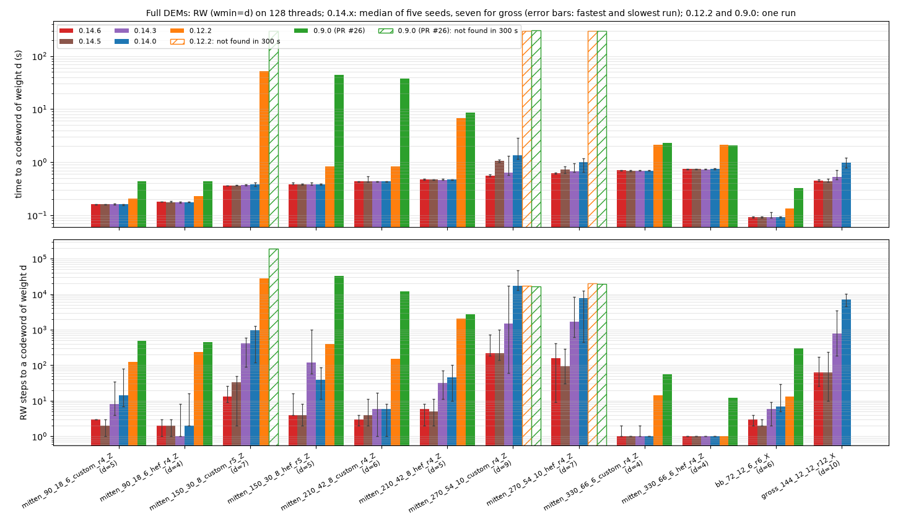
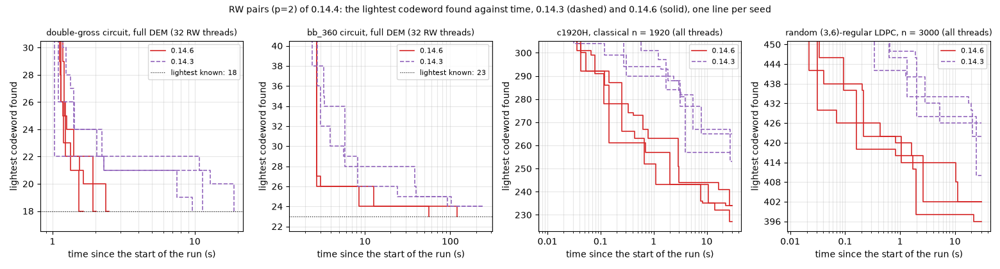

# dist-m4ri - Distance of a Classical or Quantum CSS Code

## Overview

`dist-m4ri` is a high-performance multithreaded C program and Python library for computing and bracketing the minimum
distance of binary classical linear codes, quantum CSS codes, and Stim Detector Error Models (DEMs).

The program implements three main methods (with `method=3` as the default):

- **Method 1 (`method=1`) - Random Window (RW) Algorithm**: Multithreaded random information set search to find
  low-weight non-trivial codewords and establish an **upper distance bound** $d_{\max}$.
- **Method 2 (`method=2`) - Connected Cluster (CC) Algorithm**: Multithreaded exhaustive depth-first cluster
  enumeration to compute **exact distance** or establish a certified **lower distance bound** $d_{\min}$.
- **Method 3 (`method=3`, default) - Bracketing Mode (Artillery Fork / Вилка)**: Concurrently runs CC and RW on multiple
  threads, dynamically balancing CPU cores between CC and RW based on current bounds $[d_{\min}, d_{\max}]$, distance
  estimate (`dexp`/`dest`), remaining RW steps and their measured time, timeout, and the measured scaling
  characteristics of CC.

For a classical binary linear code, only the parity-check matrix $H$ is needed.

For a quantum CSS code, matrix $H_X$ and either $H_Z$ (as `finG`) or logical operators $L_X$ (as `finL`) are needed.

Alternatively, a detector error model file from `stim` can be specified using `fdem=[str]`. The `repeat` blocks and
`shift_detectors` instructions of a DEM are unrolled, the detector coordinates are ignored, and the components of a
decomposed error (separated by `^`) are summed mod 2: a detector or observable listed twice in one `error` line cancels.
Equal columns of the DEM (error mechanisms with the same detectors and observables, common in DEMs generated by `stim`
for circuits with `REPEAT` blocks: 5-16% of the columns in our examples) are merged (`merge=1`, the default). This is
exact: dropping two equal columns of a codeword gives a lighter one, so the distance does not change. The column indices
(`outC`, `finC`, `start`, `cbeg`, `cend`, and the printed codewords) are those of the DEM, the codewords found use the
first one of each set of equal columns (RW hit counts are those of the merged codewords), and two equal columns of a
`finC` codeword cancel; `merge=0` keeps all columns (e.g., to enumerate the codewords with each of the equal columns;
the Python option `expand=1` expands the list found instead, see [Codeword Export](#codeword-export-outc--finc)).

Detectors of the DEM are dropped if this is verified to be exact (`drop=auto`, the default): the distance is then found
from the smaller DEM without these detectors and the columns touching them, and the codewords found are codewords of
the full DEM. E.g., the full DEMs of the Mitten circuits (`mitten_270`: 1080 detectors, 70254 columns) reduce to the
size of the simplified DEMs without the minority-basis detectors (648 detectors, 8910 columns), and RW finds codewords
of the minimum weights (9 and 7 for the two circuits) in a few seconds. The binary finds the detectors to drop from the
DEM alone, and `drop=[file]` gives them in a file instead (`drop=0` keeps all detectors); see
[Dropping DEM Detectors](#dropping-dem-detectors-drop).

All matrices with entries in $\text{GF}(2)$ have $n$ columns and obey the orthogonality conditions:
$$H_X H_Z^T = 0,\quad H_X L_Z^T = 0,\quad L_X H_Z^T = 0,\quad L_X L_Z^T = I.$$
The last condition is not required: it is sufficient that $L_X$, $L_Z$, and $L_X L_Z^T$ have the same full row rank
$k = n - \mathrm{rank}\,H_X - \mathrm{rank}\,H_Z$, the number of encoded qubits (printed with `debug=16`).

---

## Output Format & Stream Separation

`dist-m4ri` strictly separates machine-parseable results from informational progress logs:

- **`stdout`**: Outputs three space-separated integers:
  ```text
  dmin dmax rw_steps
  ```
  - `dmin - 1` is the maximum cluster size analyzed without success by CC (`dmin = dmax` if CC found a minimum-weight
    codeword).
  - `dmax` is the weight of the smallest non-trivial codeword found (by RW or CC, or read with `finC`), or the supplied
    upper bound `dmax=[int]` if smaller (`0` if none).
  - `rw_steps` is the number of completed RW steps across all threads (`0` if CC found a minimum-weight codeword, or
    if RW did not run in `method=2`).
  - When `dmin = dmax = d`, the exact code distance is confirmed.
  - With a stop target `dstop=U` (`method=2` or `3`), the run ends once CC has certified `dmin >= U`, unless a codeword
    of weight `< U` is found; `dmax` is then the weight of the lightest codeword found (`0` if none), never `U`, since
    `dstop` is not an upper bound (see [Bracketing Mode](#3-bracketing-mode-method3-default)).

> **Note on Compatibility**: This 3-number output format (`dmin dmax rw_steps`) is specific to the multithreaded
> `dist_m4ri` and is incompatible with the legacy single-threaded `dist_m4ri_old` (which returned a single integer `d`
> or `-w`).

- **`stderr`**: Receives all status banners, thread balancing reports, CC round timings, RW discovery logs, warnings,
  and confinement profiles, as selected by the `debug` bitmap (see [Debug Output](#debug-output-debugint)).

---

## How the Methods Work

### 1. Multithreaded RW Algorithm (`method=1`)
Searches for low-weight non-trivial binary codewords $c$ such that $Hc = 0$ and $Lc \neq 0$.
Threads independently generate random column permutations, compute Gaussian elimination to find information sets,
and extract candidate dual-row codewords. For matrices with at least 128 rows, the elimination uses the "Method of the
Four Russians" (as M4RI does, but for the scattered columns of a random permutation): 24 pivots (20 below 512 rows)
are found at a time, and every other row is then reduced in one pass with precomputed combinations of the pivot rows,
from 4 small tables kept in the cache, instead of one pass per pivot. It finds the same information sets and candidates
as the column-by-column elimination, faster for large matrices: e.g., 1.4x for $378 \times 756$, 1.5-2.0x for the
Mitten circuit DEMs ($420$ to $792$ rows), 2.3x for a $1500 \times 3000$ LDPC code and a $2736 \times 31392$ circuit
DEM, and 2-2.9x for the latter on 32 to 128 threads. Between 128 and 512 rows, where the gain depends on the sparsity
of the matrix (0.75-1.4x), each thread times both eliminations in its first steps and uses the faster one (`debug&8`
reports the choice of thread 0). Only the candidates lighter than the current weight limit are formed (the
weight of each candidate is counted first), and they are checked for $Lc \neq 0$ with bit masks of the columns of $L$,
in $O(|c|)$ operations: for DEMs, most such candidates are trivial. When a lighter codeword is discovered, all worker
threads atomically update the global upper bound $d_{\max}$. The found codewords are kept in a hash table with their
hit counts (the number of times RW found each codeword): the collection window for `outC` (weight up to
$w_{\min} + \text{dW}$, where $w_{\min}$ is the minimum weight found) and, for `min_hits`, a representative set of
`cov_cws` lowest-weight codewords, where heavier codewords are gradually replaced as lighter ones are found.

With the RW pairs (`pairs`, on by default), a RW step also finds the codewords with exactly two non-pivot columns $a$
and $b$: the sum of the codewords of $a$ and $b$, whose pivot part is the sum of the columns $a$ and $b$ of the reduced
matrix (the algorithms of Lee-Brickell and Stern with $p = 2$). Only the pairs of columns which agree on $l$ random
pivot rows are checked (the columns are sorted by these bits, their bucket), and in a bucket only the pairs whose
weights differ by less than the weight limit; the pairs of columns whose codewords have equal syndromes $Lc$ are
skipped (e.g., the many light trivial codewords of a circuit DEM).

Relevant parameters:
- `steps=[int]`: Total number of information sets / RW rounds across all threads (default: 100000).
- `min_hits=[int]`: QDistRnd-style automatic convergence stopping criterion (default: 5; set 0 to disable). Stops RW
  when the average number of hits per codeword $\langle n\rangle$ reaches `min_hits`, both for the codewords of the
  minimum weight found and for the representative set of `cov_cws` lowest-weight codewords (heavier codewords make the
  estimate more conservative). A single codeword suffices (e.g., a classical code with $k=1$). A lighter codeword is
  then missed with probability about $e^{-\langle n\rangle}$; see
  [RW Convergence](#5-rw-convergence-empirical-test-and-probability-to-find-a-codeword) for this empirical estimate,
  its test (a warning at the end with `debug&1`), and the information-set estimate.
- `cov_cws=[int]`: Size of the representative set of lowest-weight codewords for `min_hits` (default: 100; 0 for the
  minimum-weight codewords only). Without `outC` and `maxC`, at most `cov_cws` minimum-weight codewords are tracked
  (all with `cov_cws=0`). For codes with fewer than `cov_cws` minimum-weight codewords, a smaller `cov_cws` may stop
  RW earlier.
- `kwin=[int]` (alias: `win=[int]`): Localized column permutation window size $W$: the random column order starts with
  $W$ columns near a random column, which are thus preferred as pivots, in every RW step (default: 0; for $n \ge 500$,
  every other RW step then uses an index window of `win_hyb` consecutive columns, as with `win_mode=1`, and the other
  steps use uniform random permutations, also for codewords which are not local in the column order).
- `win_mode=[0|1]`: Window construction mode when `kwin > 0`: `0` for Tanner graph BFS neighborhood, `1` for contiguous
  column index window (default: 0).
- `win_hyb=[int]`: Window size of the hybrid RW steps (with `kwin=0` and $n \ge 500$; at most $3n/4$). Default: 0, i.e.,
  256 columns for a DEM and 512 for matrices. A RW step finds a codeword if all but one of its columns are pivots;
  the window columns come first in the elimination order, so that they are pivots unless they depend on earlier window
  columns. In a DEM, whose errors are in time order (stim), a window of $W$ consecutive columns is a slab of errors
  close in time, which touch only so many detectors: a window of one round of columns ($L \approx 10D$ columns for
  $D$ detectors per round) has rank about $2D$, so that most of its columns cannot be pivots. The minimum-weight
  codewords of circuit DEMs are compact in this order (e.g., the weight-18 codewords of the double-gross circuit are
  final data measurement errors within 177 columns), and windows of 192-256 columns find them 2-10 times faster than
  512 for the reduced DEMs of the gross, double-gross, `bb_360`, and mitten circuits (the double-gross DEM: about 10
  distinct codewords of weight 18 per $2 \cdot 10^4$ steps with 256 columns, 0-2 with 512 or with one round), while
  matrices of codes gain nothing from 256. With `debug&1`, the binary prints the rounds of a DEM in the input summary
  (estimated from the time translation of its errors: the number $D$ of detectors per round is the most frequent
  distance of the two detectors of an error, as of measurement errors, which maps most errors to other errors when
  their detectors are shifted by $D$; $L = n D / m$ columns per round; none, e.g., for circuits with SWAP routing),
  and at the end of RW the codewords of the three lowest weights found by the uniform steps and by the window steps
  (e.g., to see codewords which are not local in the column order).
- `pairs=[int]`: The RW pairs of non-pivot columns ($p=2$): the number $l$ of random pivot rows of their buckets (at
  most 64; 0: off). Default: -1 (auto), $l = \lceil \log_2 (n-r) \rceil$ (about one non-pivot column per bucket), with
  fewer rows (at least one) while a codeword of the weight $w$ of the upper bound would be kept with the probability
  $\binom{r-l}{w-2} / \binom{r}{w-2}$ below 0.8 ($r$: the rank of $H$), but enough rows to keep the about
  $(n-r)^2/2^{l+1}$ pairs of a step within about the work of its elimination, $rn/16$ pairs (or $2^{20}$ pairs for small
  matrices). Early in a run, while the upper bound is far above the distance, the keep probability alone gives $l = 1$,
  all pairs in two buckets: a step on a large circuit DEM would then check millions or billions of pairs (0.14.4 and
  0.14.5: e.g., 0.6 s of RW to the distance 9 of the `mitten_270` circuit instead of 0.12 s, and no stop at the timeout
  for `bb_756`). The bound gives $l \ge 6$ for such DEMs, while the codes with $n - r < r$ (e.g., `c1920H`) keep
  $l = 1$. In a fixed number of RW steps, the pairs found the minimum-weight codewords of circuit DEMs 7-26 times more
  often per second (`bb_72`: 7x; gross, `surf_d7`, `mitten_150`: 22-26x), the weight 18 of the double-gross circuit in
  3000 steps (20 without pairs, with 2% more time per step), 24 for `bb_360` in 600 steps (26), and lighter codewords of
  classical LDPC codes with a large distance (`c1920H`: 210-277 instead of 317-321 in 1000 steps, three seeds). With 128
  threads, RW finds the weight 18 of the double-gross circuit in 1.5-2.7 s instead of 10-19 s, and 23 for `bb_360` in
  1-2 min instead of 24 in 4 min (Section 8 of the [benchmark](benchmark/BENCHMARK.md)). For small codes, a step takes
  2-5 times longer, but `min_hits` is reached in fewer steps, mostly in about the same time (`surf_d7`: 2-3 times
  longer). With `debug&1`, the binary prints the pairs checked per step and the codewords recorded from the pairs and
  from the single columns (`# RW pairs (p=2, ...)`). Not with the experimental `ksub`.
- `ksub=[int]`: **Experimental, should not be used** (a warning is printed whenever `ksub>0` is given for RW, with or
  without `min_hits`). Subspace dimension sampled from $\ker(H)$ for cache-resident RW elimination (default: 0 for
  full-matrix RW; automatically falls back to `ksub=0` with a warning when $m < \nu = \dim\ker(H)$, e.g., for DEMs
  and most quantum codes). Each step reduces the span of `ksub` distinct rows of a fixed basis of $\ker(H)$, so that a
  few codewords are found much more often than others: then $e^{-\langle n\rangle}$ is optimistic, and `min_hits` may
  end RW early.
- `refresh=[int]`: RW step interval for adaptive $\ker(H)$ basis refresh via low-weight codeword exchange and
  re-echelonization, only with the experimental `ksub>0` (default: 5000 when `ksub > 0`, 0 to disable).
- `wmin=[int]`: Minimum distance of interest (stop immediately when a codeword of weight $w \le w_{\min}$ is found;
  not when collecting codewords with `outC` or `maxC`).
- `threads=[int]`: Maximum number of POSIX worker threads to run (default: all logical CPUs available to the process,
  i.e., its CPU affinity mask, e.g., with `taskset`; subject to automatic throttling unless `nothrottle=1` is
  specified).
- `timeout=[sec]`: Maximum execution time in seconds (default: 60.0).

### 2. Multithreaded CC Algorithm (`method=2`)
Recursively explores connected clusters starting from each column $i \in [0, n-1]$; a cluster started at column $i$
is grown using only columns $j > i$, so that every codeword is found starting from its smallest column. Start columns
are distributed dynamically among worker threads via a lock-free atomic counter. If there are few start columns per
thread (e.g., for $n / w$ small compared to the number of threads), the start columns are split into work units which
also fix the first one to three cluster extensions, for a balanced load (see
[Multithreading](#4-multithreading-throttling--batch-sizing)).
If `noscan=0` (default), CC scans weights $w = 1, 2, \dots, w_{\max}$. When `outC` is specified, CC exhausts all
columns for weight $w$ to collect all unique minimum-weight codewords.
With `smax=0` (default), the syndrome of a cluster is kept as a bitset (a column is added by flipping its rows), and
the last column of a cluster is found by a hash lookup: the syndrome left after the next-to-last column must equal a
column of $H$ (instead of a scan of the candidate columns). The clusters and the codewords found (with their hit
counts) are the same as with `smax>0`, only faster (about 3-5 times for CSS codes, and 5-20 times for circuit DEMs).
A cluster is extended by the columns of the first row of its syndrome, in the order of the rows of $H$ (every codeword
which contains the cluster has a column in that row). With `sort_rows=1`, the default for matrices (`finH` or `fin`),
the rows of $H$ are sorted by increasing weight (stable) after reading the input, so that light rows come first: this
reduces the CC work for matrices with very different row weights, e.g., 1.7-4.2 times for the matrices with hook
columns of an extended CSS distance (rows of weight 5 to 103), while codes with rows of equal weight are not changed.
For a DEM (`fdem`), the default is `sort_rows=0`: its detectors are in time order, and the first unsatisfied detector
of a cluster then has most of its columns before the start column (these are not used), which is better than a light
row; sorting the rows made CC 1.3-1.6 times slower for the matrices `surf_d5_H.mmx` and `surf_d7_H.mmx` exported from
DEMs in [`examples/`](examples/) (use `sort_rows=0` for such matrices), and up to about 4 times (estimated) for the
reduced DEMs of the Mitten circuits. The distance and RW do not depend on the order of the rows (with the same seed, RW
finds the same codewords); CC enumerates the same codewords (e.g., with `outC`), possibly in another order and with
other hit counts. With `debug=1`, the input summary notes that the rows were sorted.
The scan ends with the round $w = d$ in which CC finds a codeword (with `outC` and `dW>0`, after the extra rounds up to
$w = d + \text{dW}$). A known upper bound $d_{\max}$ (from `dmax=[int]` or from codewords in `finC`) ends the scan as
soon as $d_{\min} = d_{\max}$, unless codewords are collected (`outC` or `maxC`). A stop target `dstop=U` ends the scan
once $d_{\min} \ge U$ (with `outC`, after the rounds $w = U, \dots, U + \text{dW}$), and $d_{\max}$ remains the weight
of the lightest codeword found (`0` if none).
With a `timeout`, each round is started even if it is predicted not to finish in time (its CC work, the total CC
thread time, is extrapolated from the last two rounds with their growth factor, clamped to $[2, 10]$; a note is
printed): a round which cannot be completed may still find a codeword of weight $w = d_{\min}$, i.e., the exact
distance.

Relevant parameters:
- `wmax=[int]`: Maximum cluster weight to search (optional with `timeout>0`, the default, with `dmax>0`, where the
  rounds end once $d_{\min} = d_{\max}$, or with `dstop>0`, where they end once $d_{\min} \ge$ `dstop`; otherwise
  required for `method=2`).
- `smax=[int]`: Maximum syndrome weight to track for confinement profile (default: 0, disabled for faster CC pruning
  and the bitset syndromes with hash lookups above; set e.g. `smax=5` to compute confinement).
- `sort_rows=[0|1]`: Sort the rows of $H$ by increasing weight for CC (default: 1 for matrices, 0 for a DEM; see
  above).

Expert parameters (each prints a `# WARNING:` to `stderr`; see
[Restricting the CC Search](#restricting-the-cc-search-expert-options) below):
- `noscan=[0|1]`: If set to 1 (`method=2` only), run CC only at weight $w = w_{\max}$, without scanning smaller
  weights. The result is **not** a lower bound unless `dmin=wmax` is also supplied.
- `start=[list]`: Comma-separated list of CC start columns (0-based), e.g. `start=0,48,96`. Clusters grown from a
  listed column are **not** limited to larger column indices (for quasi-cyclic or otherwise symmetric codes).
- `cbeg=[int]`, `cend=[int]`: Range $[c_{\text{beg}}, c_{\text{end}}]$ of CC start columns, for splitting one CC
  calculation into several runs which together cover all columns $0, \dots, n-1$.

#### Restricting the CC Search (Expert Options)

By default, CC grows clusters from every column $i$ using only columns $j > i$. The expert options `start` and
`cbeg`/`cend` (with `method=2` or `method=3`) and `noscan` (`method=2` only) restrict this search. Each of them
prints a `# WARNING:` to `stderr`, since the reported $d_{\min}$ is then not necessarily a lower bound on the
distance. The reported $d_{\max}$ is the weight of an actual codeword, and it is always a valid upper bound.

| Option          | CC start columns                           | Cluster growth  | Reported $d_{\min}$ valid    |
|-----------------|--------------------------------------------|-----------------|------------------------------|
| (default)       | all, $0 \le i \le n-1$                     | columns $j > i$ | always                       |
| `start=a,b,c`   | listed columns only                        | unlimited       | under a code symmetry only   |
| `cbeg`, `cend`  | $c_{\text{beg}} \le i \le c_{\text{end}}$  | columns $j > i$ | after combining split runs   |
| `noscan=1`      | all, $0 \le i \le n-1$                     | columns $j > i$ | only if `dmin=wmax` is given |

- **`start=a,b,c`** (e.g., quasi-cyclic codes): CC clusters are grown only from the listed (0-based) columns, but
  they are **not** limited to larger column indices, so that every codeword whose support contains a listed column is
  found. `start=N` is a one-element list, and `start=-1` (default) means all columns; the list is sorted, and
  duplicates are removed. The reported $d_{\min}$ (and an exact result $d_{\min} = d_{\max}$) is valid only if a code
  symmetry maps every minimum-weight codeword to a codeword containing a listed column. E.g., for a quasi-cyclic code
  with circulant blocks of size $\ell$ (columns ordered block by block), simultaneous cyclic shifts of all blocks are
  a symmetry, and it is sufficient to list one column per block, e.g., `start=0,48,96` for three blocks with
  $\ell = 48$. Cannot be combined with `cbeg`/`cend`.
- **`cbeg=[int]`, `cend=[int]`** (split runs): CC starts only from columns $c_{\text{beg}} \le i \le c_{\text{end}}$
  (default `-1`: column $0$, respectively, column $n-1$), still growing clusters using only columns $j > i$. Thus the
  $d_{\min}$ of a single run only covers codewords whose smallest column is in $[c_{\text{beg}}, c_{\text{end}}]$. To
  split a calculation, e.g., among several machines, run `cbeg=0 cend=99`, `cbeg=100 cend=199`, ..., so that every
  column $0, \dots, n-1$ is eventually listed in one of the runs, and take the minimum of $d_{\min}$ (and of the
  positive $d_{\max}$) over all runs.
- **`noscan=1`** (`method=2` only): a single CC round at $w = w_{\max}$, skipping weights $w < w_{\max}$. A codeword
  found only gives an upper bound $d_{\max}$, and $d_{\min}$ is not raised above the supplied `dmin`. The result is
  certified only if `dmin=wmax` is supplied, i.e., if all smaller weights are already known to be absent.
- **Before version 0.10.0**, `start=N` was equivalent to `cbeg=N cend=N` (clusters started from column $N$ using
  only larger columns; use `cbeg=N cend=N` to reproduce it), and `noscan=1` results were reported as certified even
  though smaller weights were not checked.
- **Python interface** (`dist_m4ri.py`): `start` takes a list of columns (`start=[0, 48]`, `start="0,48"`, or
  `start=0,48` in the CLI), while `noscan`, `cbeg`, and `cend` are disabled: they are accepted for backward
  compatibility, but ignored with a warning to `stderr` (run the `dist_m4ri` binary directly to use them). With the
  persistent cache, start-list results are stored under the separate key `<key>:start=a,b,c`; such a run is seeded
  with the bounds of the main record, and only the always valid $d_{\max}$ and codewords are merged into the main
  record. The expert option `trust_start` (CLI: `--trust-start` or `trust_start=1`) accepts the start-list results as
  valid: $d_{\min}$ and `rw_steps` are merged as well, and an existing exact start-list record is copied to the main
  record (and the cache file is saved) even if no calculation is needed. For DEM input, the start columns index the
  error mechanisms in their order in the flattened DEM (after the `pmin` cutoff). For CSS codes, the same list is
  used in both sectors.
- **Possible optimization** (not implemented): clusters grown from a listed column could skip the columns listed
  before it, since all codewords containing those columns have already been enumerated.

### 3. Bracketing Mode (`method=3`, default)
Dynamically partitions the available thread pool between CC (pushing $d_{\min}$ up) and RW (pulling $d_{\max}$ down) to
determine the exact code distance as quickly as possible.

#### Dynamic Thread Allocation & Role of `dexp`:
1. **Target Search Depth**:
   - Once a codeword has been found, CC rounds continue up to $w = d_{\max} - 1$: the round $w = d_{\max} - 1$
     certifies $d_{\min} = d_{\max}$ (with `outC`, CC continues with the rounds $w = d_{\max}, \dots, d_{\max} +
     \text{dW}$, which enumerate all codewords to export). Before that, CC is limited only by `wmax` and the `timeout`.
   - `dexp=D` (alias: `dest=D`) is a hint: as long as RW has not found any codeword, CC rounds $w > D$ run only on the
     threads which cannot run RW (see
     [Multithreading, Throttling & Batch Sizing](#4-multithreading-throttling--batch-sizing)), i.e., CC pauses if RW
     can use all threads. CC resumes as soon as RW finds a codeword, or when RW ends.
   - A stop target `dstop=U` (not an upper bound) takes the place of $d_{\max}$ as long as no codeword of weight
     $< U$ is known: the run ends once the round $w = U - 1$ certifies $d_{\min} \ge U$ (with `outC`, after the rounds
     $w = U, \dots, U + \text{dW}$), without waiting for RW, and $d_{\max}$ is the weight of the lightest codeword found
     (`0` if none). E.g., `dstop=U wmin=U-1` decides whether $d \ge U$, and for a CSS code with
     $d = \min(d_X, d_Z) \le U$ known (e.g., from the other sector), `dstop=U` is all that is needed.
2. **Predictive Workload Modeling**:
   - The RW threads measure the RW step time $t_{\text{RW}}$ (thread time per step) continuously. The CC work of each
     round is measured as the total CC thread time, and the work of the next round is extrapolated with the growth
     factor of the last two rounds (clamped to $[2, 10]$).
   - For each round, the coordinator compares the remaining work in thread-seconds: $T_{\text{CC}}$ of the rounds
     $w, w+1, w+2$ (up to $d_{\max} - 1$, or up to $d_{\exp}$ before a codeword is found), and
     $T_{\text{RW}} = t_{\text{RW}} \times$ (remaining RW steps, at most 2000 once $d_{\max}$ is known), but no more
     than the RW threads can do before the `timeout`. It splits the threads as
     $$\text{ratio} = \frac{T_{\text{CC}}}{T_{\text{CC}} + T_{\text{RW}}},$$
     $$N_{\text{CC}} = \text{round}(N_{\text{threads}} \times \text{ratio}),$$
     $$N_{\text{RW}} = N_{\text{threads}} - N_{\text{CC}}$$
     with $1 \le N_{\text{CC}} \le N_{\text{threads}} - 1$, where $N_{\text{RW}}$ cannot exceed the number of threads
     allowed to run RW (see [Multithreading, Throttling & Batch Sizing](#4-multithreading-throttling--batch-sizing)).
   - **Small rounds** (estimated CC work below 5 ms): only 1–2 threads run CC while the majority maximize RW sampling
     speed.
   - **Heavier rounds**: as the CC work grows, additional threads are shifted to CC, so that both algorithms converge
     on the exact distance simultaneously.
   - **The certifying round** $w = d_{\max} - 1$ (and any later codeword collection round) runs on all threads, since
     RW can no longer improve the result.
   - **The first round at a supplied `dmin`** (no measured round yet) runs on half of the threads.
   - **During a round**, CC threads are added when RW finds a new $d_{\max}$ (e.g., if the round now certifies
     $d_{\min} = d_{\max}$), and all threads join a round which takes more than 1.5 times its predicted time. A busy
     RW thread joins a CC round when its current RW batch is done.
3. **Timeout, Early Cutoff & RW Convergence**:
   - With a `timeout`, a CC round gets enough CC threads to finish within 3/4 of the remaining time. A round predicted
     not to finish in time on all threads is not started while RW runs; once RW has ended, the run ends instead. With
     `steps=0` (no RW), as in `method=2`, such a round is started anyway, since it may still find a codeword of weight
     $w = d_{\min}$.
   - The coordinator never ends CC while RW runs. Whenever no CC round can be started (CC done up to `wmax`, a round
     predicted to exceed the `timeout`, or CC paused by `dexp`), it waits for RW and re-plans when RW finds a new
     $d_{\max}$ or ends. The run ends once RW has ended and no CC round can be started.
   - When RW satisfies the `min_hits` convergence criterion, RW workers stop early and yield 100% of threads to CC
     to finish certifying $d_{\min}$.
   - Likewise, once all RW `steps` have been claimed, RW threads join the current CC round instead of waiting for it
     to finish.

Relevant parameters:
- `dexp=[int]` (alias: `dest=[int]`): Expected code distance, a hint for the thread allocation before RW finds a
  codeword (see above).
- `dstop=[int]`: Stop target for the lower bound (default: 0, off; see above, also for `method=2`). Unlike `dmax`, it is
  not an upper bound, and it is never reported as `dmax`. A supplied `dmin >= dstop` ends the run without a search
  (unless codewords are collected with `outC` or `maxC`); otherwise, `dstop` has no effect with `method=1`.
- `threads=[int]`: Maximum number of worker threads (default: all logical CPUs available to the process; subject to
  throttling unless `nothrottle=1` is specified).
- `nothrottle=[int]`: Disable automatic thread throttling (default: 0; CLI flag: `--no-throttle`).
- `chunk_size=[int]` (alias: `batch=[int]`): Maximum RW step batch claimed at once by a thread (default: 0 for automatic
  adaptive sizing). When `chunk_size=0` (default in Python and binary), chunk size is chosen adaptively based on $n$ and
  step budget:
  - Small codes ($n < 500$): 50 steps/chunk (250 for $\ge 10^3$ steps; 500 for $\ge 5 \times 10^4$ steps).
  - Medium codes ($500 \le n < 5000$): 50 steps/chunk (100 for $\ge 10^4$ steps).
  - Large matrices ($n \ge 5000$): 25 steps/chunk (50 for $\ge 10^4$ steps).

  In either case, a batch takes at most $\lceil r / (4 N_{\text{RW}}) \rceil$ of the $r$ remaining steps, where
  $N_{\text{RW}}$ is the number of RW threads (guided scheduling, see below).
- `timeout=[sec]`: Maximum execution time in seconds (default: 60.0; set to `0` for infinite / no timeout). RW threads
  check the timeout (and the other stop conditions) between RW steps, and also within a step (every 16 columns of the
  Gaussian elimination), so that even on huge matrices, where a single RW step may take many seconds, the run ends
  shortly after the timeout.
- `steps=[int]`: Maximum total RW steps (default: 100000; set to `0` to run pure CC via bracketing coordinator).
- `min_hits=[int]`: Average number of hits per lowest-weight codeword for early RW termination (default: 5; 0 to
  disable; see [method=1](#1-multithreaded-rw-algorithm-method1)).
- `dW=[int]`: Extra weight window above $d_{\min}$ to continue collecting codewords ($w \le d_{\min} + \text{dW}$).

### 4. Multithreading, Throttling & Batch Sizing
The parameter `threads=[int]` specifies the **maximum** number of worker threads to allocate (default: all logical CPUs
available to the process, i.e., its CPU affinity mask, so that `taskset -c 0-15 dist_m4ri ...` runs 16 threads; with
SMT, the sibling hyperthreads typically add 10-50% to the throughput of a fully loaded CPU, more for RW than for CC).
By default (`nothrottle=0`), automatic heuristics clamp thread usage to avoid overhead and resource thrashing:
- **Small-Code Throttling** (`method=1` and `method=3`, all threads), to avoid the thread creation and lock contention
  overhead on tiny workloads; with $m$ the number of rows of $H$ and $W_{\text{RW}} = m \cdot n \cdot \text{steps}$ the
  RW workload: at most 4 threads for $n < 60$, or for $m \cdot n < 2 \cdot 10^4$ with $W_{\text{RW}} < 5 \cdot 10^7$;
  otherwise at most 16 threads for $n < 150$ or $m \cdot n < 10^5$, if $W_{\text{RW}} < 2 \cdot 10^8$.
- **Lazy Thread Start** (`method=2`): the CC work is not known in advance (it grows rapidly with the weight), so
  `method=2` starts only 4 threads, and the others for the first CC round predicted to take more than 2 ms on the
  threads started (or once a round has run for 5 ms): tiny runs avoid the start-up of many threads, longer runs use
  all of them.
- **Large-Matrix Memory Throttling (RW threads only)**: For massive matrices (e.g. circuit DEMs with
  $n > 20,000, m > 5,000$), RW is limited by the memory bandwidth: above 15 MB of dense working memory per RW thread
  (copies of $H$ and $H^T$, or the `ksub` $\times n$ subspace matrix with `ksub>0`; about $m \cdot n > 6 \cdot 10^7$
  for full-matrix RW), the RW throughput peaks at 32-64 threads whatever the matrix size, so that at most 32 threads
  run RW, with their total dense working memory within a quarter of the physical memory (at least 2 threads; 1.5 GB if
  the physical memory is not known). E.g., the reduced DEM of the $[[756,16,34]]$ code ($m = 13230$, $n = 129276$,
  0.43 GB per thread) runs 32 RW threads, 1.5 RW steps/s against 0.23 with the 3 threads of the former 1.5 GB limit. CC
  needs no dense matrices: `method=2` is not limited, and in `method=3` only the RW share is limited, while CC rounds
  can use all threads.
- **Small Step Counts (RW threads only)**: At most $\lceil \text{steps} / 10 \rceil$ threads run RW (all threads in
  `method=1`, the RW share in `method=3`, where CC rounds can still use all threads; `steps=0` in `method=3` runs pure
  CC without RW threads).
- **Adaptive RW Chunk Sizing**: Setting `chunk_size=0` (or omitting it) enables adaptive batching, reducing atomic CAS
  contention by up to 10x during extended searches ($10^4$ or $10^5$ steps).
- **Guided RW Scheduling**: A thread claims at most $\lceil r / (4 N_{\text{RW}}) \rceil$ of the $r$ remaining RW steps
  at once, where $N_{\text{RW}}$ is the number of RW threads (also with a given `chunk_size`): no thread can monopolize
  the steps, and the batches shrink towards the end, so that the RW threads finish together.
- **CC Work Units**: A CC round at weight $w$ hands out its start columns $i$ one at a time. The clusters from the
  first start columns, which can grow to all larger columns, are the largest share of a round (about $w/n$ for the
  first one), which limits the speedup to about $n/w$ threads: e.g., 16 threads for the $[[288,12,18]]$ code at
  $w=15$. Rounds predicted to take more than 1 ms on all threads, with fewer than about 4 such shares per thread, are
  therefore split into $B^L$ work units per start column ($L = 1, 2$, or $3$ levels, $L \le w-3$, $B$ the maximum row
  weight of $H$): a unit fixes the column added at each of the first $L$ cluster extensions (empty units, where a row
  has fewer columns, are skipped). The number of units is limited by the predicted work of the round (at most $10^4$
  per thread-second) to keep the claims cheap. With `debug&8`, the binary reports the work units of each CC round.
- **Manual Override**: Pass `nothrottle=1` (or `--no-throttle` in Python) to force `dist_m4ri` to use the exact number
  of requested threads without throttling (all threads are started at once, also in `method=2`), and specify
  `chunk_size=N` to override batch sizing.

With `debug&8`, the binary reports the throttling and the thread allocation of every CC round, and with `debug&4` a
periodic status line shows the progress of the current CC round. A CC round in `method=3` may have to wait until the RW
threads assigned to it finish their current RW batch.

### 5. RW Convergence: Empirical Test and Probability to Find a Codeword

The RW upper bound $d_{\max}$ is not certified unless CC confirms it. Two estimates of the probability
$P_{\text{fail}}$ that RW missed a lighter codeword are available.

**Empirical estimate and test**, as in the
[QDistRnd manual, Sec. 3.3](https://qec-pages.github.io/QDistRnd/doc/chap3.html#X7DA7BD6F7A61E553). The probability
that a RW step finds a given codeword is expected to depend only on its weight, and to decrease with the weight. If,
after $N$ steps, the $m$ distinct codewords of the minimum weight $w$ have been found $n_1, \dots, n_m$ times, the
probability per step is estimated as $\lambda_w = \sum_i n_i / (N m)$, and a codeword of a smaller weight is missed
with probability

$$
P_{\text{fail}} < (1 - \lambda_w)^N < e^{-N\lambda_w} = e^{-\langle n\rangle}, \qquad
\langle n\rangle = \frac{1}{m} \sum_{i=1}^m n_i .
$$

RW stops once $\langle n\rangle$ reaches `min_hits`: $e^{-5} \approx 0.7\%$ for the default `min_hits=5`, and
$e^{-10} \approx 4.5 \cdot 10^{-5}$ for `min_hits=10`. Here $\langle n\rangle$ is the smaller of the averages over the
minimum-weight codewords and over the representative set of `cov_cws` lowest-weight codewords (heavier codewords only
make the estimate more conservative). The assumption of equal probabilities for the codewords of the same weight can
be tested: QDistRnd uses Pearson's statistic $X^2 = (m / n_{\text{tot}}) \sum_i n_i^2 - n_{\text{tot}}$, where
$n_{\text{tot}} = \sum_i n_i$, which is distributed as $\chi^2_{m-1}$ for large $\langle n\rangle$. This is the
index-of-dispersion test of the hit counts against the Poisson distribution. `dist_m4ri` applies it to each weight
class of the representative set, using the zero-truncated Poisson distribution (codewords never found are not known),
and with `debug&1` warns at the end if the hit counts are strongly non-uniform: a p-value below $10^{-3}$, a relative
spread of the hit rates of at least 1, and, for gamma-distributed hit rates with this spread, a probability to miss a
lighter codeword at least 3 times larger than with equal hit rates. Then $e^{-\langle n\rangle}$ is optimistic, and a
larger `min_hits` is advisable; this happens, e.g., for the surface-code circuit `examples/surf_d5_H.mmx`.

**Probability to find a given codeword** (information sets; compare the QDistRnd manual, Sec. 3.2). A RW step reduces
$H$ (rank $r$) with a random column order; a codeword of weight $w$ is found if exactly one of its positions is among
the $s = n - r$ non-pivot columns ($s = \dim\ker H$). For uniformly random information sets, this happens with the
probability

$$
P_1(w) = \frac{w \binom{n-w}{s-1}}{\binom{n}{s}}
$$

per step ($P_1 = 0$ for $w > r + 1$), and the codeword is missed in $S$ steps with probability
$(1 - P_1)^S \approx e^{-S P_1}$. With the RW pairs (`pairs`, $l$ pivot rows of the buckets), it is also found if
exactly two of its positions are non-pivot columns and its other $w - 2$ positions avoid the $l$ rows:

$$
P(w) = P_1(w) + P_2(w), \qquad
P_2(w) = \frac{\binom{w}{2} \binom{n-w}{s-2}}{\binom{n}{s}} \cdot \frac{\binom{r-w+2}{l}}{\binom{r}{l}} .
$$

Among the weights $d_{\min} \le w < d_{\max}$, the weight with the smallest $P$ is used, and the number of RW steps
for a 1% miss probability is reported. Only the steps with uniform random column
permutations are counted (not those with localized windows; with `ksub>0`, the estimate is not available), which makes
the estimate conservative (for circuit DEMs, often very much so); on the other hand, as the QDistRnd manual points out,
the information sets of a sparse matrix need not be equally likely.

With `debug&1`, the binary prints $\langle n\rangle$ (`# codewords accumulated: ...`), the data for the
information-set estimate (`# RW information sets: n=..., rank(H)=..., steps=...`), and the estimate itself together
with the non-uniform hit count warning. The Python wrapper (`--verbose`) prints both estimates for a RW upper bound
which is not certified, with the RW steps and time needed for a 1% miss probability, and a model check which compares
the observed average hits of the codewords of weight $d_{\max}$ with $S \, P(d_{\max})$.

Example (`examples/surf_d5_H.mmx`, a circuit-level matrix of the distance-5 surface code; one thread for a reproducible
result; the single columns only, `pairs=0`):

```text
$ ./src/dist_m4ri method=1 finH=examples/surf_d5_H.mmx finL=examples/surf_d5_L.mmx steps=10000 seed=1 threads=1 \
  pairs=0 debug=1
...
# codewords accumulated: total=100, min_w=5: cws=100, total_hits=208, hits min=1, max=33, avg=2.08, ...
# RW information sets: n=1958, rank(H)=120, steps=10000 (uniform permutations: 5000), ksub=0, pairs=0, ...
# Warning: non-uniform RW hit counts of the 100 codewords of weight 5: hits min=1, max=33, avg=2.08, ...
#   some codewords are found much more often than others of the same weight (relative spread of hit rates 1.89):
#   a lighter codeword may be missed with probability ~0.58 rather than exp(-1.70)=0.18; consider a larger min_hits
#   information-set estimate (uniform random information sets, n=1958, rank(H)=120): a codeword of weight 4
#   is found with probability 0.000845 per RW step, missed in 5000 uniform steps with probability 0.015 (1% ...
1 5 10000
```

Here, 10000 steps are not enough for `min_hits=5` ($\langle n\rangle = 2.08$). The hit counts of the 100 logical
operators of weight 5 range from 1 to 33, far from the Poisson distribution ($p = 4.3 \cdot 10^{-116}$), and the
probability to miss a lighter codeword is estimated as 0.58 instead of $e^{-\mu} = 0.18$, where $\mu = 1.70$ is the
Poisson mean fitted to the zero-truncated hit counts. The information-set estimate for the weight $w = 4$, the hardest
to find, gives the miss probability 0.015, and 1% after 10890 RW steps in total (half of them uniform, since
$n \ge 500$). In fact, the distance is 5: `method=2` with `wmax=4` finds no codeword in 0.1 s. With the RW pairs (the
default, here $l = 8$), the same run reaches `min_hits=5` after 3331 steps (0.73 s), without the warning: a codeword of
weight 4 would be found with the probability 0.018 per step instead of 0.000845, and the pairs gave 67400 hits of
codewords of weight 5 (18043 distinct ones exist), the single columns 1825.

---

## Confinement Profile

By default, `smax=0` (confinement tracking disabled for maximum CC speed; in `.mtx` mode with `debug&1`, a notice is
logged to `stderr`). When `smax > 0` (e.g. `smax=5`), the CC algorithm tracks the minimum non-zero syndrome weight
observed for each cluster weight $w$:

```bash
$ ./src/dist_m4ri method=2 finH=./examples/surf_d5_H.mmx finL=./examples/surf_d5_L.mmx wmax=4 smax=5 debug=0 threads=4
# confinement: 1,1,1,1
5 0 0
```

With `debug=1`, detailed per-weight lines are printed to `stderr`:
```text
# w=1 min non-zero syndrome weight 1
# w=2 min non-zero syndrome weight 1
# w=3 min non-zero syndrome weight 1
# w=4 min non-zero syndrome weight 1
```

---

## Codeword Export (`outC` / `finC`)

- **`outC=[file.nz]`**: Saves the discovered codewords of weight up to $w_{\min} + \text{dW}$ ($w_{\min}$: the minimum
  weight found) in standard **NZLIST** format (heavier codewords kept only for the `min_hits` statistic are not
  exported). With `method=2` or `3`, once the distance $d$ is known, the CC rounds $w = d, \dots, d + \text{dW}$
  enumerate all such codewords (unless the `timeout` is hit; with a stop target `dstop=U` below $d$, only the rounds up
  to $w = U + \text{dW}$ run); with `method=1`, only the codewords found by RW are exported:
  ```text
  %% NZLIST
  % generated by dist_m4ri
  <weight> <col_1> <col_2> ... <col_weight>
  ```
  *(Indices are 1-based; for a DEM, those of its columns: with `merge=1`, the default, the codewords found use the first
  one of each set of equal columns, see the DEM input in the [Overview](#overview).)*
- **Keep the DEM with its codewords**: for a DEM, the indices refer to its `error` lines (in the order of the flattened
  DEM, after the `pmin` cutoff: with another `pmin`, the columns and the codewords change). For a Stim circuit, save
  the DEM generated by `dist_m4ri.py` in the same run that writes the codewords (`--out-dem` together with `outC`;
  otherwise a warning is printed). A DEM generated again from the circuit (also from one saved with `--out-stim`) can
  have different `error` lines, or the same ones in another order, with another version of `stim` or other options
  (e.g., `decompose_errors`), and then the codewords do not fit it. (The distance cache is not affected: its keys are
  the DEM contents and `pmin`.)
- **Expanded list (`expand=1`, Python only)**: with `merge=1`, `dist_m4ri.py` can list each DEM codeword found once
  for every choice among equal columns (the binary and the cache keep the merged list). With `dW` at most 1, this is
  the list of `merge=0` (with `dW` of 2 or more, `merge=0` also lists lighter codewords with two equal columns added).
  The expanded list grows quickly with the weight; with `maxC > 0`, at most `maxC` codewords are written, with a
  warning if some are dropped.
- **Dropped detectors (`drop`)**: with detectors dropped from a DEM (`drop=auto`, the default), the codewords found use
  only the columns which touch no dropped detector (see [Dropping DEM Detectors](#dropping-dem-detectors-drop)); use
  `drop=0` to enumerate all codewords of the DEM. (The Python wrapper returns the codewords of a cached record if it
  has any: use `--no-cache` or another cache file to enumerate them again with other options.)
- **`finC=[file.nz]`**: Reads initial codewords from a file to initialize $d_{\max}$ and the codeword hash table
  (codewords heavier than `wmax > 0` are skipped; for a DEM with `merge=1`, two equal columns of a codeword cancel).
- **`dW=[int]`**: When set (e.g. `dW=1`), preserves and exports codewords of weight up to $w \le d_{\min} + \text{dW}$.
- **`maxC=[int]`**: Limits collection to at most `maxC` unique codewords (of weight up to $w_{\min} + \text{dW}$).

---

## Dropping DEM Detectors (`drop`)

Notation: column $j$ of a DEM (an error mechanism) flips the detectors $S_j$ and the observables $O_j$ (the column $j$
of $H$ and $L$), and $M$ is a set of detectors to drop.

### When Dropping Detectors Is Exact

Dropping $M$ is exact if every column $j$ touching $M$ has a *twin*: a column $t$ with the same other (kept) detectors,
$S_t = S_j \setminus M$, which touches no detector of $M$ (or no column, if $S_j \subseteq M$), with the observables
$L_t = L_j + A H_{M,j}$ for one binary matrix $A$, where $H_M$ is the submatrix of the rows of $M$ ($A = 0$ for the
usual CSS circuits; found by elimination otherwise). Replacing the columns of a codeword $c$ by their twins (two equal
twins cancel) then gives a codeword of the same or a smaller weight which touches no detector of $M$: the kept
detectors do not change, and the observables change by $A H_M c = 0$. So the distance is that of the submatrix of the
kept detectors and of the columns which touch no detector of $M$ (with their observables), and the codewords found are
codewords of the full DEM (in its column indices; they use only the columns which touch no dropped detector). `finC`
codewords are mapped to the twins. The binary checks this for every set $M$ before dropping it (`debug=1` prints a
summary line, e.g., `dropped 8 of 24 detectors (drop=auto), exact: ...`).

- **`drop=auto`** (the default; also `drop=1`): the binary searches for the largest set $M$ (with $A = 0$) from the DEM
  alone (it finds it in all our examples), see below.
- **`drop=[file]`**: the detectors listed in the file (a text file with the 0-based detector indices, `k` for `Dk`,
  separated by white space or commas, where lines starting with `#` or `%` are comments); if dropping them is not
  exact, a note is printed, and the full DEM is used. The values `0`, `1`, and `auto` take precedence over files with
  these names (write `./1` for a file named `1`).
- **`drop=0`**: keep all detectors.
- **`outD=[file]`**: writes the detectors dropped, in the format of a drop file, e.g.,
  `# 8 of 24 detectors dropped (drop=auto), 0-based` followed by `5 7 8 10 13 15 16 18` (only the comment line if none
  is dropped).

The Python wrapper also offers `drop=css` (the minority-basis detectors of a Stim circuit classified as CSS, checked by
the binary in the same way; otherwise, e.g., for a DEM, `drop=auto` is used, with a warning), and writes the reduced
DEM with its maps to the full DEM (`--out-reduced`, see [Python Wrapper](#python-wrapper-dist_m4ripy)). In every case,
the bounds found are those of the full DEM.

### Selecting the Detectors to Drop (`drop=auto`)

The binary only sees the DEM, which does not say which detectors belong to which basis. The search rests on four
facts (with $A = 0$: the twin of column $j$ is the column $(S_j \setminus M, O_j)$, or none if $S_j \subseteq M$ and
$O_j = \emptyset$):

1. **The sets which can be dropped are closed under union.** If $M_1$ and $M_2$ can be dropped and $j$ touches $M_1$,
   then its twin $t = (S_j \setminus M_1, O_j)$ is a column; if $t$ touches $M_2$, then its twin
   $(S_j \setminus (M_1 \cup M_2), O_j)$ is a column too (the other cases are similar). So there is a unique largest
   set $M^*$, which gives the smallest reduced DEM.
2. **Sub-columns.** Let $\mathrm{Sub}(j)$ be the columns $t$ with $S_t \subsetneq S_j$ and $O_t = O_j$. If $j$ touches
   $M$, then $S_j \setminus M$ is the support of a column in $\mathrm{Sub}(j)$, or it is empty (only if
   $O_j = \emptyset$). So a column without sub-columns (*O-minimal*) has all or none of its detectors dropped, and none
   if it flips an observable. The O-minimal columns join the detectors into groups (union-find); the groups with an
   O-minimal column which flips an observable are kept.
3. **Propagation.** Once some detectors of a column $j$ are dropped, its candidates are the members of $\mathrm{Sub}(j)$
   (and the empty set, if $O_j = \emptyset$) which agree with the detectors of $j$ already dropped or kept: a detector
   of $j$ in no candidate must be dropped, and one in every candidate must be kept. No candidate at all is a
   contradiction: then no set which can be dropped contains the seed (with the detectors dropped before), so the seed
   group is kept.
4. **Seeds.** The groups which are not decided yet are tried as seeds, largest first, each followed by the
   propagation. The detectors dropped are kept if the propagation succeeds and all detectors dropped so far pass the
   check (the kept part of every column touching them is the support of one of its sub-columns, or empty with
   $O_j = \emptyset$); otherwise, the propagation is undone. The final set is checked once more as above.

The propagation is needed: dropping every group without an O-minimal column which flips an observable would drop 66
of the 120 detectors of a distance-5 surface code circuit (5 rounds), which is not exact; the propagation gives the 48
minority-basis detectors.

**Why it fits CSS circuits.** In a memory experiment in the $Z$ basis, a fault splits into an $X$ part (flipping $Z$
detectors and the observables) and a $Z$ part (flipping $X$ detectors). With depolarizing-type noise, both parts are
faults themselves, so every column touching an $X$ detector has its $X$ part in $\mathrm{Sub}(j)$: its twin. The pure
$Z$ faults are O-minimal, and their detectors are dropped all or nothing. For all CSS circuits we tested (rotated and
unrotated surface codes, XZZX codes, Mitten circuits, bivariate bicycle codes up to `bb_756` with 1.04M columns, with
`si1000` or uniform noise), `drop=auto` finds exactly the minority-basis detectors of the circuit classification of
`dist_m4ri.py`; it finds nothing for a non-CSS color code circuit or for a repetition code.

**Limitations.** A set which needs $A \neq 0$ (observables which include detectors of $M$) is not searched; use
`drop=[file]`. With missing twins (e.g., with `pmin > 0`, or biased noise without the $X$ part), fewer detectors or
none are dropped (still exact). Columns with more than 64 detectors keep their detectors, as do the detectors in no
column. No more seeds are tried after a work budget (about 64 column visits per nonzero of $H$; the groups not tried
are kept).

**Performance.** The search takes 0.08 s for `gross_144` (1728 detectors, 67752 columns after merging), 0.36 s for
`bb_360` (8640 detectors, 346680 columns), and 1.3 s for `bb_756` (25704 detectors, 1037610 columns; 5.5 s to read,
merge, and reduce the DEM in all), and it drops about half of the detectors and 7/8 of the columns of these DEMs
(`debug=8` prints the time).

---

## Command-Line Usage and Help System

`dist_m4ri` provides a four-tier help system:

1. **Short help on error**: Printed to `stderr` when invoked without arguments or with an unrecognized parameter,
   listing all allowed parameters concisely.
2. **Standard `--help` (fits 80 rows)**: Displays the most commonly used parameters with clear descriptions, bunches
   extra available parameters at the bottom, and points to `--morehelp`.
3. **Full `--morehelp`**: Displays complete, detailed descriptions of all command-line parameters, debug bitmask flags,
   and output formats.
4. **Help on some parameters, `--morehelp TOPIC`** (also `--morehelp=TOPIC`, `--help TOPIC`, or `--help=TOPIC`):
   Displays only the entries of the full help for the parameters `TOPIC`, under their section headers, e.g.,
   `dist_m4ri --help maxC,dW` (several names separated by commas; the names are case-insensitive, `-`, `_`, and
   `=VALUE` are ignored, aliases such as `dest` or `batch` work, and `debug` gives the debug bitmap). An unknown name
   gives the closest names on `stderr`, and the exit code `1`. The section "Option groups" of the full help lists
   groups of related parameters: `windows` (`kwin`, `win_mode`, `win_hyb`), `stopping`, `bounds`, `dem`, `matrices`,
   `codewords`, `threading`, `expert` (the CC options whose results rely on assumptions: `noscan`, `start`, `cbeg`,
   `cend`), and `experimental` (`ksub`, `refresh`). A group name, also as singular or plural (e.g.,
   `dist_m4ri -h window`), gives all entries of the group, and a parameter of a group also the other entries of its
   group, as "see also" (e.g., `--help kwin` gives the three window entries).

`--help`, `--morehelp`, and `--version` print to `stdout`. Conflicting inputs: `fdem` together with matrix files
(`finH`, `finG`, `finL`, `fin`), `pmin`, `outD`, or `drop` (other than `drop=0`) without `fdem`, and `drop` with
`classical=1`, are errors; `fin` followed by `finH`, `finG`, or `finL` is replaced by them (with a warning on
`stderr`), while `fin` after them is an error. The Python CLI (`python3 dist_m4ri.py`) has the same help options (see
[Python Wrapper](#python-wrapper-dist_m4ripy)).

### Standard Help (`dist_m4ri --help`)

```text
$ ./src/dist_m4ri --help
./src/dist_m4ri (version 0.14.6): calculate distance of a classical or quantum CSS code
Usage: ./src/dist_m4ri [method=1|2|3] [parameter=value ...]

Calculation method:
  method=[int]       1: Random Window (RW) algorithm (upper bound)
                     2: Connected Cluster (CC) algorithm (lower bound / exact)
                     3: Bracketing mode (concurrent RW and CC) (default: 3)

Input matrices (Matrix Market .mmx/.mtx format or Stim DEM):
  finH=[file]        Parity check matrix H (classical) or Hx (CSS quantum)
  finG=[file]        Hz check matrix (quantum CSS code only)
  finL=[file]        Lx logical operator matrix (quantum CSS code only)
                     Note: Either L=Lx or G=Hz is required for quantum CSS codes
  fin=[str]          Base name for CSS matrices (loads ${fin}X.mtx, ${fin}Z.mtx)
  fdem=[file]        Stim detector error model (DEM) file
  pmin=[float]       Minimum error probability threshold to keep for DEM (0.0)
  merge=[0|1]        Merge equal DEM columns (exact; codewords use the first one) (1)
  drop=[auto|file]   DEM detectors to drop if exact: auto=1 (default), 0 (none), or a file
  outD=[file]        Write the DEM detectors dropped (0-based) to file
  classical=[0|1]    1: classical code (Hx only), 0: quantum CSS (auto-detected)

Distance bounds and guidance:
  dmin=[int]         Certified lower bound on distance (CC starts from dmin) (1)
  dmax=[int]         Known upper bound on distance (CC up to w=dmax-1 only) (0)
  dstop=[int]        Stop once CC certifies dmin>=dstop (not an upper bound) (0)
  dexp=[int]         Expected distance for method=3 thread allocation (alias: dest) (0)

Search limits and stopping criteria:
  steps=[int]        Maximum RW decoding steps / information sets (100000)
  wmax=[int]         Maximum cluster weight to search in CC (0=until bound/timeout)
  wmin=[int]         Stop immediately if cw with weight <= wmin is found (1)
  min_hits=[int]     Stop RW when lowest-wt cws are hit min_hits times on average (5)
  timeout=[sec]      Execution timeout in seconds, 0 for infinite (60.0)

Multithreading and RW optimization:
  threads=[int]      Max worker threads to use (0: all logical CPUs) (0)
  ksub=[int]         EXPERIMENTAL, do not use: subspace dimension sampled from ker(H) for RW (0)
  kwin=[int]         Localized column permutation window size W (0: auto/hybrid) (0)

Codeword collection:
  outC=[file]        Export found min-weight codewords (up to +dW) to file (.nz format)
  finC=[file]        Import initial codewords from file (.nz format)
  maxC=[int]         Maximum number of codewords to collect (0 for unlimited) (0)
  dW=[int]           Collect codewords up to the minimum weight found + dW (0)

Extra parameters (see --morehelp for details):
  smax=[int] (0)         Max syndrome weight for confinement profile (0 to disable)
  noscan=[0|1] (0)       Expert, method 2: CC at w=wmax only (no lower bound!)
  start=[list] (-1)      Expert: CC from listed columns only, e.g. start=0,48
  cbeg/cend=[int] (-1)   Expert: CC start column range, for split runs
  sort_rows=[0|1] (1)    Sort the rows of H by weight for CC (default 0 with fdem)
  nothrottle=[0|1] (0)   Disable thread throttling (also --no-throttle)
  chunk_size=[int] (0)   RW batch chunk size (0: auto, alias: batch)
  win_mode=[0|1] (0)     Window mode: 0=Tanner BFS, 1=index proximity
  win_hyb=[int] (0)      Hybrid RW window size (0: 256 for a DEM, 512 otherwise)
  pairs=[int] (-1)       RW pairs of non-pivot columns (p=2; -1: auto, 0: off)
  cov_cws=[int] (100)    Number of lowest-wt cws used for the min_hits statistic
  refresh=[int] (0)      RW steps between ker(H) basis refreshes (experimental ksub only; 5000 if ksub>0)
  seed=[int] (0)         RNG seed [0 for time(NULL)]
  debug=[int] (3)        Debug bitmask (0: silent, 1: summary, 2: progress, ...)

Help options:
  -h, --help         Display this help message (--help TOPIC: the same as --morehelp TOPIC)
  --morehelp         Display full help for all parameters (--morehelp TOPIC: only TOPIC, e.g., maxC or windows)
  --version          Display program version
```

### Full Parameter Listing (`dist_m4ri --morehelp`)

Use `./src/dist_m4ri --morehelp` to view exhaustive parameter explanations, including all `debug` bitmask flags (see
[Debug Output](#debug-output-debugint) below).

### Debug Output (`debug=[int]`)

All diagnostic output goes to `stderr`; `stdout` only has the result line `dmin dmax rw_steps`. The `debug` bitmap
selects the diagnostic output, where lower bits are more informative. The value is a decimal or hexadecimal (`0x...`)
integer. Multiple `debug` arguments are OR-combined, where the first one replaces the default `debug=3`: e.g.,
`debug=0` alone is silent, while `debug=4` and `debug=0 debug=4` both give only the periodic status.

- `0`: silent, except for errors, warnings on the validity of the result (expert options, the experimental `ksub`,
  invalid `finC` codewords), and the confinement profile with `smax>0`.
- `1` (default) **summary**: input matrices (sizes, numbers of nonzeros, maximum row and column weights; for a DEM also
  its rounds, `#   rounds of the DEM: D=... detectors and L=... columns per round`, and for the hybrid RW the window
  size), warnings, the reason why the run ended (`# stopped after ...s: ...`, e.g., `bounds coincide: dmin = dmax = 5`,
  `timeout=60s reached during CC round w=9 (37.5% of start columns claimed)`, or `RW convergence reached`), codeword
  and hit statistics, RW information sets (`# RW information sets: ..., pairs=l, ...`), the pairs checked per step
  and the codewords found by the pairs and by the single columns (`# RW pairs (p=2, ...)`), the codewords of the three
  lowest weights found by the uniform and by the window steps (`# RW step types, w=...`), codeword export.
- `2` (default) **progress**: the run plan (method, threads, RW steps, CC weights, timeout, rng seed), finished CC
  rounds, new upper bounds, RW convergence.
- `4` **periodic status** after 1, 2, 4, ... seconds, then every 60 s: the bounds, the RW steps and their rate,
  $\langle n\rangle$, and the progress of the current CC round (or why no CC round runs).
- `8` **thread allocation and timing**: throttling, the planning and re-planning of CC rounds, waits for RW, and the
  predicted vs measured CC work of each round.
- `16` **code parameters**: $\mathrm{rank}\,H$, $\mathrm{rank}\,L$ (or $\mathrm{rank}\,G$), and $k$, by dense
  elimination at startup (slow for large matrices).
- `32` **codewords**: the support (1-based columns) of each new lightest codeword (RW, CC, `finC`).
- `64` **arguments**: the command-line arguments, the rng seed, and the files read.
- `128` **matrices** $H$, $G$, $L$ (for $n < 150$, unless bit `2048` is set).
- `256` **codeword dump**: all codewords in the hash table with their hit counts (at the end), also those of the RW
  steps with uniform permutations (`u`) and with windows (`w`).
- `2048`: no size cutoff for matrices, codeword supports, and per-weight codeword statistics.
- `4096`: `dist_m4ri_old` only, CC recursion and confinement hash traces.

Bits `512`, `1024`, and `8192` to `32768` are reserved; bits `65536` and above are reserved for the Python wrapper
(ignored by the binary). E.g., `debug=7` adds the periodic status to the default output, and `debug=11` the thread
allocation and timing.

**Before version 0.11.0**, a different numbering was used: the old default bits `1` and `2` are now split into `1`,
`2`, and `8` (`debug=11` gives similar output); the old `4` (arguments) is now `64`; the old `8` (`dist_m4ri_old`: a
line every 1000 RW steps) is now `4`; the old `16` (new codewords) is now `32` (the upper bound messages: `2`); the old
`32` (matrices and codeword list) is now `128` and `256`; the old `64` and `128` (hash traces) are now `4096`.
Repeated `debug` arguments with different values were rejected.

### CLI Examples

```bash
# 1. Classical linear code using 8 threads in bracketing mode (method=3 is default); the number of RW steps varies
$ ./src/dist_m4ri finH=./examples/c204H.mmx dest=10 steps=100000 threads=8 debug=0
8 8 6154

# 2. Stim Detector Error Model (DEM) with timeout and codeword export (rw_steps=0: CC found a codeword of weight dmin)
$ ./src/dist_m4ri fdem=./examples/surf_d3.dem dexp=3 timeout=10 outC=cws.nz threads=4 debug=0
3 3 0

# 3. Quantum CSS code (Hx and Lx) using pure CC search up to wmax=5 with confinement
$ ./src/dist_m4ri method=2 finH=./examples/surf_d5_H.mmx finL=./examples/surf_d5_L.mmx wmax=5 smax=5 debug=0 threads=4
# confinement: 1,1,1,1,1
5 5 0
```

---

## Python Wrapper (`dist_m4ri.py`)

A Python module [`dist_m4ri.py`](dist_m4ri.py) is included for high-level scripting, NumPy/SciPy integration, and Stim
interoperability without manual threading overhead.

### Key Python Functions

- `compute_classical_distance(H, ...)`: Minimum distance of a classical linear code (from NumPy 2D array, SciPy sparse
  matrix, or `.mtx` file).
- `compute_quantum_distance(H, G=None, L=None, ...)`: Distance of one sector of a quantum CSS code, i.e., the minimum
  weight of a codeword $c$ with $Hc = 0$ and $Lc \neq 0$ (with $L$ constructed from $H$ and $G$ if not given).
- `compute_css_distance(Hx, Hz, Lx=None, Lz=None, ...)`: Distance $d = \min(d_X, d_Z)$ of a CSS quantum code (two runs
  of the binary, one for each sector); both `Hx` and `Hz` are required (otherwise `ValueError`; use
  `compute_quantum_distance()` for one sector). With `outC="cws.nz"`, the $X$- and $Z$-codewords are saved to
  `cws_X.nz` and `cws_Z.nz`; with `finC="cws.nz"`, the files `cws_X.nz` and `cws_Z.nz` are read if they exist, and
  otherwise the same file is given to both runs (codewords which are not valid in a sector are skipped). A known upper
  bound `dmax` on $d$ is not an upper bound of either sector: it is passed to both sector runs as the stop target
  `dstop` (and it is not stored in the cache), and the returned $d$ is at most `dmax`. The two sectors are cached as
  the quantum codes `(H=Hx, G=Hz)` ($d_Z$) and `(H=Hz, G=Hx)` ($d_X$), with `L=Lx` / `L=Lz` if given, i.e., with the
  same cache records as `compute_quantum_distance()`.
- `compute_dem_distance(dem=None, circuit=None, basis=None, rounds=None, out_dir=None, out_dem=None, out_stim=None,`
  `p_noise=0.001, force_noise=False, drop=None, outD=None, out_reduced=None, ...)`:
  Minimum distance directly from a `stim.DetectorErrorModel`, `stim.Circuit`, `.dem` file, or `.stim` circuit file
  (the DEM has all detectors; an error channel which stim cannot write as independent error mechanisms, e.g., a
  `PAULI_CHANNEL_1` without $Y$ errors, is converted with stim's `approximate_disjoint_errors=True`, which only changes
  the probabilities of the errors):
  - **`p_noise`** (CLI: `--p-noise P` or `p_noise=P`; default: `0.001`): the strength of the uniform circuit-level noise
    added to a noiseless circuit (see `add_noise()` below; `0`: none is added, and then a noiseless circuit gives no
    distance, with a note). A circuit with noise (a noise channel, or a noisy measurement such as `M(0.001)`, see
    `has_noise()`) is used as is, unless **`force_noise=True`** (CLI: `--force-noise`, also `--force`): then its noise
    is replaced by the uniform noise of strength `p_noise` (with `p_noise=0`, all noise is removed, e.g., to save the
    noiseless circuit with `--out-stim`), e.g., to compare circuits with the same noise model.
  - **`drop`** (CLI: `drop=auto|0|css|FILE`; default: `None`, i.e., `drop=auto`): the detectors which the binary drops
    if this is verified to be exact (see [Dropping DEM Detectors](#dropping-dem-detectors-drop)), with the distance of
    the full DEM (and the full DEM as the cache key), found from the reduced DEM; the codewords found are codewords of
    the full DEM which use only errors touching no dropped detector. `None`, `True`, `1`, or `"auto"`: the binary finds
    the detectors from the DEM (`drop=auto`). `"css"`: for a Stim circuit classified as CSS, its minority-basis
    detectors (see `strip_minority_detectors()`; the basis other than the memory basis `basis`), passed to the binary
    in a file (otherwise, e.g., for a DEM, `drop=auto` is used, with a warning). `False` or `0`: keep all detectors. A
    file name: the detectors listed in the file, for any DEM. With `"css"` or a file, if dropping the detectors is not
    exact, a note is printed to `stderr`, and the full DEM is used.
  - **Ancilla and data basis tracking** (`classify_qubits_thorough`, with `drop="css"` or `--verbose`) across virtual
    SWAP permutations and Clifford gates identifies data qubits, $X$-sector and $Z$-sector ancillas, routing qubits, and
    local data basis rotations (automatically recognizing both standard CSS codes and locally basis-rotated CSS codes
    such as **XZZX**).
  - **`outD`** (CLI: `outD=FILE`): the binary writes the detectors dropped to `FILE` (see `read_drop_file()`); with a
    cached result, the binary runs only for this (with `dmin = dmax`: no search).
  - **`out_reduced`** (CLI: `--out-reduced [PREFIX]` or `out_reduced=PREFIX`): writes the reduced DEM (the errors which
    touch no dropped detector, after the `pmin` cutoff, in the order of the flattened DEM, with the other detectors
    numbered consecutively) to `PREFIX_red.dem`, and its maps to the full DEM to one JSON file `PREFIX_red.json`:
    `"detectors"` (the original index of each detector of the reduced DEM, i.e., the complement of the list of `outD`),
    `"errors"` (the original index of each error of the reduced DEM, as the column indices of `outC`), `"dropped"`,
    `"num_detectors"`, `"num_errors"`, `"pmin"`, `"source"`, `"dem"` (the DEM file, if any), `"drop"`, and
    `"__version__"` (default `PREFIX`: the basename of the input file without `_full`, in `--out-dir` or the directory
    of the input file; see `write_reduced_dem()`). The reduced DEM has the same distance, and its codewords are mapped
    to codewords of the full DEM by `"errors"`.
  - **`--simple` and `--full`** (`simple=`, `full=`): disabled since version 0.13.0 (accepted for backward
    compatibility, but ignored with a warning to `stderr`). The simplified DEM (without the minority-basis detectors)
    is replaced by `drop`, which is as fast and exact: the distance of the simplified DEM is only a lower bound on that
    of the full DEM when dropping the detectors is not exact. To compute it anyway, pass the circuit stripped with
    `strip_minority_detectors()`.
  - **`--rounds [N]`**: Constructs the DEM with `N` repetitions in the circuit's `REPEAT` block (`rounds=2` by default
    when `--rounds` is passed without a number). If the `.stim` circuit does not contain a `REPEAT` block, issues a
    warning to `stderr` and continues with the original circuit.
  - **`--out-dir DIR`, `--out-dem [FILE]`, `--out-stim [FILE]`**: Optionally saves the constructed DEM and/or the
    processed (noisy, round-adjusted) `.stim` circuit. When `--out-dem` or `--out-stim` is passed without a filename
    (or `out_dem=True` / `out_stim=True`), filenames default to `<basename>_full.dem` and `<basename>_full.stim`. By
    default, `--out-dir` defaults to the directory of the input file. To use codewords (`outC`) later, save the DEM in
    the same run: a DEM generated again from the saved circuit may differ with another version of `stim` (see
    [Codeword Export](#codeword-export-outc--finc)).
  - **`merge`** (CLI: `merge=0|1`; default: `True`): the binary merges the equal columns of the DEM (see the DEM input
    in the [Overview](#overview)). This is exact, and the cache key does not depend on it; `merge=False` keeps all
    columns (e.g., to enumerate the codewords with each of the equal columns).
  - **`expand`** (CLI: `expand=0|1`; default: `False`): the codewords returned and written to `outC` are expanded over
    the choices among equal columns (see [Codeword Export](#codeword-export-outc--finc)); `maxC > 0` limits the
    expanded list (with a warning if some codewords are dropped).
- `compute_model_lower_bound(circuit, minority=True, out_model=None, return_info=False, ...)` (CLI: `fdem=FILE.stim
  --model-lb [--out-model PREFIX]`): a certified lower bound on the distance of a Stim memory circuit from its
  code-sized model, a row reduction of its DEM $(H, L)$, for circuits whose DEM is too large for CC:
  - Two detectors are linked if they share a measurement record other than a final data measurement; in a memory
    circuit, each group of linked detectors is the chain of the detectors of one check over the rounds. Each group
    gives one row of the model, the sum of the rows of its detectors: the chain of a check $h$ of the measured basis
    telescopes to the parity of the final data measurements on $h$, so that the column of an error is the syndrome of
    its net data error (a data or hook error), and with `minority=True` (default) the chains of the minority-basis
    checks are rows as well. Equal columns are merged, and the errors with no effect (e.g., ancilla measurement
    errors) are dropped: a few columns per data qubit, e.g., $144 \times 720$ for the double-gross circuit without the
    minority-basis rows.
  - Every row is a sum of detector rows, so every codeword of the DEM gives a model codeword of no larger weight: the
    distance of the model certified by CC is a lower bound on the circuit distance. It ignores the timing within the
    rounds: it is tight for the surface-code circuits of stim, the `hef` Mitten circuits, and the `n120` torus
    circuit, but 1-2 below the distance of the BB circuits (`bb_72`: 5, distance 6; gross: 8, distance 10; double
    gross: 12, distance at most 18), of the custom Mitten circuits (`mitten_270`: 8, distance 9), and of the `n60`
    torus circuit (4, distance 6).
  - The binary runs on the model with the measured-basis rows first, then with all rows starting from that bound: RW
    first, which ends as soon as it finds a model codeword of that weight, and only otherwise CC from `dmin` (CC on
    all rows alone would be much slower: gross 75 s for 7, instead of 1.8 s for 8). The bound is stored as
    `dmin` in the cache record of the DEM (with `"dmin_model"`), so that `compute_dem_distance()` starts CC from it, and
    the CLI prints the bounds of the circuit. With `return_info=True`, the info has the model (`"H"`, `"L"`, and
    `"col_map"`, the model column of each error of the DEM), its sizes, and the bounds of both runs.
- `classify_qubits_thorough(circuit, ...)` / `strip_minority_detectors(circuit, basis, ..., mask_out=None)` /
  `set_circuit_rounds(circuit, rounds)`: Helpers for Stim circuit Pauli basis tracking, minority-detector stripping (a
  list `mask_out` receives one entry per detector: `True` if it is stripped; `compute_dem_distance()` uses it for the
  detectors to drop with `drop="css"`), and `REPEAT` block round adjustment.
- `read_drop_file(path)` / `write_reduced_dem(dem, dropped, prefix, pmin=0.0, num_detectors=None, meta=None)`: Reads
  a drop file (e.g., written by the binary with `outD`): the sorted 0-based detectors and the number of detectors of
  the DEM from the comment line `# N of M detectors dropped ...` (`None` if none); writes the DEM without the detectors
  `dropped` to `PREFIX_red.dem` and its maps to `PREFIX_red.json` (see `out_reduced` above).
- `has_noise(circuit)` / `strip_noise(circuit)` / `add_noise(circuit, p=0.001, force=False)`: Checks a `stim.Circuit`
  for noise (a noise channel, or a noisy measurement such as `M(0.001)`); removes all noise (stim's
  `Circuit.without_noise()`: the noise channels are removed, the measurements lose their flip probabilities, and
  heralded noise such as `HERALDED_ERASE` is replaced by `MPAD`, which keeps the measurement record); and adds uniform
  circuit-level noise of strength `p` (with `force=True`, after removing the noise of the circuit; `p=0`: none), with
  the gates classified by `stim.gate_data()`:
  - `DEPOLARIZE2(p)` after the two-qubit gates (`CX`, `CY`, `CZ`, `XCX`, `XCY`, `XCZ`, `YCX`, `YCY`, `YCZ`, `SWAP`,
    `ISWAP`, `SQRT_XX`, `SQRT_YY`, `SQRT_ZZ`, their `_DAG` versions, `CXSWAP`, `SWAPCX`, `CZSWAP`, and `II`); a
    classically controlled gate (e.g., `CX rec[-1] 5` or `CZ sweep[0] 5`) gets `DEPOLARIZE1(p/10)` on its qubit;
  - `DEPOLARIZE1(p/10)` after the one-qubit gates (`I`, `X`, `Y`, `Z`, `H`, `H_XY`, `H_YZ`, `S`, `SQRT_X`, `SQRT_Y`,
    their `_DAG` versions, `C_XYZ`, `C_ZYX`, and the other variants), and on the qubits idle since the previous `TICK`;
  - bit (phase) flips with probability `p` after $Z$-basis or $Y$-basis ($X$-basis) resets and before measurements,
    both before and after the measurements with reset (`MR`, `MRX`, `MRY`);
  - none for the multi-qubit measurements (`MPP`, `MXX`, `MYY`, `MZZ`) and the Pauli product gates (`SPP`,
    `SPP_DAG`).

  `compute_dem_distance()` adds this noise to a noiseless circuit (see `p_noise` and `force_noise` above); for the
  distance, only which errors are possible matters, as long as `pmin=0`.
- `read_sparse_vectors(filepath)`: Parses NZLIST files into lists of 0-based integer support indices.
- Distance caching: `enable_distance_cache()`, `disable_distance_cache()`, `clear_distance_cache()`,
  `get_cached_distance(..., start=None)`, and the `cache_file` argument of the `compute_*_distance()` functions (a
  persistent JSON file with the version `"__version__"`; the CLI uses `tmp_dist_cache.json` in the working directory
  unless `--no-cache` or `cache=FILE` is given). For a Stim circuit, `get_cached_distance(circuit=...)` processes it as
  `compute_dem_distance()` does (with the same `rounds`, `p_noise`, and `force_noise`), so that the same
  DEM gives the cache key. A cache file written by a newer version is ignored (with a warning) and is not overwritten.
  The CSS records written before version 0.12.0 (keys `css:...`) are converted into the two sector records: the lower
  bounds are kept, but an upper bound only if a stored codeword confirms it, or if it is smaller than that of the other
  sector (earlier versions could store a `dmax` given to `compute_css_distance()` as the upper bound of both sectors).
  Earlier versions ignore a cache file written by a later version (with a warning), and they may overwrite it with their
  own results: use separate cache files for different versions.
- Codewords (`do_cws=True` or `outC=FILE`): the codewords of a run are merged with the cached ones (also in the cache
  record), and they are written to `outC` (for CSS codes, to the sector files); with `finC` identical to `outC`, the
  codewords already in the file are kept.
- Stop target `dstop` of all `compute_*_distance()` functions (CLI: `dstop=U`): the search ends once CC has certified
  `dmin >= dstop`, unless a lighter codeword is found (see [Bracketing Mode](#3-bracketing-mode-method3-default));
  the bounds are then `[dmin, w, rw_steps]` with `dmin >= dstop` and the weight `w` of the lightest codeword found
  (`0` if none). A cached lower bound `dmin >= dstop` answers the request without a calculation.
- Row order `sort_rows` of all `compute_*_distance()` functions (CLI: `sort_rows=0|1`; default: `None`, the binary's
  default, i.e., sorted rows for matrices and the detectors of a DEM in time order): passed to the binary (see
  [CC Algorithm](#2-multithreaded-cc-algorithm-method2)); the result and the cache key do not depend on it.
- RW window size `win_hyb` of all `compute_*_distance()` functions (CLI: `win_hyb=N`; default: 0, i.e., 256 columns
  for a DEM and 512 for matrices): passed to the binary if nonzero (see
  [RW Algorithm](#1-multithreaded-rw-algorithm-method1)); the cache key does not depend on it. With `verbose=True`
  (CLI: `--verbose`), the binary's summary shows the rounds of a DEM, and the explanation of the bounds the codewords
  found by the uniform and by the window steps; `_last_run_stats` holds them as `"rounds"` (`D`, `L`, `score`) and
  `"rw_step_types"` (per weight: the distinct codewords and hits of each kind of step), and the model check of the
  information-set estimate uses the hits of the uniform steps only.
- RW pairs `pairs` of all `compute_*_distance()` functions (CLI: `pairs=N`; default: -1, auto; 0: off): passed to the
  binary if not -1 (see [RW Algorithm](#1-multithreaded-rw-algorithm-method1)); the cache key does not depend on it.
  `_last_run_stats` holds the number of rows `"rw_pairs_l"` (0: no pairs), and with `debug&1` the pairs checked per
  step `"rw_pairs_per_step"` and the codewords recorded from the pairs and from the single columns (`"rw_hits_pairs"`,
  `"rw_hits_single"`); the information-set estimate (`rw_infoset_find_prob()`, `rw_infoset_estimate()`: argument
  `pairs_l`) includes the pairs.
- Expert CC options of all `compute_*_distance()` functions: `start` (list of CC start columns, e.g. `start=[0, 48]`;
  separate cache record `<key>:start=a,b,c`) and `trust_start=True` (CLI: `--trust-start`; accept the start-list
  results as valid and copy them to the main cache record). The binary options `noscan`, `cbeg`, and `cend` are
  disabled in Python (ignored with a warning to `stderr`); see
  [Restricting the CC Search](#restricting-the-cc-search-expert-options).
- The experimental RW option `ksub` of the `compute_*_distance()` functions and the CLI should not be used: with
  `ksub>0` (and `method=1` or `3`), the same warning as from the binary is written to `stderr`.
- An unknown keyword argument of the `compute_*_distance()` functions (e.g., a misspelled option, or `steps=` for
  `num_steps=`) raises `TypeError`, with the closest parameter name as a hint (`win=` is accepted for `kwin=`).
- CLI (`python3 dist_m4ri.py`): `--version` also shows the version of the `dist_m4ri` binary; inputs which are ignored
  give a warning on `stderr` (the input is selected in the order `fdem`, `Hx`/`Hz`, `finH`/`finG`/`finL`/`fin`; e.g.,
  matrices with `fdem`, `pmin`, `merge`, `expand`, `drop`, `outD`, or `--out-reduced` without `fdem`, `basis`,
  `--p-noise`, or `--force-noise` without a Stim circuit, `basis` without `drop=css`, `fin` with `finH`, `classical=1`
  with `finG`), where the binary rejects some of these combinations with an error.
- CLI help: `--help` (commonly used parameters, fits 80 rows) and `--morehelp` (all parameters); `--morehelp TOPIC`
  (also `--morehelp=TOPIC`, and `--help TOPIC` or `--help=TOPIC`) prints only the entries of the parameters `TOPIC`
  (several separated by commas, e.g., `--morehelp maxC,dW`; the names are case-insensitive, `-`, `_`, and `=VALUE` are
  ignored, and aliases such as `dest` or `batch` work). An unknown name gives the closest names on `stderr`, and the
  exit code `1`. As in the binary, the option groups (also `stim` and `cache` in the Python CLI) give all their entries
  (e.g., `-h window`), and a parameter of a group also the other entries of its group. The binary has the same help
  options.
- Optional solver backend: `solver="codedistance"` (uses the `codedistance` library if installed).
- Debug output: `debug=N` (default: 0) is a bitmap, where the bits `1` to `32768` are passed to the binary (see
  [Debug Output](#debug-output-debugint); its `stderr` is then printed), and the higher bits are used by the wrapper:
  `PY_DBG_COMMANDS` (`65536`: the `dist_m4ri` command lines and run times), `PY_DBG_CACHE` (`131072`: cache
  messages), `PY_DBG_CIRCUITS` (`262144`: Stim circuit to DEM conversion details), and `PY_DBG_KEEP_FILES`
  (`524288`: keep and list the temporary files). In the CLI, the value may be hexadecimal (e.g., `debug=0x10003`),
  multiple `debug` arguments are OR-combined, and `--verbose` implies the bits `1`, `2`, `65536`, and `131072`.

### Python Example

```python
import numpy as np
import stim
import dist_m4ri

# 1. Classical Code Distance
H = np.array([
    [1, 0, 0, 1, 1, 0, 1],
    [0, 1, 0, 1, 0, 1, 1],
    [0, 0, 1, 0, 1, 1, 1]
], dtype=np.int8)
d = dist_m4ri.compute_classical_distance(H, threads=4)
print(f"Hamming code distance: {d}")  # 3

# 2. Stim DEM / Circuit Distance with Codewords
circuit = stim.Circuit.generated(
    "surface_code:rotated_memory_z",
    rounds=3,
    distance=3,
    after_clifford_depolarization=0.001
)
dist, dist_list, cws = dist_m4ri.compute_dem_distance(circuit=circuit, do_cws=True, threads=4)
print(f"Surface code distance: {dist}, found {len(cws)} minimum-weight error mechanisms")

# The binary drops 8 of the 24 detectors (drop=auto, the default): save the reduced DEM and its maps to the DEM
dist_m4ri.compute_dem_distance(circuit=circuit, out_reduced="tmp/surf_d3", outD="tmp/surf_d3_drop.txt")
print(dist_m4ri.read_drop_file("tmp/surf_d3_drop.txt"))  # ([4, 6, 9, 11, 12, 14, 17, 19], 24): the X detectors
dist_red, _ = dist_m4ri.compute_dem_distance(dem="tmp/surf_d3_red.dem", drop=0)  # the same distance, 3

# 3. CSS Quantum Code ([[150, 32, 6]]): d = min(dX, dZ), with the bounds [dmin, dmax, rw_steps] of each sector
dist, d_x, d_z = dist_m4ri.compute_css_distance(
    Hx="examples/QX150.mtx",
    Hz="examples/QZ150.mtx",
    threads=4
)
print(f"CSS distance: {dist}, dX: {d_x}, dZ: {d_z}")  # 6, [6, 6, 0], [6, 6, 0]
```

---

## Compilation & Testing

### Prerequisites
- Recent `gcc` with POSIX threads support (`-pthread`).
- `libm4ri-dev` linear algebra library:
  ```bash
  sudo apt-get update -y
  sudo apt-get install -y libm4ri-dev
  ```

### Build Targets

```bash
cd src

# Compile both multithreaded dist_m4ri and single-threaded dist_m4ri_old
make all

# Run full C test suite (108 tests)
make test
```

### Python Unit Tests

```bash
pytest tests/test_dist_m4ri.py -v
```

### Benchmark Suite (`benchmark/`)

The [`benchmark/`](benchmark/BENCHMARK.md) directory provides quantum CSS codes ($d = 4$ to $\le 34$) and Stim circuits
(bivariate bicycle codes including the gross and double-gross codes, Mitten codes, and 2D-local torus BB circuits),
their code and circuit-level distances computed with `dist_m4ri`, and the results of the benchmarks of the program on a
128-thread server: the scaling with the number of threads, and a comparison of the versions 0.14.6, 0.14.5, 0.14.3,
0.14.0, 0.12.2, and 0.9.0. For example, on the full DEMs of the circuits, 0.14.0 finds a codeword of the minimum weight
in at most 1.4 s, while 0.12.2 needs up to 52 s or finds none in 300 s, and it certifies the circuit-level distance 9 of
the `mitten_270` circuit (custom schedule) on its full DEM in 3 min (0.12.1: 2.1 h for the DEM with the minority-basis
detectors stripped, whose distance is only a lower bound). Its Section 7 measures the RW window size and the thread
throttle of 0.14.3 on the large circuit DEMs (see `win_hyb`), and its Section 8 the RW pairs of 0.14.4 with the work
bound of 0.14.6 (see `pairs`) and the code-sized model bound of 0.14.5. With the pairs, RW needs 6-30 times fewer steps
to a minimum-weight codeword of a full DEM where many steps are needed (the time of these short runs is mostly reading
and reducing the DEM), it finds the weight 18 of the double-gross circuit in 1.5-2.7 s instead of 10-19 s and the weight
23 of the `bb_360` circuit in 1-2 min (0.14.3: 24 in 4 min), and it finds lighter codewords of codes with a large
distance.





---

## References

If you use this program, please cite:

*   A. Dumer, A. A. Kovalev, and L. P. Pryadko, "Distance verification for classical and quantum LDPC codes,"
    *IEEE Transactions on Information Theory*, vol. 63, no. 7, pp. 4675-4690, 2017.
    [doi:10.1109/TIT.2017.2690381](https://doi.org/10.1109/TIT.2017.2690381).

Other related papers and software:

*   **vecdec Repository** (Random Information Set (RW) algorithm with error weights/probabilities):
    [QEC-pages/vecdec](https://github.com/QEC-pages/vecdec).

*   **QDistRnd GAP Package** (Random Information Set algorithm for quantum codes over arbitrary finite fields):
    L. P. Pryadko, V. A. Shabashov, and V. K. Kozin, "QDistRnd: A GAP package for computing the distance of quantum
    error-correcting codes," *Journal of Open Source Software*, vol. 7, no. 71, p. 4120, 2022.
    [doi:10.21105/joss.04120](https://doi.org/10.21105/joss.04120).

*   **Performance Comparison**:
    M. Webster, A. Jacob, and O. Higgott, "Distance-Finding Algorithms for Quantum Codes and Circuits,"
    arXiv:2603.22532 [quant-ph], 2026. [arXiv:2603.22532](https://arxiv.org/abs/2603.22532).


