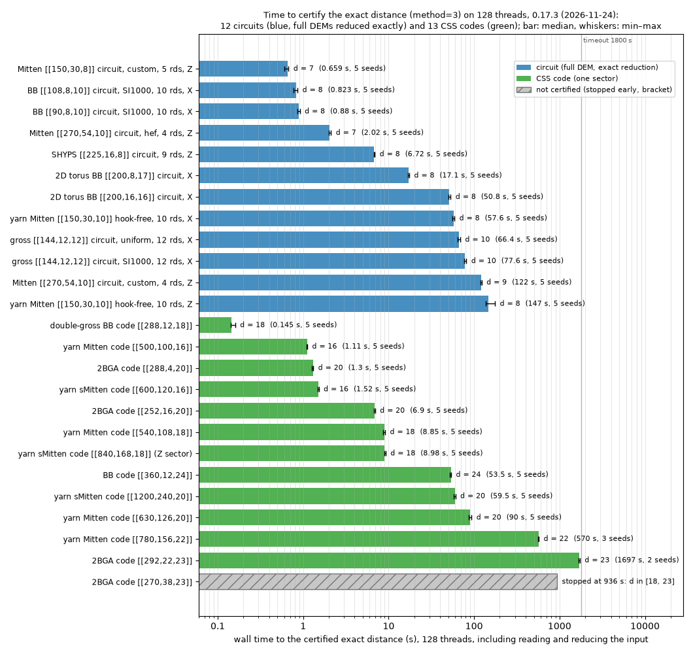
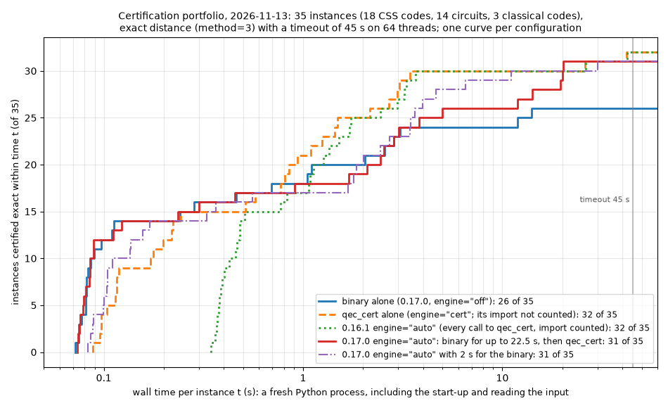
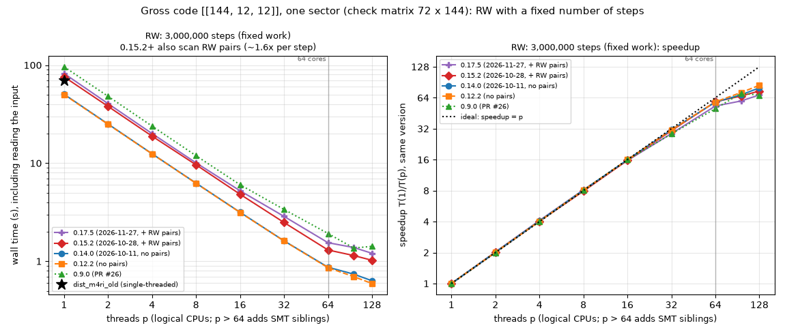
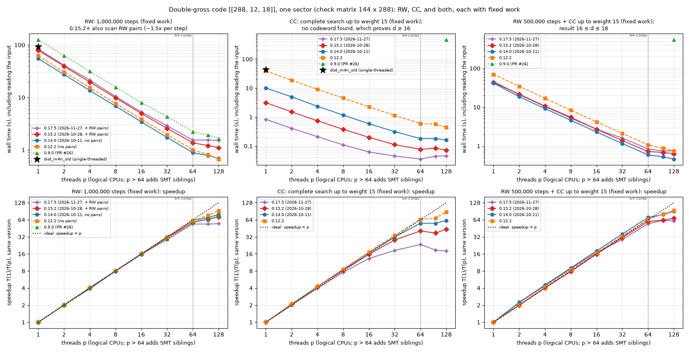
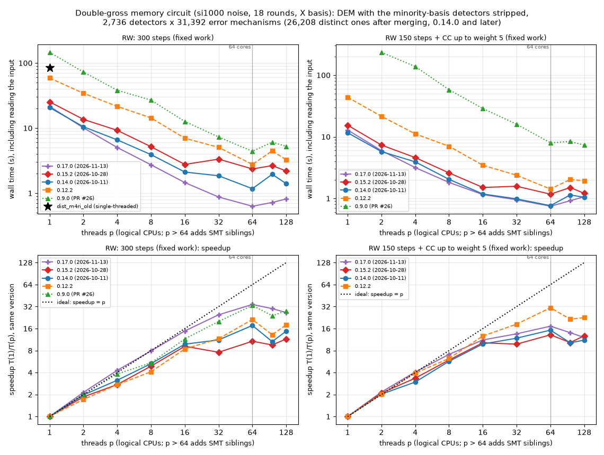
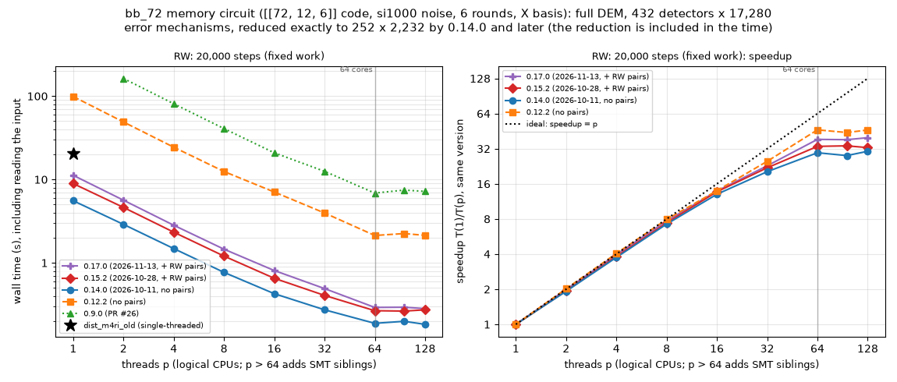
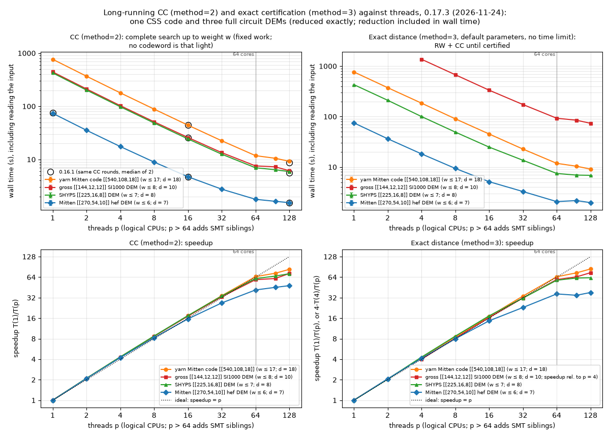
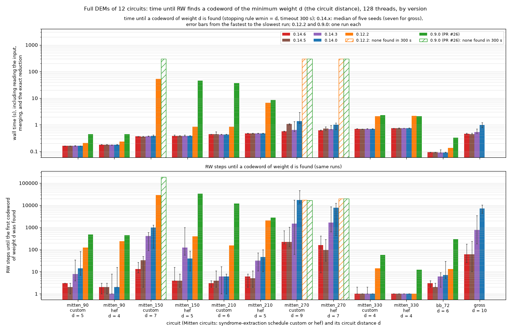
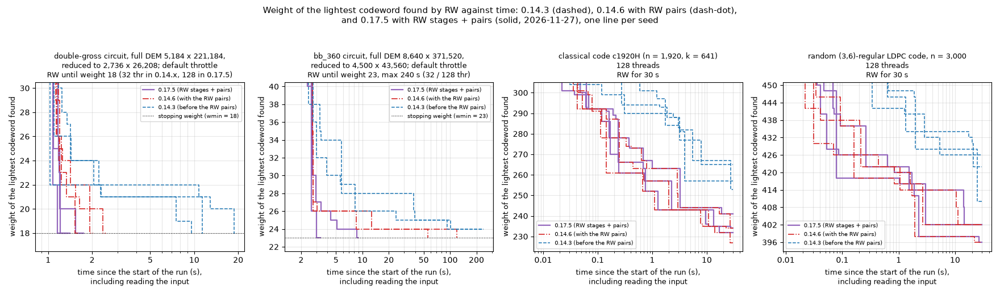
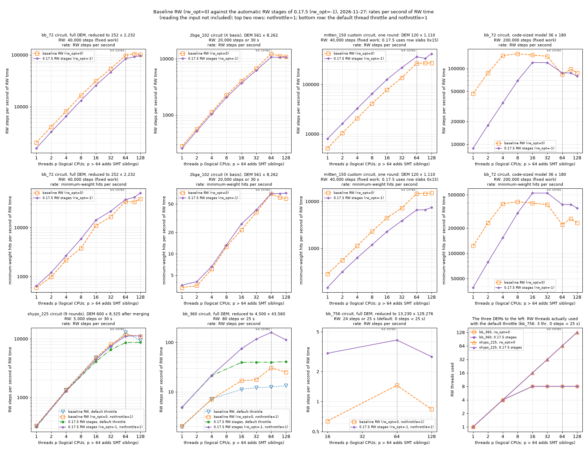

# Benchmark Suite for `dist-m4ri`

This directory contains quantum LDPC CSS parity-check matrices (`.mtx`) and Stim circuit-level fault-tolerance files
(`.stim`) spanning code distances $d = 4$ to $d \le 34$. Detector Error Models (`.dem`) can be generated on the fly from
the `.stim` circuits with `dist_m4ri.py` (noise is added to the noiseless templates with `add_noise`); since version
0.14.0, the binary reduces the full DEM of a circuit exactly (Section 3), so that its distance, the circuit-level
distance, is found as fast as that of the DEM with the minority-basis detectors stripped.

`dist_m4ri` computes the distance of a code (classical, quantum CSS, subsystem, or non-CSS in Pauli form) or of a
circuit (from its DEM): it finds light codewords, which bound the distance from above, and proves that no lighter ones
exist, which bounds it from below; when the two bounds meet, the distance is certified. These files are also the
inputs of the benchmarks of `dist_m4ri` on a 128-thread server, whose current results this file shows:

- [How to Read the Results](#how-to-read-the-results): the terms used in the figures, in plain language;
- [Methods](#methods): the hardware, the software, and the protocol of each figure;
- [Key Results](#key-results): the figures, each with a plain caption and a link to the details;
- [Instance Set and Tiers](#instance-set-and-tiers): the instances for the certification benchmarks, by difficulty;
- [Directory Structure and Running the Suite](#directory-structure-and-running-the-suite);
- [the inputs](#inputs-codes-circuits-and-dems): the codes and their distances
  ([Section 1](#1-css-parity-check-and-logical-matrices-benchmarkcss)), the circuits and their circuit-level distances
  ([Section 2](#2-stim-circuits-stim_bb-stim_mitten-stim_shyps-stim_torus-stim_2bga)), and the full DEMs with their
  exact reduction ([Section 3](#3-full-dems-and-their-exact-reduction));
- [Origins and References](#origins-and-references) of the inputs.

The dated, version-by-version results (Sections 4–12, with all the tables) are in [HISTORY.md](HISTORY.md).

---

## How to Read the Results

- **Distance of a code.** A codeword is a set of errors (columns of the parity-check matrix $H$) which flips no check
  but changes the encoded information, and its weight is the number of errors in it; the distance $d$ is the smallest
  weight of a codeword. A quantum CSS code has two sectors, the $X$-type and the $Z$-type logical operators, with the
  distances $d_X$ and $d_Z$, and $d = \min(d_X, d_Z)$ (Section 1); `dist_m4ri` computes one sector at a time.
- **Distance of a circuit** (the circuit-level distance). The fewest faults (error mechanisms of the circuit's detector
  error model) which cause an undetected logical error. A DEM is a matrix whose rows are the detectors (parities of
  measurement outcomes which are deterministic without errors) and whose columns are the error mechanisms, together
  with the logical observables that each error flips; the circuit distance is the distance of this matrix. It is often
  below the distance of the code, since a single fault in the syndrome-extraction circuit (e.g., a hook error, which
  spreads from an ancilla to several data qubits) can act like several data errors (Section 2.6).
- **RW (`method=1`).** A randomized information-set search (RW stands for random window): each step eliminates the
  matrix with its columns in a random order (for a DEM, often a window of columns close in time) and reads off light
  codewords. A codeword of weight $w$ proves $d \le w$, an upper bound. RW never proves that no lighter codeword exists,
  and the time until it reaches the minimum weight is random: it changes from run to run (seed). RW stops after a
  number of steps (`steps`), at the first codeword of weight at most `wmin`, at the `timeout`, or, by default, when the
  lightest codewords have been found again often enough (`min_hits`); with `min_hits=0` and a given number of steps,
  every run does the same work (fixed work).
- **CC (`method=2`).** An exhaustive connected-cluster search: it grows clusters of connected columns, weight by
  weight, and provably finds every codeword of the minimum weight up to its weight limit `wmax`. If it finds none of
  weight at most $w$, this proves $d > w$, a certified lower bound. Its work up to a given weight is deterministic: it
  depends neither on the seed nor on the number of threads.
- **`method=3`** (the default). RW and CC run together, with the threads balanced between them: RW lowers the upper
  bound $d_{\max}$, CC raises the lower bound $d_{\min}$, and the run ends when they meet, which certifies the exact
  distance. A run stopped earlier (by a `timeout`, or by given `steps` and `wmax`) reports the bracket
  $[d_{\min}, d_{\max}]$.
- **Full and reduced DEM.** The full DEM of a memory circuit has the detectors of both bases ($X$ and $Z$ checks):
  with two-qubit depolarizing noise, many errors flip detectors of both. The stripped DEM keeps only the detectors of
  the measured basis, and its distance is only a lower bound on the circuit distance. Since 0.14.0, `dist_m4ri` merges
  the equal columns of a DEM and drops the minority-basis detectors when it verifies that this is exact (`drop=auto`,
  the default), which reduces the full DEM to a much smaller matrix with the same distance (Section 3).
- **Threads, wall time, speedup.** $p$ is the number of threads (`threads=p`, with `nothrottle=1` in the scaling runs,
  so that the binary uses all $p$ threads). The wall time is that of the whole run of the binary: it includes reading
  the input and, for a DEM, merging and reducing it (the input stage). The fast cases were repeated, and the figures
  show the medians. The speedup is $T(1)/T(p)$, the time on one thread over the time on $p$ threads, of the same
  version; the ideal speedup is $p$. Rates such as RW steps per second (Figure 10) use the RW time reported by the
  binary instead, without the input stage.
- **The default thread throttle.** Without `nothrottle=1`, the binary may run RW on fewer threads than given: for
  example, on a large matrix whose dense RW working copies take more than 15 MB per thread, at most 32 threads run RW
  (the memory bus saturates at 32–64 threads), and a short run gets about one RW thread per 10 steps
  ($\lceil\texttt{steps}/10\rceil$).
- **The sparse elimination** (0.17.0). On wide DEMs, with many more columns than detectors, an RW step of 0.17.0
  eliminates with an $m \times m$ inverse per thread ($m$ detectors) instead of dense copies of the whole
  $m \times n$ matrix and of its transpose, which lifts the memory-bandwidth limit (Figures 5 and 10).
- **The Python wrapper and the engines.** `dist_m4ri.py` is the Python interface of the binary: it also builds the
  DEMs of Stim circuits and adds noise. Its option `engine=` selects how a distance is computed: the binary alone
  (`"off"`, the default), `qec_cert` alone (`"cert"`; `qec_cert` is the Python package of `qec-cert`, a separate
  project with its own exact certification methods), or both (`"auto"`: since 0.17.0, the binary first and then
  `qec_cert` on what remains open).
- **The server.** All runs used a two-socket AMD EPYC 7B13 server: 2 x 32 cores, i.e., 64 physical cores and 128
  logical CPUs with SMT (two hardware threads per core), and 236 GiB of memory. In the thread-scaling runs (Figures
  3–7 and 10), a run with $p$ threads is pinned with `taskset` to the logical CPUs $0..p-1$, in this order: 0–31 are
  the cores of socket 0, 32–63 those of socket 1, and 64–95 and 96–127 their SMT siblings (the second hardware threads
  of the cores of socket 0 and 1). Up to $p = 64$, each thread has a core of its own; beyond, the threads share cores.
  The gray line in the figures marks $p = 64$.
- **Versions.** The figures compare versions of `dist_m4ri`, from 0.9.0 (pull request #26, 2026-09-18) to 0.17.3–0.17.4
  (2026-11-24); `dist_m4ri_old` is the legacy single-threaded program, built from the 0.14.0 sources.

---

## Methods

- **Hardware.** One server, a virtual machine (KVM) with two AMD EPYC 7B13 sockets: 2 x 32 cores, 128 logical CPUs
  with SMT, and 236 GiB of memory; NUMA node 0 holds the CPUs 0–31 and 64–95, node 1 the CPUs 32–63 and 96–127.
- **Software.** Each version of `dist_m4ri` named in a figure, built from its own sources with its makefile, and
  `dist_m4ri.py` of the same version; `dist_m4ri_old` built from the 0.14.0 sources. The DEMs of the circuits are
  generated from the `.stim` files with stim 1.16 (Section 3). Figure 2 also uses `qec_cert`, whose version was not
  recorded in the 0.17.0 run.
- **Wall time.** The time of the whole process: for the binary (Figures 1 and 3–9), from its start to its exit,
  including reading the input and, for a DEM, merging and reducing it; for Figure 2, the fresh Python process,
  including its start-up and imports (the `qec_cert` curve without the import of `qec_cert`). Figure 10 shows rates per
  second of the RW time reported by the binary.
- **Exclusive runs.** Within each benchmark, one run at a time, except in Figure 2 (two runs at once, one per NUMA
  node). The runs of 0.17.3 (Figures 1 and 7) and 0.17.0 (Figures 2 and 10, and the 0.17.0 curves of Figures 3–6) were
  made on a server without other jobs, with the load recorded; for the earlier runs, the load was not recorded.
- **Protocol of each figure:**
  - Figure 1: `method=3` with the default parameters on 128 threads (`nothrottle=1`, `timeout=1800`); 5 seeds (3 or 2
    where a run exceeds 300 or 900 s).
  - Figure 2: `method=3`, the exact distance or the bracket at the time limit of 45 s; 64 threads on one NUMA node;
    one run per instance and configuration.
  - Figures 3–6: fixed work (RW `steps` with `min_hits=0`, CC up to `wmax`, or both); $p = 1, \dots, 128$ threads on
    the CPUs $0..p-1$, with `nothrottle=1`; no time limit (`timeout=0`), except 600 s per case and method for 0.9.0
    (400 s on the full DEM of Figure 6, also for 0.12.2); the same seed for every version; the median of three runs
    for the fast cases, one run otherwise.
  - Figure 7: long-running CC up to `wmax` (`method=2`, fixed work) and exact certification (`method=3`, default
    parameters, `timeout=0`); $p = 1, \dots, 128$ threads on the CPUs $0..p-1$ (`p >= 4` for `gross` `method=3`), with
    `nothrottle=1`; median of three runs where $\le 150$ s, one run otherwise.
  - Figure 8: until a codeword of weight $d$ (`wmin=d`, `min_hits=0`, `steps=10^9`); 128 threads, not pinned, with
    `nothrottle=1`; a time limit of 300 s (120 s for gross); five seeds for 0.14.x (seven for gross), one run for
    0.12.2 and 0.9.0.
  - Figure 9: the lightest codeword found against time; the default threads (32 RW threads on the two DEMs, 128 on the
    codes), not pinned; until weight 18 (time limit 180 s) or 23 (240 s) on the DEMs, and 30 s on the codes; three
    seeds (two for `bb_360`).
  - Figure 10: RW with a fixed step limit; $p = 1, \dots, 128$ threads on the CPUs $0..p-1$, with `nothrottle=1` and
    with the default throttle; a time limit of 25–30 s; one run per point.

---

## Key Results

Each figure below has a one-line statement of what is measured (with the versions and the run dates), a caption (the
runs, the axes, how to read them, the main result), and a link to the details in [HISTORY.md](HISTORY.md). The
figures are grouped: the certification of distances (Figures 1 and 2), the scaling with the number of threads (Figures
3–7), and diagnostics of the RW search (Figures 8–10). The protocols are summarized in [Methods](#methods).

### Certification

#### Figure 1: Exact certification on 128 threads

**Wall time to certify the exact distance (`method=3`) of 12 circuits and 13 CSS codes on 128 threads; 0.17.3,
2026-11-24.**



- *Run:* `method=3` with the default parameters on 128 threads (`nothrottle=1`, `timeout=1800`) on the full DEMs of 12
  multi-round circuits (reduced exactly by `drop=auto`) and one sector ($d_Z$) of 13 CSS codes; 5 seeds, or 3
  (`yarn_mitten_780`) and 2 (`2bga_292`) on the two longest codes.
- *Axes:* horizontal bars show the median wall time across seeds (logarithmic axis, reading and reducing the input
  included), with whiskers from the fastest to the slowest seed; blue bars are circuits, green bars CSS codes, and
  hatched gray is an uncertified bracket when the binary stops early (`STOP_CC_SLOW`) because the next CC round is
  predicted to exceed the remaining time budget.
- *Result:* 24 of the 25 instances are certified exact across every seed: all 12 circuits in 0.66–147 s (e.g., 77.6 s
  on the 12-round `si1000` gross circuit, $1728 \times 72576 \to 936 \times 8784$, $d = 10$; 122 s on `mitten_270`
  custom, $d = 9$) and 12 of the 13 codes in 0.145–1,697 s (0.145 s on `double_gross` $[[288, 12, 18]]$, 53.5 s on
  `bb_360` $[[360, 12, 24]]$, 570 s on `yarn_mitten_780` $[[780, 156, 22]]$, and 1,697 s on `2bga_292`
  $[[292, 22, 23]]$). On `2bga_270_38_23` ($k = 38$), CC certifies $d \ge 18$ and stops cleanly at 936 s with the
  bracket $[18, 23]$.
- *Details:* [HISTORY.md, Section 12.1](HISTORY.md#121-exact-certification-on-128-threads).

#### Figure 2: Certification portfolio

**Instances (of 35) certified exact within a given wall time per instance, by engine configuration; 0.17.0,
2026-11-13.**



- *Run:* 35 instances (18 CSS codes, one sector each; 14 circuits, with one or more rounds; 3 classical LDPC codes),
  `method=3`, `timeout=45`, `threads=64` on one NUMA node (two runs at once), each run in a fresh Python process with
  the distance cache disabled.
- *Curves:* the binary alone (`engine="off"`); `qec_cert` alone (`engine="cert"`, timed without the import of
  `qec_cert`); the `engine="auto"` of 0.16.1, which handed every call to `qec_cert`; and the two-stage
  `engine="auto"` of 0.17.0, which runs the binary first, for up to $\tau_1 = 22.5$ s (in the fifth curve, 2 s), and
  then `qec_cert`, while circuits with more than 25,000 raw error mechanisms go to `qec_cert` first.
- *Axes:* a curve at height $k$ at time $t$ means that $k$ instances were certified exact, each within $t$ seconds of
  wall time of its Python process (logarithmic time axis; gray line: the timeout).
- *Result:* the two-stage `auto` certified 31 instances, against 26 for the binary alone and 32 for `qec_cert` alone,
  and on the 20 easy instances it is as fast as the binary (median 0.087 s, against 0.443 s for the delegation of
  0.16.1, which imports `qec_cert` in every call).
- *Caveats and 0.17.3–0.17.4 updates:* the budget is 45 s per instance, with two runs sharing the server at once (one
  per NUMA node). Since 0.17.1, the default Stage-A budget is $\tau_1 = \min(\max(2, \texttt{timeout}/10), 10)$ s:
  re-measured in 0.17.3 (`2026-11-24`), `auto` ($\tau_1 = 4.5$ s) certifies 31/35 in 258.6–261.2 s total (vs 301.0 s
  at $\tau_1 = 22.5$ s, and 250.2 s at $\tau_1 = 2.0$ s) with easy median 0.079 s. Since 0.17.4, Stage B passes
  `search_opts={"force_dom": 1}` when handing a certified `wmin > 1` to `qec_cert`: on exclusive 64 threads, this cuts
  `bb_360` `auto` from 8.2 s to 3.2 s, certifies `2bga_292` ($d = 23$) in 33.8 s (lifting `auto` to **32/35**, matching
  `cert`), and raises the `double_gross` $T = 1$ bracket in `auto` from $[13, 16]$ to $[14, 16]$.
- *Details:* [HISTORY.md, Sections 11.3](HISTORY.md#113-two-stage-certification-portfolio-with-qec_cert) and
  [12.4](HISTORY.md#124-portfolio-re-measurement-and-stage-b-force_dom-fix).

### Thread Scaling with Fixed Work and Certification

#### Figure 3: Gross code, RW with fixed work

**Wall time of 3,000,000 RW steps on one sector of the gross code $[[144, 12, 12]]$ against the number of threads;
versions 0.9.0–0.17.0, run 2026-10-11 to 2026-11-13.**



- *Run:* `method=1 steps=3000000 min_hits=0` on `css/gross_144_12_12_Hx.mtx` with `_Hz.mtx`, for $p = 1, \dots, 128$.
  With `min_hits=0`, RW does not stop when it has found the distance, so every run does the same work: the time
  measures how fast the RW steps run, not how fast the distance is found (Figures 8 and 9 measure that).
- *Axes:* left, the wall time against $p$ (both axes logarithmic); right, the speedup $T(1)/T(p)$ of each version,
  with the ideal speedup $p$ dotted. The star is the legacy single-threaded `dist_m4ri_old` (one thread).
- *Reading:* with perfect scaling, the time halves with each doubling of $p$.
- *Result:* RW scales almost linearly up to 64 threads, and the SMT siblings ($p > 64$) add more: 0.17.0 takes 80 s
  on one thread, with a speedup of 57x at 64 threads and 76x at 128 (0.14.0: 50 s, 58x, and 80x). A step of 0.15.2 or
  0.17.0 takes longer than one of 0.14.0, since it also checks pairs of columns (since 0.14.4); the pairs find light
  codewords in far fewer steps (Figures 8 and 9).
- *Not shown:* CC up to weight 11 and the exact distance (`method=2 wmax=11` and `method=3`), which take a fraction of
  a second with 0.14.0 and later and are dominated by the start-up of the threads (Figure 7 measures multi-second to
  multi-minute CC and `method=3` runs); their times are in HISTORY.md.
- *Versions (run dates):* 0.17.0 (2026-11-13), 0.15.2 (2026-10-28), and 0.14.0, 0.12.2, and 0.9.0 (2026-10-11).
- *Details:* [HISTORY.md, Section 4](HISTORY.md#4-scaling-with-the-number-of-threads-versions-and-details).

#### Figure 4: Double-gross code, RW, CC, and both with fixed work

**Wall time of fixed-work RW, CC, and RW + CC on the double-gross code $[[288, 12, 18]]$ against the threads;
versions 0.9.0–0.17.0, run 2026-10-11 to 2026-11-13.**



- *Run:* left, RW with 1,000,000 steps (`method=1 steps=1000000 min_hits=0`); middle, the complete CC search up to
  weight 15 (`method=2 wmax=15`), which finds no codeword, since $d = 18$, and so proves $d \ge 16$; right, both
  (`method=3 steps=500000 wmax=15 min_hits=0`), which gives the bracket $16 \le d \le 18$.
- *Axes:* top, the wall time against $p$; bottom, the speedup $T(1)/T(p)$ of each version (dotted: ideal).
- *Result:* RW scales as on the gross code (0.17.0: 82 s on one thread, 1.18 s on 128). CC became much faster from
  version to version: up to weight 15, 0.17.0 takes 0.83 s on one thread, 3.8x less than 0.15.2 (3.1 s), and 0.14.0
  took 10 s, while 0.9.0 needs 472 s on 128 threads. On 64–128 threads, 0.17.0 takes only 0.035–0.047 s, and more
  threads hardly help. RW + CC: 42 s on one thread and 0.59 s on 128 with 0.17.0.
- *Versions:* as in Figure 3; 0.9.0 ran CC and RW + CC on 128 threads only (it was limited to 600 s per case and
  method).
- *Details:* [HISTORY.md, Section 4](HISTORY.md#4-scaling-with-the-number-of-threads-versions-and-details).

#### Figure 5: Double-gross circuit, RW and RW + CC with fixed work

**Wall time of fixed-work RW and RW + CC on the DEM of the double-gross circuit against the number of threads;
versions 0.9.0–0.17.0, run 2026-10-11 to 2026-11-13.**



- *Run:* the $X$-basis memory circuit of the double-gross code with `si1000` noise and 18 rounds
  (`stim_bb/double_gross_288_12_18_si1000_r18_X.stim`), as its DEM with the minority-basis detectors stripped,
  $2736 \times 31392$ (merged to 26208 distinct columns since 0.14.0). Left, RW with 300 steps
  (`method=1 steps=300 min_hits=0`); right, RW with 150 steps and CC up to weight 5
  (`method=3 steps=150 wmax=5 min_hits=0`).
- *Axes:* as in Figure 4.
- *Result:* until 0.15.2, RW on this large matrix is limited by the memory bandwidth (each thread works on dense
  copies of the matrix and of its transpose): at most about 15–20x faster with 0.14.0 and 11x with 0.15.2, and the SMT
  siblings make it slower. 0.17.0 instead uses the sparse elimination (see [How to Read](#how-to-read-the-results))
  and scales almost linearly to 32 threads (25x): 21.6 s on one thread and 0.63 s on 64 threads, 3.7 times less than
  0.15.2 (2.36 s). RW + CC: 12.9 s on one thread and 0.75 s on 64 (0.15.2: 15.4 s and 1.17 s).
- *Not shown:* CC alone up to weight 5 (`method=2 wmax=5`), which takes under one second with 0.14.0 and later (Figure
  7 shows deeper CC rounds); its times are in HISTORY.md.
- *Versions:* as in Figure 3; 0.9.0 ran RW + CC from $p = 2$ on only (600 s per case), so it has no speedup curve
  there.
- *Details:* [HISTORY.md, Section 4](HISTORY.md#4-scaling-with-the-number-of-threads-versions-and-details) (and
  [Section 11.2](HISTORY.md#112-thread-scaling-of-the-rw-stages) for 0.17.0).

#### Figure 6: bb_72 circuit, RW with fixed work on the full DEM

**Wall time of 20,000 RW steps on the full DEM of the `bb_72` circuit, reduction included, against the threads;
versions 0.9.0–0.17.0, run 2026-10-11 to 2026-11-13.**



- *Run:* the $X$-basis memory circuit of the $[[72, 12, 6]]$ bivariate bicycle code with `si1000` noise and 6 rounds
  (`stim_bb/bb_72_12_6_si1000_r6_X.stim`), as its full DEM with 432 detectors and 17280 error mechanisms;
  `method=1 steps=20000 min_hits=0`: a fixed 20,000 RW steps. This is the RW throughput, not the time to find a
  codeword of the minimum weight 6, which takes 0.092 s on 128 threads (Figure 8).
- *Input stage:* every time includes reading the full DEM and, since 0.14.0, reducing it exactly to $252 \times 2232$
  (the stripped DEM with its equal columns merged); 0.12.2 and 0.9.0 search the full matrix.
- *Axes:* left, the wall time against $p$; right, the speedup $T(1)/T(p)$ of each version (dotted: ideal).
- *Result:* the exact reduction makes RW much faster: 0.14.0 takes 5.6 s on one thread instead of 99 s (0.12.2) and
  163 s (0.9.0, two threads), and 0.18 s on 128 threads instead of 2.1 s and 7.2 s. 0.17.0 takes 11.2 s on one thread
  and 0.28 s on 128: its steps are 1.25 times longer than those of 0.15.2 (8.9 s on one thread), since they also
  shorten the candidate codewords, and they record 1.5 times more minimum-weight hits per second
  ([HISTORY.md, Section 11.1](HISTORY.md#111-stage-ablation-16-threads)).
- *Not shown:* the complete CC search up to weight 5 (`method=2 wmax=5`, which finds nothing, since $d = 6$) and the
  exact distance with the default parameters (`method=3`), which take a fraction of a second with 0.14.0 and later,
  mostly the input stage (see Figure 7 for larger DEMs); their times are in HISTORY.md.
- *Versions:* as in Figure 3; 0.9.0 ran from $p = 2$ on only, so it has no speedup curve.
- *Details:* [HISTORY.md, Section 4](HISTORY.md#4-scaling-with-the-number-of-threads-versions-and-details).

#### Figure 7: Long-running CC and exact certification against threads

**Wall time and speedup of long-running CC (`method=2`) and exact distance certification (`method=3`) on one CSS code
and three full circuit DEMs; 0.17.3 and 0.16.1, 2026-11-24.**



- *Run:* $p = 1, \dots, 128$ threads pinned to CPUs $0..p-1$ with `nothrottle=1` and `timeout=0` on `yarn_mitten_540`
  ($216 \times 540$, $d = 18$), the `gross` `si1000` full DEM ($1728 \times 72576 \to 936 \times 8784$, $d = 10$;
  `method=3` from $p = 4$ on), the `shyps_225` DEM ($600 \times 10125 \to 600 \times 8325$, $d = 8$), and the
  `mitten_270` `hef` full DEM ($1080 \times 67482 \to 648 \times 8910$, $d = 7$). Left: fixed-work CC (`method=2`) up
  to weights $w = 17, 8, 7, 6$; right: exact certification (`method=3`, default parameters). Open circles on the CC
  panel are back-to-back runs of 0.16.1 at $p = 1, 16, 128$.
- *Axes:* top, the wall time (including reading and reducing the full DEMs) against $p$; bottom, the speedup
  $T(1)/T(p)$ ($4 \cdot T(4)/T(p)$ for `gross` `method=3`), with the ideal speedup $p$ dotted.
- *Result:* on the three multi-minute inputs, both CC and `method=3` scale with parallel efficiency 1.01–1.10 across
  $p = 2..32$, reaching **58–65x** on 64 physical cores and **63–84x** with SMT on 128 threads (`yarn_mitten_540`:
  768 s on one thread to 9.10 s on 128, **84.4x**; `gross` `method=3`: 1,370 s on 4 threads to 73.6 s on 128,
  **74.4x**). On the faster `mitten_270` `hef` DEM (74–75 s on one thread, 1.54 and 1.97 s on 128), the serial
  $\approx 0.35$ s DEM input/reduction stage bounds the 128-thread speedup to 48.0x (`method=2`) and 38.1x
  (`method=3`). The 0.16.1 CC medians match 0.17.3 within $< 1\%$ (ratios 0.997–1.008).
- *Details:* [HISTORY.md, Section 12.2](HISTORY.md#122-long-running-thread-scaling-of-cc-and-method3).

### Diagnostics of the RW Search

#### Figure 8: Full DEMs, time to a minimum-weight codeword

**Wall time and RW steps until RW finds a codeword of the minimum weight in the full DEMs of 12 circuits; versions
0.9.0–0.14.6, run 2026-10-11 and 2026-10-15.**



- *Run:* `method=1 wmin=d min_hits=0 steps=10^9`, which stops at the first codeword of weight at most $d$ (timeout
  300 s, 120 s for gross; 0.9.0 has no `min_hits`), with 128 threads and `nothrottle=1`, on the full DEMs of the ten
  Mitten circuits, the `bb_72` circuit, and the gross circuit; $d$ is the certified circuit distance (Section 2.6).
- *Axes:* top, the wall time (logarithmic), which includes reading the DEM, merging, and the exact reduction; bottom,
  the RW steps until the codeword was found. The bars of 0.14.x are the medians of five seeds (seven for gross), with
  error bars from the fastest to the slowest run; 0.12.2 and 0.9.0: one run each, not run on gross; hatched: no
  codeword of weight $d$ found in 300 s.
- *Result:* since the exact reduction of 0.14.0, a codeword of the minimum weight is found in at most 1.4 s for every
  circuit, while 0.12.2 needs up to 52 s and finds none for the two `mitten_270` circuits in 300 s, and 0.9.0 misses
  three. With the RW pairs, 0.14.5 needs 6–30 times fewer steps than 0.14.3 where many steps are needed (`mitten_150`,
  `mitten_210` hef, `mitten_270`, gross), and 0.14.6 about as few; the wall time is then mostly the input stage
  (0.07–0.7 s).
- *Versions:* 0.14.6, 0.14.5, 0.14.3, and 0.14.0 (2026-10-15); 0.12.2 and 0.9.0 (2026-10-11).
- *Details:* [HISTORY.md, Sections 5.2](HISTORY.md#52-full-dems-time-to-a-codeword-of-the-minimum-weight),
  [8.1](HISTORY.md#81-full-dems-time-to-a-codeword-of-the-minimum-weight), and
  [8.7](HISTORY.md#87-a-work-bound-for-the-rw-pairs-0146).

#### Figure 9: Lightest codeword against time, with and without the RW pairs

**Weight of the lightest codeword found by RW against time, without (0.14.3) and with (0.14.6) the RW pairs;
2026-10-15.**



- *Run:* RW (`method=1 min_hits=0 steps=10^9`) on the full DEMs of the double-gross circuit (until a codeword of
  weight 18, `wmin=18`, three seeds) and of the `bb_360` circuit (until weight 23 or 240 s, two seeds), with the
  default 32 RW threads (the thread throttle, see [How to Read](#how-to-read-the-results)); and on the classical codes
  `c1920H` ($n = 1920$, $k = 641$) and a random (3,6)-regular LDPC code with $n = 3000$, for 30 s on 128 threads,
  three seeds.
- *Axes:* the weight of the lightest codeword found so far against the time since the start of the run (logarithmic),
  which includes reading and reducing the input (about 1 s and 2 s for the two DEMs); one line per run, and each step
  down is a lighter codeword.
- *Result:* the RW pairs (since 0.14.4) find light codewords much sooner: weight 18 of the double-gross circuit after
  1.5–2.4 s instead of 9.6–18.8 s, and weight 23 of `bb_360` after 56 and 119 s, while 0.14.3 found only 24 in 240 s.
  For the two classical codes, the lightest codeword found is lighter at all times; at 30 s, 227–234 against 253–265
  for `c1920H`, and 396–402 against 410–426 for the LDPC code.
- *Note:* 18 is not the distance of the double-gross circuit: `qec_cert` later found a codeword of weight 16 and the
  bracket $[13, 16]$ ([HISTORY.md, Section 11.3](HISTORY.md#113-two-stage-certification-portfolio-with-qec_cert); on
  one round, row slabs find weight 16 in 0.08–0.14 s,
  [Section 12.3](HISTORY.md#123-rw-pipeline-validation-and-open-points-of-01710174)).
- *Versions:* 0.14.3 and 0.14.6 (2026-10-15).
- *Details:* [HISTORY.md, Sections 8.2](HISTORY.md#82-large-dems-the-time-to-light-codewords),
  [8.3](HISTORY.md#83-codes-with-a-large-distance), and [8.7](HISTORY.md#87-a-work-bound-for-the-rw-pairs-0146).

#### Figure 10: RW stages of 0.17.0 against threads

**RW steps and minimum-weight hits per second against the threads: the RW of 0.16.1 and the RW stages of 0.17.0;
2026-11-13.**



- *Run:* `method=1` with a fixed step limit, or a 25–30 s timeout on the slower inputs (as given in the panel titles),
  with `rw_opt=0` (the RW of 0.16.1) and with `rw_opt=-1` (the automatic stages of 0.17.0, which shorten the
  candidate codewords and record the codewords found in a step together, and which also choose the sparse elimination
  on the two wide DEMs, `bb_360` and `bb_756`). Top two rows: four inputs on which RW finds minimum-weight codewords
  often (`min_hits=10^9`, so that RW does not stop early), with `nothrottle=1`; the fourth is the code-sized model of
  the `bb_72` circuit, a $36 \times 180$ matrix with one column per net effect of a single fault on the checks, whose
  distance is a certified lower bound on the circuit distance
  ([HISTORY.md, Section 6.3](HISTORY.md#63-certified-lower-bounds-from-a-code-sized-model)). Bottom row: three deep or
  wide DEMs (`min_hits=0`), with the default thread throttle and with `nothrottle=1`, and, on the right, the RW
  threads which the default throttle allowed.
- *Axes:* the RW steps per second (top and bottom rows) and the minimum-weight hits per second (middle row; a hit is an
  RW step finding one of the up to 100 stored codewords of the minimum weight) against $p$. The rates use the RW time
  reported by the binary, without reading the input.
- *Result:* where hits are frequent, 0.17.0 records them per step, which removes the contention of the threads on the
  shared codeword table of 0.16.1: on the full `bb_72` DEM, the step rate grows 63x from one to 128 threads instead of
  34x, and at 128 threads, 0.17.0 records 1.9x the hits per second. On the wide `bb_360` DEM, the sparse elimination
  runs 2.3x the steps per second on one thread. With the default throttle, the short runs of the bottom row get few RW
  threads (8 for `bb_360` with 80 steps, 3 for `bb_756` with 24), equally for both modes; in sustained 1,280-step runs
  (`0.17.3`), `-1` reaches 311 steps/s on `bb_360` (9.9–13.5x `0`) and 8.35 steps/s on `bb_756` (5.3–7.7x `0`).
- *Versions:* 0.17.0 (2026-11-13), with `rw_opt=0` for the RW of 0.16.1.
- *Details:* [HISTORY.md, Sections 11.2](HISTORY.md#112-thread-scaling-of-the-rw-stages),
  [11.1](HISTORY.md#111-stage-ablation-16-threads), and
  [12.3](HISTORY.md#123-rw-pipeline-validation-and-open-points-of-01710174).

---

## Instance Set and Tiers

The certification benchmarks use a fixed set of 51 instances from `benchmark/`, in four tiers by the wall time of the
baseline (the binary alone, `method=3` with the default options, on 128 threads): T0 under 1 s, T1 1–60 s, T2 1–30
min, and T3 not certified in 30 min. Each tier has one time budget, the same for every engine: 60, 300, 1800, and
3600 s. The versioned manifest [`manifest/certify_v1.json`](manifest/certify_v1.json) (see
[`manifest/README.md`](manifest/README.md) and [`tools/bench/`](../tools/bench/README.md)) records the sha256 of every
input and the deterministic recipe of every generated DEM; the best known times below calibrate the tiers.

- Ids: `css/<prefix>:Z` is one sector of a code of Section 1 (`finH=Hx finG=Hz`, which gives $d_Z$; `:X` gives
  $d_X$); `classical/<prefix>` a classical code of Section 1.1; `dem/<circuit>.full` and `circ/<circuit>` a circuit
  of Section 2 with all its detectors (the noiseless templates with `add_noise(p=0.001)`; the binary reduces the DEM
  exactly).
- Best known: the median wall time of `dist_m4ri` alone on 128 threads, with the version that measured it, unless noted
  otherwise. The sources are the sections of this file and of [HISTORY.md](HISTORY.md) ("H" below), and the
  baselines of `qec-cert` (`bench/README_baselines.md` there).

**T0: under 1 s** (13 instances, budget 60 s).

| Instance | $d$ | Best known (s) | Source |
| :--- | :-: | :--- | :--- |
| `css/gross_144_12_12:Z` | 12 | 0.014 (0.17.3, 16 threads; 0.031 in 0.14.0) | H 5.3, 12.3 |
| `css/double_gross_288_12_18:Z` | 18 | 0.145 (0.17.3; 0.34 in 0.15.0) | H 9.1, 12.1 |
| `css/yarn_mitten_300_60_14:Z` | 14 | 0.22 (0.15.0) | H 9.1 |
| `css/yarn_smitten_600_120_14:Z` | 14 | 0.14 (0.15.0) | H 9.1 |
| `css/mitten_270_54_10_C9xS3:Z` | 10 | < 0.04 (0.14.0) | Section 1 |
| `css/kasai_cpm_184_50_10:Z` | 10 | 0.015 (0.17.3, 16 threads) | Section 1, H 12 |
| `css/hyp_3_7_546_28_7:Z` | 7 | 0.014 (0.17.3, 16 threads) | Section 1, H 12 |
| `classical/tanner_155_64_20` | 20 | 0.284 (0.17.3, 16 threads) | Section 1.1, H 12.3 |
| `dem/bb_72_12_6_si1000_r6_X.full` | 6 | 0.11 (0.14.0) | H 5.1 |
| `dem/mitten_150_30_8_C5xS3_custom_r5_Z.full` | 7 | 0.659 (0.17.3; 0.56 in 0.14.0) | H 5.1, 12.1 |
| `dem/bb_90_8_10_si1000_r10_X.full` | 8 | 0.880 (0.17.3; 0.68 in 0.14.0) | H 5.1, 12.1 |
| `dem/torus_n60_k8_d14_X.full` | 6 | 0.15 (0.14.0) | H 5.1 |
| `circ/surface_rot_d7_r7_Z` | 7 | 0.716 (0.17.3, 64 threads, `dist_m4ri.py`) | Section 2.7, H 12.4 |

**T1: 1–60 s** (15 instances, budget 300 s).

| Instance | $d$ | Best known (s) | Source |
| :--- | :-: | :--- | :--- |
| `css/yarn_mitten_500_100_16:Z` | 16 | 1.11 (0.17.3) | H 9.3, 12.1 |
| `css/yarn_smitten_600_120_16:Z` | 16 | 1.52 (0.17.3; 1.4 in 0.15.0) | H 9.3, 12.1 |
| `css/yarn_smitten_840_168_18:X` | 17 | 3.3 (0.15.0) | H 9.3 |
| `css/yarn_smitten_840_168_18:Z` | 18 | 8.98 (0.17.3) | H 9.3, 12.1 |
| `css/yarn_mitten_540_108_18:Z` | 18 | 8.85 (0.17.3) | H 9.3, 12.1 |
| `css/yarn_smitten_1200_240_20:Z` | 20 | 59.5 (0.17.3; 58 in 0.15.0) | H 9.3, 12.1 |
| `css/2bga_288_4_20_C24xS3:Z` | 20 | 1.30 (0.17.3) | H 12.1 |
| `css/2bga_252_16_20_C7xD18:Z` | 20 | 6.90 (0.17.3) | H 12.1 |
| `css/2bga_288_8_22_C18xD8:Z` | 22 | 33 (CC of 0.16.1, 64 threads) | `qec-cert` baselines |
| `css/bb_360_12_24:Z` | 24 | 53.5 (0.17.3; 3.2 min in 0.15.0) | H 9.3, 12.1 |
| `dem/mitten_270_54_10_C9xS3_hef_r4_Z.full` | 7 | 2.02 (0.17.3) | H 10.3, 12.1 |
| `dem/shyps_225_16_8_r9_Z.full` | 8 | 6.72 (0.17.3) | H 10.3, 12.1 |
| `dem/torus_n200_k8_d17_X.full` | 8 | 17.1 (0.17.3) | H 10.3, 12.1 |
| `dem/torus_n200_k16_d16_X.full` | 8 | 50.8 (0.17.3; 67.3 in 0.15.1) | H 10.3, 12.1 |
| `dem/yarn_mitten_150_30_10_hookfree_r10_X.full` | 8 | 57.6 (0.17.3; 62.4 in 0.15.1) | H 10.3, 12.1 |

**T2: 1–30 min** (8 instances, budget 1800 s).

| Instance | $d$ | Best known | Source |
| :--- | :-: | :--- | :--- |
| `css/yarn_mitten_630_126_20:Z` | 20 | 90.0 s (0.17.3; 82 s in 0.15.0) | H 9.3, 12.1 |
| `css/yarn_mitten_780_156_22:Z` | 22 | 570 s (0.17.3; 9.3 min in 0.15.0) | H 9.3, 12.1 |
| `css/2bga_292_22_23_C146:Z` | 23 | 1,697 s (0.17.3; `qec_cert`: 30.8 s, 64 threads) | H 12.1, 12.4 |
| `css/2bga_294_24_21_SG147_5:Z` | 21 | to calibrate | Section 1 |
| `dem/gross_144_12_12_si1000_r12_X.full` | 10 | 77.6 s (0.17.3) | H 9.1, 10.3, 12.1 |
| `dem/gross_144_12_12_uniform_r12_X.full` | 10 | 66.4 s (0.17.3) | H 10.3, 12.1 |
| `dem/yarn_mitten_150_30_10_hookfree_r10_Z.full` | 8 | 147 s (0.17.3; 154 s in 0.15.1) | H 10.3, 12.1 |
| `dem/mitten_270_54_10_C9xS3_custom_r4_Z.full` | 9 | 122 s (0.17.3; 137–150 s in 0.15.0–1) | H 9.1, 10.3, 12.1 |

**T3: not certified by `dist_m4ri` alone in 30 min** (15 instances, budget 3600 s; the result is the bracket at the
budget).

| Instance | $d$ or bracket | Known | Source |
| :--- | :-: | :--- | :--- |
| `css/yarn_mitten_975_195_24:Z` | 24 | 59 min (0.15.0) | H 9.3 |
| `css/yarn_mitten_975_195_24:X` | [23, 24] | open after 20 min; the round $w = 23$ takes about 46 min | H 9.3 |
| `css/bb_756_16_34:Z` | [26, 34] | open after 12 min (0.15.0) | H 9.3 |
| `css/2bga_270_38_23_C45xC3:Z` | 23 | `qec_cert`: 19,671 s (48 thr); `dist_m4ri`: [18, 23] | Section 1, H 12.1 |
| `css/2bga_270_38_21_SG135_4:Z` | 21 | `qec_cert`; `dist_m4ri`: [13, 21] | Section 1 |
| `css/color_721_1_31:Z` | 31 | `qec_cert` (rank-DP) | Section 1 |
| `css/toric_3_6_432_2_12:X` | 24 | `qec_cert`; `dist_m4ri`: [18, 24] | Section 1 |
| `css/surface_strip_333_1_3:Z` | 67 | `qec_cert`; `dist_m4ri`: [11, 78] | Section 1 |
| `dem/double_gross_288_12_18_si1000_r18_X.full` | [13, 16] | `qec_cert`; `dist_m4ri`: [11, 19] in 2.8 h | Section 2.6 |
| `dem/double_gross_288_si1000_X.T1` ($T = 1$) | [14, 16] | `qec_cert` / `auto`; RW slabs find 16 | H 11.1, 12.3, 12.4 |
| `dem/bb_360_12_24_si1000_r24_X.full` | [12, 23] | the code-sized model bound and RW | Section 2.6 |
| `circ/surface_rot_d11_r11_Z`, `circ/surface_rot_d13_r13_Z` | 11, 13 | `qec_cert` (`engine="auto"`) | Section 2.7 |
| `dem/rep_d71_r6` | 71 | `qec_cert`; `dist_m4ri`: [7, 71] | Section 2.7 |
| `circ/yarn_mitten_300_60_14_hookfree_r14_X` | – | not computed yet | Section 2.6 |

---

## Directory Structure and Running the Suite

### Directory Structure

- `classical/`: MatrixMarket (`.mtx`) parity-check matrices (`_H.mtx`) of classical linear, Reed–Muller, BCH, and
  quasi-cyclic LDPC codes (including a full-rank $k = 0$ check matrix).
- `css/`: MatrixMarket (`.mtx`) CSS parity-check matrices (`_Hx.mtx`, `_Hz.mtx`) and logical operator bases
  (`_Lx.mtx`, `_Lz.mtx` for the Mitten codes, including the `yarn_*` codes of arXiv:2607.28795, and for the `2bga_*`
  codes; the seven Bicycle Race codes of Origins, item 5, also have logical operators of the minimum weight in `.nz`
  files, `_wX.nz` and `_wZ.nz`).
- `subsystem/`: MatrixMarket (`.mtx`) static subsystem gauge sectors, hook-extended CSS matrices, unmerged
  identical-column matrices, and duplicate-entry coordinate test matrices (`_H.mtx`, `_G.mtx`, `_L.mtx`).
- `stabilizer/`: MatrixMarket (`.mtx`) non-CSS quantum stabilizer codes in length-$3n$ Pauli-expanded form
  (`_H.mtx`, `_G.mtx`, `_L.mtx`, with exact quantum Pauli weight and $|\mathcal{T}_3| \ge n$).
- `dem/`: Standalone Detector Error Models (`.dem`), detector-drop lists (`.drop`), and `make_large_drop_dems.py` for
  large $A \neq 0$ drop benchmarks.
- `stim_surface/`: Rotated planar surface-code `.stim` memory circuits ($d = 3, 5, 7, 9, 11, 13$).
- `stim_color/`: Color-code `memory_xyz` `.stim` circuits ($d = 3, 5, 7, 9$, cycling $X \to Y \to Z$ detectors).
- `stim_noise/`: Specialized noise-model, gate-set, and high-$k$ ($k = 125 > 64$) `.stim` circuits (`PAULI_CHANNEL_1/2`,
  XZZX rotated basis, `HERALDED_ERASE`, `MPP`/`MZZ`).
- `stim_bb/`: Unmodified Bivariate Bicycle (BB), Gross, and Double-Gross `.stim` circuits from external repositories.
- `stim_mitten/`: Mitten code `.stim` circuits generated via `quits` with `CircuitBuildOptions(get_all_detectors=True)`
  (`mitten_*`), and from the published hook-free schedules of arXiv:2607.28795 with `make_yarn_mitten_circuits.py`
  (`yarn_*`).
- `stim_shyps/`: Unmodified SHYPS code `.stim` circuits ($Z$-basis memory).
- `stim_2bga/`: Unmodified `.stim` circuits of two two-block group-algebra (2BGA) codes (memory in both bases).
- `stim_torus/`: 2D local torus Bivariate Bicycle `.stim` circuits (`d = 14` to `17`, noiseless templates).
- `manifest/`: versioned certification benchmark manifest ([`manifest/certify_v1.json`](manifest/certify_v1.json)) and
  canonical DEM builder ([`manifest/make_inputs.py`](manifest/make_inputs.py); harness in
  [`tools/bench/`](../tools/bench/README.md)).
- `figures/`: the figures of the [Key Results](#key-results): 128-thread certification and long-running CC/`method=3`
  scaling (Section 12 of [HISTORY.md](HISTORY.md)), fixed-work scaling across versions (Section 4), the time to a
  minimum-weight codeword in the full DEMs of the circuits (Sections 5 and 8), the lightest codeword found against time
  with and without the RW pairs (Section 8), and the RW scaling of the stages of 0.17.0 and the certification portfolio
  with `qec_cert` (Section 11); made by `scratch/bench_doc/make_doc_figures.py` and
  `scratch/bench_fold/make_phase2_figures.py` (not in the repository).

### Running `dist_m4ri` on the Inputs

To avoid storing large pre-generated `.dem` files in the repository, DEMs can be generated on the fly from the `.stim`
files (noise of strength `p_noise=0.001` is added to the noiseless templates; `--force-noise` replaces the noise of a
circuit by this uniform noise):
```python
import dist_m4ri

# the full DEM of the circuit, reduced exactly by the binary; also save the reduced DEM and its maps to the full one
dist, bounds = dist_m4ri.compute_dem_distance(
    circuit="benchmark/stim_torus/NNEESEEESEENN_L3_torus_s1_NW_w10p_s2_SW_w6p_n60_k8_d14_X.stim",
    out_dem="tmp/torus_n60_X_full.dem", out_reduced="tmp/torus_n60_X")  # tmp/torus_n60_X_red.dem, _red.json
```

The command-line arguments used in the benchmarks (`method`, `steps`, `wmax`, `wmin`, `min_hits`, `threads`,
`nothrottle`, `rw_opt`, `drop`, ...) are described in the [README](../README.md).

---

## Inputs: Codes, Circuits, and DEMs

Sections 1–3 list the inputs: the codes and their distances (Section 1), the circuits and their circuit-level
distances (Section 2), and the full DEMs of the circuits with their exact reduction (Section 3). Sections 4–12,
the version-by-version results, are in [HISTORY.md](HISTORY.md).

> [!NOTE]
> The distances in the file names (and in the source patterns below) are the nominal values of the sources, and they are
> not always correct; the file names are kept unchanged. The distances computed with `dist_m4ri` are listed in the
> tables below: an exact value is certified (by CC), and $[d_{\min}, d_{\max}]$ is a bracket from a run which hit the
> timeout. The values of the Mitten codes and circuits and of the full DEMs of the $X$-basis BB circuits are from the
> overnight benchmark of `dist_m4ri` 0.14.0 (128 threads,
> [Section 5](HISTORY.md#5-overnight-benchmark-of-0140-2026-10-11)), the bracket of the `bb_360` circuit is from the
> follow-up runs of 0.14.1 ([Section 6](HISTORY.md#6-follow-up-runs-of-0141-2026-10-14)), and that of the double-gross
> circuit ($[13, 16]$, tightening $[12, 18]$ of [Section 6](HISTORY.md#6-follow-up-runs-of-0141-2026-10-14)) is from
> `qec_cert` via `dist_m4ri.py` in
> 0.17.0 ([Section 11.3](HISTORY.md#113-two-stage-certification-portfolio-with-qec_cert)); the values marked "(s)" are
> from shorter runs of earlier versions on the stripped DEMs, and they are provisional. The values of the codes and
> circuits added on 2026-10-20 (the `yarn_*` Mitten codes and circuits, the SHYPS circuits, the $Z$-basis uniform-noise
> BB circuits) and the re-runs of the uniform-noise gross circuit and of the torus circuits (Section 2.6) are from short
> runs of 0.14.7. The distances of the larger codes of Section 1 (the `yarn_*` codes with $d \ge 16$, `bb_360`, and
> `bb_756`) are from the branch-and-bound CC search of
> 0.15.0 ([Section 9](HISTORY.md#9-branch-and-bound-cc-search-of-0150-2026-10-25); those up to $d = 18$ confirmed with
> the walk of the earlier versions, [Section 10.1](HISTORY.md#101-the-distances-of-section-93-with-the-walk-cc_prune0)).
> The `2bga_*` codes and circuits added on 2026-11-05 (Origins, item 5) were only checked in short RW runs of 0.15.2:
> the distances in their prefixes are the exact values of their source database. The high-rate 2BGA code
> `2bga_270_38_23_C45xC3` added on 2026-11-16 (Origins, item 6) was certified at $d = 23$ with `qec_cert` on
> 2026-11-14 and checked here in short runs.

---

## 1. CSS Parity-Check and Logical Matrices (`benchmark/css/`)

| Prefix | $[[n, k, d]]$ | Size ($m \times n$) | Construction / Polynomials or Group |
| :--- | :--- | :--- | :--- |
| `bb_72_12_6` | $[[72, 12, 6]]$ | $36 \times 72$ | $\ell=6, m=6$, $A=x^3+y+y^2$, $B=y^3+x+x^2$ |
| `bb_90_8_10` | $[[90, 8, 10]]$ | $45 \times 90$ | $\ell=15, m=3$, $A=x^9+y+y^2$, $B=1+x^2+x^7$ |
| `bb_108_8_10` | $[[108, 8, 10]]$ | $54 \times 108$ | $\ell=9, m=6$, $A=x^3+y+y^2$, $B=y^3+x+x^2$ |
| `gross_144_12_12` | $[[144, 12, 12]]$ | $72 \times 144$ | $\ell=12, m=6$, $A=x^3+y+y^2$, $B=y^3+x+x^2$ |
| `double_gross_288_12_18` | $[[288, 12, 18]]$ | $144 \times 288$ | $\ell=12, m=12$, $A=x^3+y^2+y^7$, $B=y^3+x+x^2$ |
| `bb_360_12_24` | $[[360, 12, 24]]$ | $180 \times 360$ | $\ell=30, m=6$, $A=x^9+y+y^2$, $B=y^3+x^{25}+x^{26}$ |
| `bb_756_16_34` | $[[756, 16, \le 34]]$ | $378 \times 756$ | $\ell=21, m=18, A=x^3+y^{10}+y^{17}, B=y^5+x^3+x^{19}$ |
| `mitten_90_18_6_C3xS3` | $[[90, 18, 6]]$ | $36 \times 90$ | $G = C_3 \times S_3$ ($\|G\|=18$, `seed=2`) |
| `mitten_150_30_8_C5xS3` | $[[150, 30, 8]]$ | $60 \times 150$ | $G = C_5 \times S_3$ ($\|G\|=30$, `seed=2`) |
| `mitten_210_42_8_C7xS3` | $[[210, 42, 6]]$ | $84 \times 210$ | $G = C_7 \times S_3$ ($\|G\|=42$, `seed=2`) |
| `mitten_270_54_10_C9xS3` | $[[270, 54, 10]]$ | $108 \times 270$ | $G = C_9 \times S_3$ ($\|G\|=54$, `seed=2`) |
| `mitten_330_66_6_C11xS3` | $[[330, 66, 4]]$ | $132 \times 330$ | $G = C_{11}\times S_3$ ($\|G\|=66$, `seed=2`) |
| `yarn_mitten_150_30_10` | $[[150, 30, 10]]$ | $60 \times 150$ | $G = C_5 \times S_3$ |
| `yarn_mitten_200_40_12` | $[[200, 40, 12]]$ | $80 \times 200$ | $G = C_4 \times D_{10}$ |
| `yarn_mitten_300_60_14` | $[[300, 60, 14]]$ | $120 \times 300$ | $G = C_{10} \times S_3$ |
| `yarn_mitten_500_100_16` | $[[500, 100, 16]]$ | $200 \times 500$ | $G = C_5 \times (C_5 \rtimes C_4)$ |
| `yarn_mitten_540_108_18` | $[[540, 108, 18]]$ | $216 \times 540$ | $G = (C_9 \rtimes C_3) \rtimes C_4$ |
| `yarn_mitten_630_126_20` | $[[630, 126, 20]]$ | $252 \times 630$ | $G = C_7 \rtimes C_{18}$ |
| `yarn_mitten_780_156_22` | $[[780, 156, 22]]$ | $312 \times 780$ | $G = C_{13} \times A_4$ |
| `yarn_mitten_975_195_24` | $[[975, 195, \le 24]]$ | $390 \times 975$ | $G = C_5 \times (C_{13} \rtimes C_3)$ |
| `yarn_smitten_300_60_9` | $[[300, 60, 10]]$ | $120 \times 300$ | structured, $G = C_{10} \times S_3$ |
| `yarn_smitten_330_66_12` | $[[330, 66, 12]]$ | $132 \times 330$ | structured, $G = C_{11} \times S_3$ |
| `yarn_smitten_600_120_14` | $[[600, 120, 14]]$ | $240 \times 600$ | structured, $G = C_5 \times S_4$ |
| `yarn_smitten_600_120_16` | $[[600, 120, 16]]$ | $240 \times 600$ | structured, $G = C_5 \times S_4$ |
| `yarn_smitten_840_168_18` | $[[840, 168, 17]]$ | $336 \times 840$ | structured, $G = C_7 \times S_4$ |
| `yarn_smitten_1200_240_20` | $[[1200, 240, 20]]$ | $480 \times 1200$ | structured, $\|G\| = 240$ |
| `yarn_ablp_560_112_14` | $[[560, 112, 14]]$ | $224 \times 560$ | abelian lifted product, $\|G\| = 112$ |
| `2bga_102_20_10_C51` | $[[102, 20, 10]]$ | $51 \times 102$ | 2BGA, $G = C_{51}$, weight 9 = 5 + 4 |
| `2bga_120_24_10_C30xC2` | $[[120, 24, 10]]$ | $60 \times 120$ | 2BGA, $G = C_{30} \times C_2$, weight 9 = 5 + 4 |
| `2bga_252_16_20_C7xD18` | $[[252, 16, 20]]$ | $126 \times 252$ | 2BGA, $G = C_7 \times D_{18}$, weight 7 = 4 + 3 |
| `2bga_288_4_20_C24xS3` | $[[288, 4, 20]]$ | $144 \times 288$ | 2BGA, $G = C_{24} \times S_3$, weight 5 = 3 + 2 |
| `2bga_288_8_22_C18xD8` | $[[288, 8, 22]]$ | $144 \times 288$ | 2BGA, $G = C_{18} \times D_8$, weight 6 = 3 + 3 |
| `2bga_292_22_23_C146` | $[[292, 22, 23]]$ | $146 \times 292$ | 2BGA, $G = C_{146}$, weight 8 = 4 + 4 |
| `2bga_294_24_21_SG147_5` | $[[294, 24, 21]]$ | $147 \times 294$ | 2BGA, $G = C_7^2 \rtimes C_3$, weight 9 = 6 + 3 |
| `2bga_270_38_23_C45xC3` | $[[270, 38, 23]]$ | $135 \times 270$ | 2BGA, $G = C_{45} \times C_3$, weight 12 = 6 + 6 |
| `k0_graph_ghz5` | $[[5, 0, \text{–}]]$ | $1 \times 5, 4 \times 5$ | 5-qubit GHZ stabilizer state ($k = 0$) |
| `tiny_d1_4_1_1` | $[[4, 1, 1]]$ | $1 \times 4, 2 \times 4$ | 3-qubit state + unchecked qubit 4 ($d = 1$) |
| `steane_7_1_3` | $[[7, 1, 3]]$ | $3 \times 7$ | Steane CSS Hamming code, weight 4 |
| `shor_9_1_3` | $[[9, 1, 3]]$ | $2 \times 9, 6 \times 9$ | Shor 9-qubit code ($w_X = 6, w_Z = 2$) |
| `hyp_5_5_40_10_4` | $[[40, 10, 4]]$ | $16 \times 40$ | $\{5, 5\}$ hyperbolic surface (`QX40`/`QZ40`), $w = 5$ |
| `hyp_3_7_84_6_4` | $[[84, 6, 4]]$ | $24, 56 \times 84$ | $\{3, 7\}$ Klein quartic ($\mathrm{PSL}(2,7)$, $w=7,3$) |
| `hyp_3_7_252_14_6` | $[[252, 14, 6]]$ | $72, 168 \times 252$ | $\{3, 7\}$ Macbeath ($\mathrm{PSL}(2,8)$, $w=7,3$) |
| `hyp_3_7_546_28_7` | $[[546, 28, 7]]$ | $156, 364 \times 546$ | $\{3, 7\}$ Hurwitz ($\mathrm{PSL}(2,13)$, $w=7,3$) |
| `hyp_3_8_96_10_4` | $[[96, 10, 4]]$ | $24, 64 \times 96$ | $\{3, 8\}$ quotient ($\|Q\|=192$, $w=8,3$) |
| `hyp_3_8_216_20_5` | $[[216, 20, 5]]$ | $54, 144 \times 216$ | $\{3, 8\}$ quotient ($\|Q\|=432$, $w=8,3$) |
| `hyp_3_8_648_56_6` | $[[648, 56, 6]]$ | $162, 432 \times 648$ | $\{3, 8\}$ quotient ($\|Q\|=1296$, $w=8,3$) |
| `toric_3_6_108_2_6` | $[[108, 2, 6]]$ | $36, 72 \times 108$ | $(3, 6)$ triangular toric, $L = 6$ ($w = 6, 3$) |
| `toric_3_6_192_2_8` | $[[192, 2, 8]]$ | $64, 128 \times 192$ | $(3, 6)$ triangular toric, $L = 8$ ($w = 6, 3$) |
| `toric_3_6_432_2_12` | $[[432, 2, 12]]$ | $144, 288 \times 432$ | $(3, 6)$ triangular toric, $L = 12$ ($w = 6, 3$) |
| `surface_rot_9_1_3` | $[[9, 1, 3]]$ | $4 \times 9$ | Rotated planar surface, $L = 3$ ($w \le 4$) |
| `surface_rot_25_1_5` | $[[25, 1, 5]]$ | $12 \times 25$ | Rotated planar surface, $L = 5$ ($w \le 4$) |
| `surface_rot_49_1_7` | $[[49, 1, 7]]$ | $24 \times 49$ | Rotated planar surface, $L = 7$ ($w \le 4$) |
| `surface_rot_81_1_9` | $[[81, 1, 9]]$ | $40 \times 81$ | Rotated planar surface, $L = 9$ ($w \le 4$) |
| `surface_rot_121_1_11` | $[[121, 1, 11]]$ | $60 \times 121$ | Rotated planar surface, $L = 11$ ($w \le 4$) |
| `surface_rot_169_1_13` | $[[169, 1, 13]]$ | $84 \times 169$ | Rotated planar surface, $L = 13$ ($w \le 4$) |
| `color_271_1_19` | $[[271, 1, 19]]$ | $135 \times 271$ | $(6.6.6)$ triangular color code, $d = 19$ ($w \le 6$) |
| `color_721_1_31` | $[[721, 1, 31]]$ | $360 \times 721$ | $(6.6.6)$ triangular color code, $d = 31$ ($w \le 6$) |
| `bidir_rect_261_16_9` | $[[261, 16, 9]]$ | $105, 140 \times 261$ | Directional rectangle (`NNENWWSWWNENN`, $w\le13$) |
| `rep_css_68_1_1` | $[[68, 1, 1]]$ | $66, 1 \times 68$ | Asymmetric CSS repetition ($d_Z = 67 > 64, d_X = 1$) |
| `surface_strip_333_1_3` | $[[333, 1, 3]]$ | $198, 134 \times 333$ | $3 \times 67$ surface strip ($d_Z=67, d_X=3$) |
| `hgp_585_112_5` | $[[585, 112, 5]]$ | $248, 225 \times 585$ | $\mathrm{HGP}([15,7,5], [31,16,7])$ BCH |
| `kasai_cpm_184_50_10` | $[[184, 50, 10]]$ | $69 \times 184$ | CPM pair-partition ($P = 23, w = 8$, rank 67) |
| `bp_zsz_275_55_10` | $[[275, 55, 10]]$ | $110 \times 275$ | ZSZ balanced product, $C_{11} \rtimes C_5$ ($w=9$) |
| `bp_zsz_625_125_14` | $[[625, 125, \le 14]]$ | $250 \times 625$ | ZSZ balanced product, $C_{25} \rtimes C_5$ ($w=9$) |
| `bb_18_4_4` | $[[18, 4, 4]]$ | $9 \times 18$ | $\ell=3, m=3, A=x^2+x^2y^2+x, B=x^2+x^2y^2+y^2$ |
| `bb_30_4_6` | $[[30, 4, 6]]$ | $15 \times 30$ | $\ell=3, m=5, A=y^2+xy^3+x^2y, B=xy+y+x^2y^4$ |
| `torus_60_8_6` | $[[60, 8, 6]]$ | $30 \times 60$ | 2D local torus (`NNEESEEESEENN ... n60_k8_d14`) |
| `torus_120_8_6` | $[[120, 8, 6]]$ | $60 \times 120$ | 2D local torus (`NEENNWNWNNEEN ... n120_k8_d15`) |
| `torus_200_16_10` | $[[200, 16, 10]]$ | $100 \times 200$ | 2D local torus (`NEENNWNWNNEEN ... n200_k16_d16`) |
| `torus_200_8_10` | $[[200, 8, 10]]$ | $100 \times 200$ | 2D local torus (`ENENESESENENE ... n200_k8_d17`) |
| `2bga_270_38_21_SG135_4` | $[[270, 38, 21]]$ | $135 \times 270$ | 2BGA, $G = C_5 \times (C_9 \rtimes C_3)$, $w = 12$ |
| `2bga_310_36_21_SG155_1` | $[[310, 36, \le 21]]$ | $155 \times 310$ | 2BGA, $G = C_{31} \rtimes C_5$, $w = 12$ |

Distances computed with `dist_m4ri`:

| Prefix | $d_X$ | $d_Z$ |
| :--- | :--- | :--- |
| `bb_72_12_6` | 6 | 6 |
| `bb_90_8_10` | 10 | 10 |
| `bb_108_8_10` | – | 10 |
| `gross_144_12_12` | 12 | 12 |
| `double_gross_288_12_18` | 18 | 18 |
| `bb_360_12_24` | – | 24 |
| `bb_756_16_34` | – | [26, 34] |
| `mitten_90_18_6_C3xS3` | 6 | 6 |
| `mitten_150_30_8_C5xS3` | 8 | 8 |
| `mitten_210_42_8_C7xS3` | **6** | 8 |
| `mitten_270_54_10_C9xS3` | 10 | 10 |
| `mitten_330_66_6_C11xS3` | **4** | 6 |
| `yarn_mitten_150_30_10` | 10 | 10 |
| `yarn_mitten_200_40_12` | 12 | 12 |
| `yarn_mitten_300_60_14` | 14 | 14 |
| `yarn_mitten_500_100_16` | 16 | 16 |
| `yarn_mitten_540_108_18` | 18 | 18 |
| `yarn_mitten_630_126_20` | 20 | 20 |
| `yarn_mitten_780_156_22` | 22 | 22 |
| `yarn_mitten_975_195_24` | [23, 24] | 24 |
| `yarn_smitten_300_60_9` | **10** | **10** |
| `yarn_smitten_330_66_12` | 12 | 12 |
| `yarn_smitten_600_120_14` | 14 | 14 |
| `yarn_smitten_600_120_16` | 16 | 16 |
| `yarn_smitten_840_168_18` | **17** | 18 |
| `yarn_smitten_1200_240_20` | 20 | 20 |
| `yarn_ablp_560_112_14` | 14 | 14 |
| `2bga_102_20_10_C51` | $\le 10$ | 10 |
| `2bga_120_24_10_C30xC2` | $\le 10$ | 10 |
| `2bga_252_16_20_C7xD18` | $\le 20$ | 20 |
| `2bga_288_4_20_C24xS3` | $\le 20$ | 20 |
| `2bga_288_8_22_C18xD8` | $\le 22$ | $\le 22$ |
| `2bga_292_22_23_C146` | $\le 23$ | 23 |
| `2bga_294_24_21_SG147_5` | $\le 21$ | $\le 21$ |
| `2bga_270_38_23_C45xC3` | [14, 23] | [18, 23] |
| `k0_graph_ghz5` | 0 ($k=0$) | 0 ($k=0$) |
| `tiny_d1_4_1_1` | 1 | 1 |
| `steane_7_1_3` | 3 | 3 |
| `shor_9_1_3` | 3 | 3 |
| `hyp_5_5_40_10_4` | 4 | 4 |
| `hyp_3_7_84_6_4` | 8 | 4 |
| `hyp_3_7_252_14_6` | 14 | 6 |
| `hyp_3_7_546_28_7` | 14 | 7 |
| `hyp_3_8_96_10_4` | 10 | 4 |
| `hyp_3_8_216_20_5` | 12 | 5 |
| `hyp_3_8_648_56_6` | 14 | 6 |
| `toric_3_6_108_2_6` | 12 | 6 |
| `toric_3_6_192_2_8` | 16 | 8 |
| `toric_3_6_432_2_12` | [18, 24] | 12 |
| `surface_rot_9_1_3` | 3 | 3 |
| `surface_rot_25_1_5` | 5 | 5 |
| `surface_rot_49_1_7` | 7 | 7 |
| `surface_rot_81_1_9` | 9 | 9 |
| `surface_rot_121_1_11` | 11 | 11 |
| `surface_rot_169_1_13` | 13 | 13 |
| `color_271_1_19` | [13, 19] | [13, 19] |
| `color_721_1_31` | [13, 31] | [13, 31] |
| `bidir_rect_261_16_9` | 9 | 9 |
| `rep_css_68_1_1` | 1 | 67 |
| `surface_strip_333_1_3` | 3 | [11, 78] |
| `hgp_585_112_5` | 7 | 5 |
| `kasai_cpm_184_50_10` | 10 | 10 |
| `bp_zsz_275_55_10` | 12 | 10 |
| `bp_zsz_625_125_14` | [12, 14] | [12, 18] |
| `bb_18_4_4` | 4 | 4 |
| `bb_30_4_6` | 6 | 6 |
| `torus_60_8_6` | 6 | 6 |
| `torus_120_8_6` | 6 | 6 |
| `torus_200_16_10` | 10 | 10 |
| `torus_200_8_10` | 10 | 10 |
| `2bga_270_38_21_SG135_4` | [13, 21] | [13, 21] |
| `2bga_310_36_21_SG155_1` | [13, 21] | [13, 25] |

- $d_X$ ($d_Z$) is the minimum weight of an $X$-type ($Z$-type) logical operator, i.e., of a vector $c$ with
  $H_Z c = 0$ ($H_X c = 0$) which is not in the row space of $H_X$ ($H_Z$); $d = \min(d_X, d_Z)$. "–": not computed
  yet.
- For the BB codes, $d_X = d_Z$ by the symmetry exchanging the two sectors, so one sector suffices.
- `mitten_330_66_6_C11xS3` has distance **4**, not 6: $d_X = 4$ (132 $X$-type logical operators of weight 4 were
  found, and those checked independently over GF(2) are valid), while $d_Z = 6$.
- `mitten_210_42_8_C7xS3` has distance **6**, not 8: $d_X = 6$, while $d_Z = 8$.
- The Mitten distances are certified by CC (0.14.0: under 0.04 s per sector on 128 threads), and the lightest logical
  operator found in each run of the 0.12.1 benchmark passed an independent check over GF(2). Numbers of
  minimum-weight logical operators ($X$ / $Z$, enumerated by CC): 66 / 90 (`mitten_90`), 180 / 120 (`mitten_150`),
  84 / 42 (`mitten_210`), 216 / 648 (`mitten_270`), and 132 / 132 (`mitten_330`).
- For `bb_360` and `bb_756`, the published distances are upper bounds (the codewords found by `dist_m4ri` have the same
  weights). 0.15.0 certified $d = 24$ for `bb_360` in 3.2 min (53.5 s in 0.17.3 with the even-weight CC skip,
  [Section 12.1](HISTORY.md#121-exact-certification-on-128-threads)) and raised the lower bound of `bb_756` from 17
  (60 s runs) to 26 in 12 min ([Section 9.3](HISTORY.md#93-distances-of-the-larger-codes-of-section-1)).
- The `yarn_*` codes (2026-10-20): `method=3` of 0.14.7 with a timeout of 20 s per sector on 128 threads. The upper
  bounds are the nominal distances, except for `yarn_smitten_840_168_18`. The codes with $d \ge 16$ were certified by
  0.15.0 (2026-10-25, `method=3` on 128 threads,
  [Section 9.3](HISTORY.md#93-distances-of-the-larger-codes-of-section-1)): from 1 s per sector for
  `yarn_mitten_500_100_16` to 59 min for $d_Z$ of `yarn_mitten_975_195_24`, whose $d_X$ is in $[23, 24]$ (the round
  $w = 23$ was not run).
  - `yarn_smitten_300_60_9` has distance **10**, not 9, certified by CC in both sectors (also by the single-threaded
    `dist_m4ri_old method=2 wmax=9`: no codeword of weight at most 9).
  - `yarn_smitten_840_168_18` has distance **17**, not 18: RW found 7 distinct $X$-type logical operators of weight 17,
    valid in an independent check over GF(2), and 0.15.0 certified $d_X = 17$ and $d_Z = 18$.
- The seven Bicycle Race `2bga_*` codes (2026-11-05, Origins, item 5): $\le w$ is the weight of the lightest logical
  operator found by RW of 0.15.2 (20,000 steps on 16 threads, under 0.1 s per sector); 0.17.3 (`method=3`) certified
  $d_Z$ by CC for `2bga_102` (0.077 s), `2bga_120` (0.081 s), `2bga_288_4` (1.30 s), `2bga_252` (6.90 s), and
  `2bga_292` (1,697 s on 128 threads; [Section 12.1](HISTORY.md#121-exact-certification-on-128-threads)), and 0.16.1 CC
  certified `2bga_288_8` ($d_Z = 22$, 33 s on 64 threads). In both sectors of every code it is the exact distance of
  the source database ($d_X = d_Z = d$ in the prefix). The `.nz` files of these codes give the same upper bounds
  through `finC`, and the logical bases `_Lx.mtx`, `_Lz.mtx` (`finL`) the same RW results as `finG`.
- `2bga_270_38_23_C45xC3` (2026-11-16, Origins, item 6): certified at $d_X = d_Z = 23$ by `qec_cert` on 2026-11-14
  (48 threads, 19,671 s). Fixed-work runs of `dist_m4ri` (`method=3 wmax=13 steps=50000` on 8 threads, `finG`) certify
  $d_{\min} = 14$ and find valid weight-23 logical operators in both sectors (`[14, 23]`, verified over GF(2)), and a
  128-thread `method=3` run in 0.17.3 reaches $[18, 23]$ at 936 s
  ([Section 12.1](HISTORY.md#121-exact-certification-on-128-threads)); `_Lx.mtx`, `_Lz.mtx` (`finL`) give the same RW
  upper bound 23.
- Boundary and small CSS codes (Origins, item 7): `k0_graph_ghz5` returns `0 0 0` (`k = 0`) in both sectors;
  `tiny_d1_4_1_1` triggers the zero-column $d = 1$ fast path (`1 1 0`); `steane_7_1_3`, `shor_9_1_3`, and
  `hyp_5_5_40_10_4` are certified by CC in both sectors (`finG` and `finL`).
- $(3, q)$ hyperbolic surface and $(3, 6)$ triangular-lattice toric codes (Origins, item 8): on the $Z$-logical sector
  (`finH=Hx`, `finG=Hz`), the weight-3 triangular face checks give $|\mathcal{T}_3| = 2n/3$ ($w_G = 3$), exercising
  Stage 1 (`0x01`), `rw_opt=2` ($w_G = 3$), and bit-32 (`0x20`) codeword expansion. All sectors above are certified by
  CC ($\le 8$ threads), except $d_X$ of `toric_3_6_432_2_12` (`[18, 24]` at `wmax=16`, certified exact 24 by
  `qec_cert`).
- Topological $k = 1$, planar rectangle, and $d > 64$ CSS codes (Origins, item 9): `surface_rot_*` ($d = 3..13$),
  `bidir_rect_261_16_9` ($d_X = d_Z = 9$), and `rep_css_68_1_1` ($d_Z = 67 > 64$, $d_X = 1$) are certified by native CC
  ($\le 8$ threads); `color_271_1_19` ($d = 19$), `color_721_1_31` ($d = 31$), and $d_Z$ of `surface_strip_333_1_3`
  ($d_Z = 67 > 64$) are certified exact by `qec_cert` rank-DP (with short native `wmax=10..12` brackets above).
- HGP, CPM pair-partition, ZSZ balanced-product, small BB, 2D torus, and non-abelian $w = 12$ 2BGA CSS codes (Origins,
  item 11): `hgp_585_112_5` ($k = 112 > 64$, $d_X = 7, d_Z = 5$), `kasai_cpm_184_50_10` ($d = 10$), `bp_zsz_275_55_10`
  ($d_X = 12, d_Z = 10$), `bb_18_4_4` ($d = 4$), `bb_30_4_6` ($d = 6$), and the four `torus_*` static codes ($d = 6, 6,
  10, 10$) are certified exact by native CC ($\le 8$ threads). `2bga_270_38_21_SG135_4` is certified exact at
  $d_X = d_Z = 21$ by `qec_cert` in `hr-2bga` (short `wmax=12` brackets above), while `bp_zsz_625_125_14` ($k = 125 >
  64$) and `2bga_310_36_21_SG155_1` ($d_X \in [18, 21]$, $d_Z \in [18, 27]$ in 64-thread baselines) report short
  8-thread brackets.

### 1.1 Classical Linear Codes (`benchmark/classical/`)

| File (`benchmark/classical/`) | $[n, k, d]$ | Size ($m \times n$) | `dist_m4ri` ($d$) | Construction / Source |
| :--- | :--- | :--- | :--- | :--- |
| `k0_classical_eye8_H.mtx` | $[8, 0, \text{–}]$ | $8 \times 8$ | 0 ($k=0$) | $I_8$, full-rank check ($k = 0$) |
| `hamming_7_4_3_H.mtx` | $[7, 4, 3]$ | $3 \times 7$ | 3 | Binary Hamming code |
| `golay_24_12_8_H.mtx` | $[24, 12, 8]$ | $12 \times 24$ | 8 | Extended binary Golay ($[I_{12} \mid B_{12}]$, even-wt) |
| `bch_63_36_11_H.mtx` | $[63, 36, 11]$ | $27 \times 63$ | 11 | Narrow-sense primitive BCH ($x^6 + x + 1$) |
| `bch_127_64_21_H.mtx` | $[127, 64, 21]$ | $63 \times 127$ | [8, 21] | Narrow-sense primitive BCH ($x^7 + x + 1$) |
| `rm_2_7_128_29_32_H.mtx` | $[128, 29, 32]$ | $99 \times 128$ | [16, 32] | Reed–Muller $\mathrm{RM}(2, 7)$ |
| `tanner_155_64_20_H.mtx` | $[155, 64, 20]$ | $93 \times 155$ | 20 | $(3, 5)$ QC-LDPC ($\ell = 31$, rank 91) |
| `bch_255_45_87_H.mtx` | $[255, 45, 87]$ | $210 \times 255$ | [10, 87] | Narrow-sense BCH ($n=255$, $d=87>64$) |

Checked with `classical=1 method=3` ($\le 8$ threads, Origins, item 7): exact CC certificates for Hamming, Golay
(even-weight CC skip), BCH $[63, 36, 11]$, and Tanner $[155, 64, 20]$ (also with `start=0,31,62,93,124 start_scan=1`),
and short-run brackets (`wmax=12` and `wmax=14`, `steps=5000`) matching the exact algebraic distances 21 and 32 for
`bch_127_64_21` and `rm_2_7_128_29_32`.

### 1.2 Subsystem Gauge and Hook-Extended Matrices (`benchmark/subsystem/`)

| Prefix (`subsystem/`) | $[[n, k, d]]$ | $H$ ($m \times n$) | $G$ ($m_G \times n, w_G$) | $\|\mathcal{T}_3\|$ | $d$ |
| :--- | :--- | :--- | :--- | ---: | :--- |
| `shyps_225_16_8_gauge` | $[[225, 16, 8]]$ | $44 \times 225$ | $225 \times 225$, $w_G=3$ | 525 | 8 |
| `bacon_shor_25_1_5_gauge` | $[[25, 1, 5]]$ | $4 \times 25$ | $20 \times 25$, $w_G=2$ | 0 | 5 |
| `bacon_shor_81_1_9_gauge` | $[[81, 1, 9]]$ | $8 \times 81$ | $72 \times 81$, $w_G=2$ | 0 | 9 |
| `bb_72_hookext` | $[[180, 12, 5]]$ | $36 \times 180$ | $144 \times 180$, $w_G=6$ | 144 | 5 |
| `gross_144_hookext` | $[[360, 12, 8]]$ | $72 \times 360$ | $288 \times 360$, $w_G=6$ | 288 | 8 |
| `t11_8_1_3` | $[[8, 1, 3]]$ | $5 \times 8$ | $2 \times 8$, $w_G=5$ | 1 | 3 |

All six instances include `_H.mtx`, `_G.mtx`, and `_L.mtx` (Origins, item 8) and are certified exact by CC (`method=3`,
$\le 8$ threads, with `finG` and `finL`, and under `rw_opt=3`). Note: on Bacon–Shor, the weight-2 gauge rows of $G$ make
columns within each column of the $L \times L$ grid identical in $(H, L)$.

### 1.3 Unmerged Identical-Column and Duplicate-Entry Matrices (`benchmark/subsystem/`)

| Files (`subsystem/`) | Mode | $H$ ($m \times n$) | $L$ ($k \times n$) | Unique | $\|\mathcal{T}_3\|$ | $d$ |
| :--- | :--- | :--- | :--- | ---: | ---: | :--- |
| `bb_72_dup2x_{H,L}.mtx` | `finH`, `finL` | $36 \times 144$ | $12 \times 144$ | 72 | 0 | 6 |
| `bb_72_r3_X_unmerged_{H,L}.mtx` | `finH`, `finL` | $180 \times 9{,}180$ | $12 \times 9{,}180$ | 1,512 | 653,688 | 6 |
| `dup_entries_xor_H.mtx` | `classical=1` | $12 \times 24$ | – ($k = 12$) | 24 | – | 8 |

Checked on $\le 8$ threads (Origins, item 10): `bb_72_dup2x` exports all 5,376 weight-6 codewords across 84 canonical
classes via $1 \leftrightarrow 1$ identical-column swaps (`rw_opt=33`, `steps=600`); `bb_72_r3_X_unmerged` is certified
at $d = 6$ by CC (`method=3`, 3.9–4.2 s on 16 threads with default parameters since 0.17.4,
[Section 12.3](HISTORY.md#123-rw-pipeline-validation-and-open-points-of-01710174)); and `dup_entries_xor_H.mtx` logs
`# WARNING: ... summed mod 2` and certifies the extended Golay distance $d = 8$.

### 1.4 Non-CSS Stabilizer Codes in Length-$3n$ Pauli Form (`benchmark/stabilizer/`)

| Prefix (`stabilizer/`) | $[[n, k, d]]$ | $H$ | $G$ | $L$ | $\|\mathcal{T}_3\|$ | $d$ |
| :--- | :--- | :--- | :--- | :--- | ---: | :--- |
| `laflamme_5_1_3_pauli3n` | $[[5, 1, 3]]$ | $4 \times 15$ | $9 \times 15$ | $2 \times 15$ | 5 | 3 |
| `gottesman_8_3_3_pauli3n` | $[[8, 3, 3]]$ | $5 \times 24$ | $13 \times 24$ | $6 \times 24$ | 8 | 3 |
| `halved_92_25_8_pauli3n` | $[[92, 25, 8]]$ | $69 \times 276$ | $161 \times 276$ | $50 \times 276$ | 92 | 8 |

All three non-CSS stabilizer codes (Origins, item 11) include `_H.mtx`, `_G.mtx`, and `_L.mtx` ($L G^\top = 0$) and are
certified at their exact quantum Pauli distances $d = 3, 3, 8$ by CC (`method=3`, $\le 8$ threads) with both `finG` and
`finL`.

---

## 2. Stim Circuits (`stim_bb/`, `stim_mitten/`, `stim_shyps/`, `stim_torus/`, `stim_2bga/`)

The circuit-level distances are listed in [Section 2.6](#26-circuit-level-distances).

### 2.1 Bivariate Bicycle, Gross, and Double-Gross (`benchmark/stim_bb/`)

| File (`benchmark/stim_bb/`) | Repo | Noise | $p$ | Rounds | Basis | Source Pattern |
| :--- | :--- | :--- | :--- | :--- | :--- | :--- |
| `bb_72_12_6_si1000_r6_X.stim` | `tesseract` | `si1000` | `1e-4` | 6 | `X` | `r=6,d=6,nkd=[[72,12,6]]` |
| `bb_72_12_6_si1000_r6_Z.stim` | `tesseract` | `si1000` | `1e-4` | 6 | `Z` | `r=6,d=6,nkd=[[72,12,6]]` |
| `bb_90_8_10_si1000_r10_X.stim` | `tesseract` | `si1000` | `1e-4` | 10 | `X` | `r=10,d=10,nkd=[[90,8,10]]` |
| `bb_90_8_10_si1000_r10_Z.stim` | `tesseract` | `si1000` | `1e-4` | 10 | `Z` | `r=10,d=10,nkd=[[90,8,10]]` |
| `bb_108_8_10_si1000_r10_X.stim` | `tesseract` | `si1000` | `1e-4` | 10 | `X` | `r=10,d=10,nkd=[[108,8,10]]` |
| `bb_108_8_10_si1000_r10_Z.stim` | `tesseract` | `si1000` | `1e-4` | 10 | `Z` | `r=10,d=10,nkd=[[108,8,10]]` |
| `gross_144_12_12_si1000_r12_X.stim` | `tesseract` | `si1000` | `1e-4` | 12 | `X` | `r=12,d=12,nkd=[[144,12,12]]` |
| `gross_144_12_12_si1000_r12_Z.stim` | `tesseract` | `si1000` | `1e-4` | 12 | `Z` | `r=12,d=12,nkd=[[144,12,12]]` |
| `double_gross_288_12_18_si1000_r18_X.stim` | `tesseract` | `si1000` | `1e-4` | 18 | `X` | `r=18,d=18,[[288,12,18]]` |
| `double_gross_288_12_18_si1000_r18_Z.stim` | `tesseract` | `si1000` | `1e-4` | 18 | `Z` | `r=18,d=18,[[288,12,18]]` |
| `bb_360_12_24_si1000_r24_X.stim` | `tesseract` | `si1000` | `1e-4` | 24 | `X` | `r=24,d=24,nkd=[[360,12,24]]` |
| `bb_360_12_24_si1000_r24_Z.stim` | `tesseract` | `si1000` | `1e-4` | 24 | `Z` | `r=24,d=24,nkd=[[360,12,24]]` |
| `bb_756_16_34_si1000_r34_X.stim` | `tesseract` | `si1000` | `1e-4` | 34 | `X` | `r=34,d=34,nkd=[[756,16,34]]` |
| `bb_756_16_34_si1000_r34_Z.stim` | `tesseract` | `si1000` | `1e-4` | 34 | `Z` | `r=34,d=34,nkd=[[756,16,34]]` |
| `bb_72_12_6_uniform_r6_X.stim` | `relay` | `uniform` | `1e-3` | 6 | `X` | `..._72_12_6_memory_X` |
| `gross_144_12_12_uniform_r12_X.stim` | `relay` | `uniform` | `1e-3` | 12 | `X` | `..._144_12_12_memory_X` |
| `double_gross_288_12_18_uniform_r18_X.stim` | `relay` | `uniform` | `1e-3` | 18 | `X` | `..._288_12_18_memory_X` |
| `bb_72_12_6_uniform_r6_Z.stim` | `relay` | `uniform` | `1e-3` | 6 | `Z` | `..._72_12_6_memory_Z` |
| `gross_144_12_12_uniform_r12_Z.stim` | `relay` | `uniform` | `1e-3` | 12 | `Z` | `..._144_12_12_memory_Z` |
| `double_gross_288_12_18_uniform_r18_Z.stim` | `relay` | `uniform` | `1e-3` | 18 | `Z` | `..._288_12_18_memory_Z` |

### 2.2 Mitten Codes (`benchmark/stim_mitten/`)

| File (`benchmark/stim_mitten/`) | Source | Schedule | Depth | $p$ | Rounds | Basis |
| :--- | :--- | :--- | :--- | :--- | :--- | :--- |
| `mitten_90_18_6_C3xS3_custom_r4_Z.stim` | `quits` | `custom` (interleaved) | 12 | `1e-3` | 4 | `Z` |
| `mitten_90_18_6_C3xS3_hef_r4_Z.stim` | `quits` | `hook_error_free` | 24 | `1e-3` | 4 | `Z` |
| `mitten_150_30_8_C5xS3_custom_r5_Z.stim` | `quits` | `custom` (interleaved) | 12 | `1e-3` | 5 | `Z` |
| `mitten_150_30_8_C5xS3_hef_r5_Z.stim` | `quits` | `hook_error_free` | 24 | `1e-3` | 5 | `Z` |
| `mitten_210_42_8_C7xS3_custom_r4_Z.stim` | `quits` | `custom` (interleaved) | 12 | `1e-3` | 4 | `Z` |
| `mitten_210_42_8_C7xS3_hef_r4_Z.stim` | `quits` | `hook_error_free` | 24 | `1e-3` | 4 | `Z` |
| `mitten_270_54_10_C9xS3_custom_r4_Z.stim` | `quits` | `custom` (interleaved) | 12 | `1e-3` | 4 | `Z` |
| `mitten_270_54_10_C9xS3_hef_r4_Z.stim` | `quits` | `hook_error_free` | 24 | `1e-3` | 4 | `Z` |
| `mitten_330_66_6_C11xS3_custom_r4_Z.stim` | `quits` | `custom` (interleaved) | 12 | `1e-3` | 4 | `Z` |
| `mitten_330_66_6_C11xS3_hef_r4_Z.stim` | `quits` | `hook_error_free` | 24 | `1e-3` | 4 | `Z` |

The `quits` Mitten circuits are $Z$-basis memory experiments, whose logical observables are flipped by $X$-type errors;
their circuit-level distance cannot exceed the code's $d_X$, which is 6 for `mitten_210` and 4 for `mitten_330`
(Section 1).

The circuits of the codes of arXiv:2607.28795 with the published hook-free schedule (Origins, item 2) are generated by
`make_yarn_mitten_circuits.py` in this directory: memory in both bases, $r = d$ rounds (the cycles after the first in a
`REPEAT` block), the noise of `dist_m4ri.add_noise(p=0.001)`; the qubits are the $n$ data qubits and one ancilla per
check.

| Files (`benchmark/stim_mitten/`) | Code | Rounds | Qubits | Detectors | Observables |
| :--- | :--- | ---: | ---: | ---: | ---: |
| `yarn_mitten_150_30_10_hookfree_r10_{X,Z}.stim` | $[[150, 30, 10]]$ | 10 | 270 | 1,200 | 30 |
| `yarn_mitten_200_40_12_hookfree_r12_{X,Z}.stim` | $[[200, 40, 12]]$ | 12 | 360 | 1,920 | 40 |
| `yarn_mitten_300_60_14_hookfree_r14_{X,Z}.stim` | $[[300, 60, 14]]$ | 14 | 540 | 3,360 | 60 |
| `yarn_mitten_500_100_16_hookfree_r16_{X,Z}.stim` | $[[500, 100, 16]]$ | 16 | 900 | 6,400 | 100 |
| `yarn_mitten_540_108_18_hookfree_r18_{X,Z}.stim` | $[[540, 108, 18]]$ | 18 | 972 | 7,776 | 108 |
| `yarn_mitten_630_126_20_hookfree_r20_{X,Z}.stim` | $[[630, 126, 20]]$ | 20 | 1,134 | 10,080 | 126 |
| `yarn_mitten_780_156_22_hookfree_r22_{X,Z}.stim` | $[[780, 156, 22]]$ | 22 | 1,404 | 13,728 | 156 |
| `yarn_mitten_975_195_24_hookfree_r24_{X,Z}.stim` | $[[975, 195, 24]]$ | 24 | 1,755 | 18,720 | 195 |
| `yarn_smitten_300_60_9_hookfree_r9_{X,Z}.stim` | $[[300, 60, 9]]$ | 9 | 540 | 2,160 | 60 |
| `yarn_smitten_330_66_12_hookfree_r12_{X,Z}.stim` | $[[330, 66, 12]]$ | 12 | 594 | 3,168 | 66 |
| `yarn_smitten_600_120_14_hookfree_r14_{X,Z}.stim` | $[[600, 120, 14]]$ | 14 | 1,080 | 6,720 | 120 |
| `yarn_smitten_600_120_16_hookfree_r16_{X,Z}.stim` | $[[600, 120, 16]]$ | 16 | 1,080 | 7,680 | 120 |
| `yarn_smitten_840_168_18_hookfree_r18_{X,Z}.stim` | $[[840, 168, 18]]$ | 18 | 1,512 | 12,096 | 168 |

The code parameters are the nominal ones (Section 1 for the distances); the codes `yarn_smitten_1200_240_20` and
`yarn_ablp_560_112_14` have no published schedule.

### 2.3 2D Local Torus BB Circuits (`benchmark/stim_torus/`)

| File (`benchmark/stim_torus/`) | Nominal $[[n, k, d]]$ | Basis | Notes |
| :--- | :--- | :--- | :--- |
| `NNEESEEESEENN_L3_torus_s1_NW_w10p_s2_SW_w6p_n60_k8_d14_X.stim` | $[[60, 8, 14]]$ | `X` | Noiseless (`tmp/`) |
| `NNEESEEESEENN_L3_torus_s1_NW_w10p_s2_SW_w6p_n60_k8_d14_Z.stim` | $[[60, 8, 14]]$ | `Z` | Noiseless (`tmp/`) |
| `NEENNWNWNNEEN_L3_torus_s1_NW_w10p_s2_SW_w12p_n120_k8_d15_X.stim` | $[[120, 8, 15]]$ | `X` | Noiseless (`tmp/`) |
| `NEENNWNWNNEEN_L3_torus_s1_NW_w10p_s2_SW_w12p_n120_k8_d15_Z.stim` | $[[120, 8, 15]]$ | `Z` | Noiseless (`tmp/`) |
| `NEENNWNWNNEEN_L3_torus_s1_NW_w10p_s2_SW_w20p_n200_k16_d16_X.stim` | $[[200, 16, 16]]$ | `X` | Noiseless (`tmp/`) |
| `NEENNWNWNNEEN_L3_torus_s1_NW_w10p_s2_SW_w20p_n200_k16_d16_Z.stim` | $[[200, 16, 16]]$ | `Z` | Noiseless (`tmp/`) |
| `ENENESESENENE_L3_torus_s1_NW_w10p_s2_SW_w20p_n200_k8_d17_X.stim` | $[[200, 8, 17]]$ | `X` | Noiseless (`tmp/`) |
| `ENENESESENENE_L3_torus_s1_NW_w10p_s2_SW_w20p_n200_k8_d17_Z.stim` | $[[200, 8, 17]]$ | `Z` | Noiseless (`tmp/`) |

The nominal code parameters are taken from the file names; the code distances of the torus codes have not been
verified yet (no check matrices are included).

Static check matrices extracted from these four circuits are now included in `css/torus_*` (Origins, item 11, and
Section 1), certifying their exact static CSS distances as $d_X = d_Z = 6, 6, 10, 10$ (matching the `d_code` header
entries of the `.stim` files, whereas `d14`–`d17` in the file names reflect the routing-schedule parameter).

### 2.4 SHYPS Codes (`benchmark/stim_shyps/`)

| File (`benchmark/stim_shyps/`) | Code | $r$ | Rounds | Basis | Source file |
| :--- | :--- | ---: | ---: | :--- | :--- |
| `shyps_225_16_8_r9_Z.stim` | $[[225, 16, 8]]$ | 4 | 9 | `Z` | `shyps_r4_..._Z_detectors_circuit_p_0.001.stim` |
| `shyps_961_25_16_r17_Z.stim` | $[[961, 25, 16]]$ | 5 | 17 | `Z` | `shyps_r5_..._Z_detectors_circuit_p_0.001.stim` |

SHYPS codes are subsystem codes: each round measures the $Z$- and the $X$-type gauge operators, and the circuits have
detectors of the $Z$ type only (Origins, item 4).

### 2.5 2BGA Codes (`benchmark/stim_2bga/`)

| File (`benchmark/stim_2bga/`) | Code | Rounds | Qubits | Detectors | Observables | Basis |
| :--- | :--- | ---: | ---: | ---: | ---: | :--- |
| `2bga_102_20_10_C51_idlefree_r10_X.stim` | $[[102, 20, 10]]$ | 10 | 204 | 561 | 20 | `X` |
| `2bga_102_20_10_C51_idlefree_r10_Z.stim` | $[[102, 20, 10]]$ | 10 | 204 | 561 | 20 | `Z` |
| `2bga_120_24_10_C30xC2_idlefree_r10_X.stim` | $[[120, 24, 10]]$ | 10 | 240 | 660 | 24 | `X` |
| `2bga_120_24_10_C30xC2_idlefree_r10_Z.stim` | $[[120, 24, 10]]$ | 10 | 240 | 660 | 24 | `Z` |
| `2bga_162_24_16_C9xC9_folded_T1_X.stim` | $[[162, 24, 16]]$ | 1 | 324 | 162 | 24 | `X` |
| `2bga_162_24_16_C9xC9_folded_T1_Z.stim` | $[[162, 24, 16]]$ | 1 | 324 | 162 | 24 | `Z` |
| `2bga_162_24_16_C9xC9_folded_T16_X.stim` | $[[162, 24, 16]]$ | 16 | 324 | 2,592 | 24 | `X` |
| `2bga_162_24_16_C9xC9_folded_T16_Z.stim` | $[[162, 24, 16]]$ | 16 | 324 | 2,592 | 24 | `Z` |

The source files are `w9_102_20_10_g51_1_2859_memory_{x,z}basis_r10_idlefree_p0.001.stim` and
`w9t_120_24_10_g60_13_48f7b6_memory_{x,z}basis_r10_idlefree_p0.001.stim` in `data/circuits/` of the database (Origins,
item 5). The qubits are numbered as in the database: data qubit $j < |G|$ in the left block and $|G| + j$ in the right
block, and the ancilla of check $i$ (row $i$ of `_Hx.mtx` or `_Hz.mtx` in `css/`) is $n + i$ for an $X$ check and
$n + |G| + i$ for a $Z$ check; in the first round, the CX gates of every ancilla address exactly the support of its
check. Each circuit has the detectors of its own basis only; the full DEM has 8,262 (`2bga_102`) or 9,720
(`2bga_120`) error mechanisms.

The noiseless Shaw–Terhal folded templates `2bga_162_24_16_C9xC9_folded_T{1,16}_{X,Z}.stim` (source prefix
`n162_k24_d16_w55_C9xC9_T*`, Origins, item 12; wrapped to $\le 120$ columns with identical DEMs) have 1,620 ($T = 1$)
and 186,219 / 196,911 ($T = 16$, `X` / `Z`) raw error mechanisms under `add_noise(p=0.001)`, certified model lower bound
8, short 8-thread native brackets `[6, 9]` ($T = 1$) and `[4, 9]` ($T = 16$), and exact distance 9 certified via
`engine="auto"` / `qec_cert` (7.8 and 10.3 s on 64 threads). The script
`stim_2bga/make_folded_2bga_circuits.py` reproduces both `2bga_162` and `2bga_254_44_19_C127_folded_T{1,19}_{X,Z}.stim`
($[[254, 44, 19]]$, $w = 12$, 508 qubits, 254 / 4,826 detectors, 44 observables, 3,048 / 440,055 raw errors).

### 2.6 Circuit-Level Distances

The circuit-level distance is the minimum number of faults (error mechanisms of the DEM) which cause an undetectable
logical error, i.e., the distance of the full DEM (all detectors).
- Values without a mark: the full DEM, computed by `dist_m4ri` 0.14.0 in the overnight benchmark
  ([Section 5](HISTORY.md#5-overnight-benchmark-of-0140-2026-10-11); `method=3`, 128 threads), which drops the
  minority-basis detectors exactly (Section 3). An exact value is certified by CC: in under 6 s, except 179 s for
  `gross` and 182 s for `mitten_270 custom`.
- The bracket $[13, 16]$ of `double_gross` (`si1000`, $X$ basis) is from `qec_cert` via `dist_m4ri.py`
  ([Section 11.3](HISTORY.md#113-two-stage-certification-portfolio-with-qec_cert), with a verified weight-16 witness;
  [Section 6](HISTORY.md#6-follow-up-runs-of-0141-2026-10-14) gives $[12, 18]$ from a code-sized model and RW). The
  bracket $[12, 23]$ of `bb_360` is from [Section 6](HISTORY.md#6-follow-up-runs-of-0141-2026-10-14): the lower bound is
  certified with a code-sized model of the circuit
  ([Section 6.3](HISTORY.md#63-certified-lower-bounds-from-a-code-sized-model)), and the upper bound 23 is a codeword of
  the full DEM found by RW ([Section 6.1](HISTORY.md#61-rw-threads-for-the-largest-dems)).
- The uniform-noise `gross` circuit and the torus circuits were re-run on their full DEMs with the current noise on
  2026-10-15, and the `yarn_mitten_150` circuits, the $Z$-basis `bb_72` uniform-noise circuit, and `shyps_225` on
  2026-10-20 (`method=3` of 0.14.7, default threads): all values certified by CC, in 0.4–168 s, and in 114 s ($X$)
  and 291 s ($Z$) for `yarn_mitten_150` and 20 s for `shyps_225`.
- (s): the stripped DEM (minority-basis detectors removed), computed by earlier versions in 30 s `method=3` runs on 16
  threads. The stripped DEM keeps a subset of the detectors, so its distance is a lower bound on the circuit distance
  (for a bracket, only its lower end applies to the circuit).
- For the noiseless torus templates, the noise of `add_noise(p=0.001)` is added; the circuit distance depends on the
  noise model (which faults are included), but not on $p$. Since 0.14.0, `add_noise` also adds `DEPOLARIZE2` after
  `CZSWAP`, which these circuits use for routing; the torus values are for this noise.
- $\le w$ (the `2bga_*` circuits, 2026-11-05): the weight of the lightest logical error found by RW of 0.15.2 in the
  full DEM of the circuit with its own noise (8 s on 16 threads), not certified; it is the circuit-level distance 8
  given in the headers of the files (Section 2.5).
- "–": not computed yet; "n/a": no circuit for this basis.

| Circuit (`.stim` file name without `_X`/`_Z`) | $X$ basis | $Z$ basis |
| :--- | :--- | :--- |
| `bb_72_12_6_si1000_r6` | 6 | 6 (s) |
| `bb_90_8_10_si1000_r10` | 8 | – |
| `bb_108_8_10_si1000_r10` | 8 | – |
| `gross_144_12_12_si1000_r12` | 10 | – |
| `double_gross_288_12_18_si1000_r18` | [13, 16] | – |
| `bb_360_12_24_si1000_r24` | [12, 23] | – |
| `bb_756_16_34_si1000_r34` | – | – |
| `bb_72_12_6_uniform_r6` | 6 (s) | 6 |
| `gross_144_12_12_uniform_r12` | 10 | – |
| `double_gross_288_12_18_uniform_r18` | – | – |
| `mitten_90_18_6_C3xS3_custom_r4` | n/a | 5 |
| `mitten_90_18_6_C3xS3_hef_r4` | n/a | 4 |
| `mitten_150_30_8_C5xS3_custom_r5` | n/a | 7 |
| `mitten_150_30_8_C5xS3_hef_r5` | n/a | 5 |
| `mitten_210_42_8_C7xS3_custom_r4` | n/a | 6 |
| `mitten_210_42_8_C7xS3_hef_r4` | n/a | 5 |
| `mitten_270_54_10_C9xS3_custom_r4` | n/a | 9 |
| `mitten_270_54_10_C9xS3_hef_r4` | n/a | 7 |
| `mitten_330_66_6_C11xS3_custom_r4` | n/a | 4 |
| `mitten_330_66_6_C11xS3_hef_r4` | n/a | 4 |
| `yarn_mitten_150_30_10_hookfree_r10` | **8** | **8** |
| `yarn_mitten_*`, `yarn_smitten_*` (the other 12 codes, Section 2.2) | – | – |
| `shyps_225_16_8_r9` | n/a | 8 |
| `shyps_961_25_16_r17` | n/a | – |
| `NNEESEEESEENN_L3_torus_..._n60_k8_d14` | 6 | 6 |
| `NEENNWNWNNEEN_L3_torus_..._n120_k8_d15` | 6 | – |
| `NEENNWNWNNEEN_L3_torus_..._n200_k16_d16` | 8 | – |
| `ENENESESENENE_L3_torus_..._n200_k8_d17` | 8 | – |
| `2bga_102_20_10_C51_idlefree_r10` | $\le 8$ | $\le 8$ |
| `2bga_120_24_10_C30xC2_idlefree_r10` | $\le 8$ | $\le 8$ |

The circuit-level distances are often below the code distances in the file names. For example, the gross-code circuit
has distance 10 (also with the uniform noise), consistent with the circuit-level distance $\le 10$ reported for the IBM
syndrome-extraction circuit, and the BB circuits with $d = 10$ have distance 8. For the Mitten codes, the
"hook-error-free" schedule of `quits` has a lower circuit-level distance than the `custom` schedule (4 vs 5, 5 vs 7,
5 vs 6, and 7 vs 9 for `mitten_90`, `mitten_150`, `mitten_210`, and `mitten_270`; 4 with both schedules for
`mitten_330`). The `custom` schedule reaches the code's $d_X$ for `mitten_210` (6) and `mitten_330` (4), and $d_X - 1$
for `mitten_90`, `mitten_150`, and `mitten_270`. With the published hook-free schedule, the circuit-level distance of
`yarn_mitten_150_30_10` is 8 in both bases, two below the code distance 10; the paper's DEM of this circuit (Origins,
item 2) has the same error mechanisms, and RW finds 117 distinct logical errors of weight 8 in it. A weight-8 logical
error of the $X$-basis circuit consists of four hook errors on $Z$-check ancillas in the last cycle ($Z$ errors which
spread to the data qubits of the later CX gates of their checks) and four single data-qubit $Z$ errors. The SHYPS
circuit `shyps_225_16_8_r9_Z` keeps the code distance 8.

### 2.7 Rotated Surface Circuits (`benchmark/stim_surface/`) and Standalone DEM Suite (`benchmark/dem/`)

| File | Parameters / Mode | Qubits | Detectors | Raw errs | `dist_m4ri` ($d$) |
| :--- | :--- | ---: | ---: | ---: | :--- |
| `stim_surface/surface_rot_d3_r3_Z.stim` | $[[9, 1, 3]]$, $r=3$ | 26 | 24 | 219 | 3 |
| `stim_surface/surface_rot_d5_r5_Z.stim` | $[[25, 1, 5]]$, $r=5$ | 64 | 120 | 1,677 | 5 |
| `stim_surface/surface_rot_d7_r7_Z.stim` | $[[49, 1, 7]]$, $r=7$ | 118 | 336 | 6,023 | 7 |
| `stim_surface/surface_rot_d9_r9_Z.stim` | $[[81, 1, 9]]$, $r=9$ | 188 | 720 | 13,937 | 9 |
| `stim_surface/surface_rot_d11_r11_Z.stim` | $[[121, 1, 11]]$, $r=11$ | 274 | 1,320 | 26,803 | 11 (`qec_cert`) |
| `stim_surface/surface_rot_d13_r13_Z.stim` | $[[169, 1, 13]]$, $r=13$ | 376 | 2,184 | 45,821 | 13 (`qec_cert`) |
| `dem/rep_d71_r6.dem` | 6-round rep, $k=1$ | – | 420 | 1,121 | [7, 71] (71 via `qec_cert`) |
| `dem/tagged_repeat_pmin.dem` | `pmin=0` / `0.005` / `0.02` | – | 24 | 49 | 3 / 5 / 0 ($k=0$) |
| `dem/bb_72_dropA.dem` | `drop=auto` / `bb_72_dropA.drop` | – | 432 / 252 | 16,200 | 6 / 6 ($A \neq 0$) |

All `surface_rot_d*` circuits use Stim's standard depolarizing noise at $p = 0.001$ (Origins, item 9; $d = 3..9$
certified by native CC on $\le 8$ threads, $d = 11, 13$ certified by `engine="auto"` / `qec_cert`). `rep_d71_r6.dem` has
$|\mathcal{T}_3| = 700$ and exact distance $d = 71 > 64$ (above `RW_SHORTEN_WMAX = 64`). In `dem/` (Origins, item 10),
`tagged_repeat_pmin.dem` exercises `[tag]` annotations, `repeat` + `shift_detectors`, self-cancelling `^` components,
and `pmin` cuts (`d = 3`, `5` via CC and `qec_cert`, and `0 0 0` at `pmin=0.02`); `bb_72_dropA.{dem,drop}` exercises
exact detector dropping with $A \neq 0$ (`bb_72_bad.drop` tests invalid-drop fallback), and
`dem/make_large_drop_dems.py` generates the $> 2\text{ MB}$ `dgross_288_dropA` and `bb_756_dropA` files on demand.

### 2.8 Color-Code `memory_xyz` (`stim_color/`) and Specialized Noise / High-$k$ Circuits (`stim_noise/`)

| File | Parameters / Feature | Qubits | Detectors | Raw errs | `dist_m4ri` ($d$) |
| :--- | :--- | ---: | ---: | ---: | :--- |
| `stim_color/color_d3_r3_xyz.stim` | $[[7, 1, 3]]$, $r=3$, `xyz` | 10 | 9 | 72 | 2 |
| `stim_color/color_d5_r5_xyz.stim` | $[[19, 1, 5]]$, $r=5$, `xyz` | 28 | 45 | 1,104 | 3 |
| `stim_color/color_d7_r7_xyz.stim` | $[[37, 1, 7]]$, $r=7$, `xyz` | 55 | 126 | 3,651 | 4 |
| `stim_color/color_d9_r9_xyz.stim` | $[[61, 1, 9]]$, $r=9$, `xyz` | 91 | 270 | 7,683 | 5 |
| `stim_noise/surface_rect_23_1_3_yz_biased_r5_Z.stim` | $[[23, 1, 3]]$, $Y/Z$-biased | 45 | 108 | 282 | 5 (model 3/5) |
| `stim_noise/surface_xzzx_d5_biased_r5.stim` | $[[25, 1, 5]]$, XZZX biased | 64 | 120 | 785 | 5 (`is_rotated_css`) |
| `stim_noise/surface_rot_d5_heralded_erase_r5_Z.stim` | $[[25, 1, 5]]$, heralded | 64 | 120 | 1,677 | 5 (`MPAD`) |
| `stim_noise/color_d5_mpp_r5_Z.stim` | $[[19, 1, 5]]$, `MPP` + `MZZ` | 19 | 91 | 351 | 5 |
| `stim_noise/bp_zsz_625_125_14_r2_Z.stim` | $[[625, 125]]$, $r=2, k=125$ | 1,125 | 1,000 | 46,154 | [5, 11] (`kw=2`) |

Checked on $\le 8$ threads (Origins, item 12): all four `color_d*_xyz` circuits (`drop=auto` keeps all detectors) and
the four $d = 5$ `stim_noise/` circuits are certified exact by native CC; on
`surface_rect_23_1_3_yz_biased_r5_Z.stim`, `compute_model_lower_bound` certifies 3 with `minority=False` and 5 with
`minority=True`.

---

## 3. Full DEMs and Their Exact Reduction

In circuit-level noise models using `DEPOLARIZE2(p)`, cross-term two-qubit Pauli errors (such as $X \otimes Z$,
$Y \otimes X$, $Y \otimes Z$, $Y \otimes Y$) occur with probability $p/15 = O(p)$, the same order as single-type errors
($X \otimes X$ or $Z \otimes Z$). Consequently, the full DEM couples $X$-detectors and $Z$-detectors into a single
large parity-check matrix with 6–8 times more distinct error columns than a single-basis projection. Since version
0.14.0, `dist_m4ri` merges the equal columns of a DEM and drops detectors when this is verified to be exact
(`drop=auto`, the default; see "Dropping DEM Detectors" in the README): for every circuit below with detectors of both
bases (all but the SHYPS circuits, whose detectors are all of the $Z$ type), it finds exactly the minority-basis
detectors, and the matrix searched is the stripped DEM with its equal columns merged (the search for the detectors to
drop takes 0.02–0.4 s, and 1.2 s for `bb_756`, with 0.14.0). Hence the distance of the full DEM, the circuit-level
distance, is found as fast as that of the stripped DEM, which is only a lower bound on it.

The DEMs are generated from the `.stim` files on the fly (see
[Running `dist_m4ri` on the Inputs](#running-dist_m4ri-on-the-inputs)):

| Stim circuit | Basis | Full (dets x errs) | Stripped | Searched | $k$ |
| :--- | :--- | :--- | :--- | :--- | :--- |
| `mitten_90_18_6_C3xS3_custom_r4_Z` | `Z` | 360 x 23,394 | 216 x 3,330 | 216 x 2,970 | 18 |
| `mitten_90_18_6_C3xS3_hef_r4_Z` | `Z` | 360 x 22,410 | 216 x 3,330 | 216 x 2,970 | 18 |
| `mitten_150_30_8_C5xS3_custom_r5_Z` | `Z` | 720 x 47,700 | 420 x 6,660 | 420 x 5,910 | 30 |
| `mitten_150_30_8_C5xS3_hef_r5_Z` | `Z` | 720 x 46,130 | 420 x 6,660 | 420 x 5,910 | 30 |
| `mitten_210_42_8_C7xS3_custom_r4_Z` | `Z` | 840 x 54,726 | 504 x 7,770 | 504 x 6,930 | 42 |
| `mitten_210_42_8_C7xS3_hef_r4_Z` | `Z` | 840 x 52,437 | 504 x 7,665 | 504 x 6,825 | 42 |
| `mitten_270_54_10_C9xS3_custom_r4_Z` | `Z` | 1,080 x 70,254 | 648 x 9,990 | 648 x 8,910 | 54 |
| `mitten_270_54_10_C9xS3_hef_r4_Z` | `Z` | 1,080 x 67,482 | 648 x 9,990 | 648 x 8,910 | 54 |
| `mitten_330_66_6_C11xS3_custom_r4_Z` | `Z` | 1,320 x 85,932 | 792 x 12,210 | 792 x 10,890 | 66 |
| `mitten_330_66_6_C11xS3_hef_r4_Z` | `Z` | 1,320 x 81,642 | 792 x 11,880 | 792 x 10,560 | 66 |
| `bb_72_12_6_si1000_r6_X` | `X` | 432 x 17,280 | 252 x 2,664 | 252 x 2,232 | 12 |
| `bb_72_12_6_si1000_r6_Z` | `Z` | 432 x 17,244 | 252 x 2,664 | 252 x 2,232 | 12 |
| `bb_90_8_10_si1000_r10_X` | `X` | 900 x 37,440 | 495 x 5,490 | 495 x 4,590 | 8 |
| `bb_90_8_10_si1000_r10_Z` | `Z` | 900 x 37,395 | 495 x 5,490 | 495 x 4,590 | 8 |
| `bb_108_8_10_si1000_r10_X` | `X` | 1,080 x 44,928 | 594 x 6,588 | 594 x 5,508 | 8 |
| `bb_108_8_10_si1000_r10_Z` | `Z` | 1,080 x 44,874 | 594 x 6,588 | 594 x 5,508 | 8 |
| `gross_144_12_12_si1000_r12_X` | `X` | 1,728 x 72,576 | 936 x 10,512 | 936 x 8,784 | 12 |
| `gross_144_12_12_si1000_r12_Z` | `Z` | 1,728 x 72,504 | 936 x 10,512 | 936 x 8,784 | 12 |
| `double_gross_288_12_18_si1000_r18_X` | `X` | 5,184 x 221,184 | 2,736 x 31,392 | 2,736 x 26,208 | 12 |
| `double_gross_288_12_18_si1000_r18_Z` | `Z` | 5,184 x 221,040 | 2,736 x 31,392 | 2,736 x 26,208 | 12 |
| `bb_360_12_24_si1000_r24_X` | `X` | 8,640 x 371,520 | 4,500 x 52,200 | 4,500 x 43,560 | 12 |
| `bb_360_12_24_si1000_r24_Z` | `Z` | 8,640 x 371,340 | 4,500 x 52,200 | 4,500 x 43,560 | 12 |
| `bb_756_16_34_si1000_r34_X` | `X` | 25,704 x 1,112,832 | 13,230 x 154,980 | 13,230 x 129,276 | 16 |
| `bb_756_16_34_si1000_r34_Z` | `Z` | 25,704 x 1,112,454 | 13,230 x 154,980 | 13,230 x 129,276 | 16 |
| `bb_72_12_6_uniform_r6_X` | `X` | 432 x 16,200 | 252 x 2,232 | 252 x 2,232 | 12 |
| `gross_144_12_12_uniform_r12_X` | `X` | 1,728 x 67,824 | 936 x 8,784 | 936 x 8,784 | 12 |
| `double_gross_288_12_18_uniform_r18_X` | `X` | 5,184 x 206,496 | 2,736 x 26,208 | 2,736 x 26,208 | 12 |
| `bb_72_12_6_uniform_r6_Z` | `Z` | 432 x 16,164 | 252 x 2,232 | 252 x 2,232 | 12 |
| `gross_144_12_12_uniform_r12_Z` | `Z` | 1,728 x 67,752 | 936 x 8,784 | 936 x 8,784 | 12 |
| `double_gross_288_12_18_uniform_r18_Z` | `Z` | 5,184 x 206,352 | 2,736 x 26,208 | 2,736 x 26,208 | 12 |
| `yarn_mitten_150_30_10_hookfree_r10_X` | `X` | 1,200 x 80,295 | 660 x 11,100 | 660 x 9,600 | 30 |
| `yarn_mitten_150_30_10_hookfree_r10_Z` | `Z` | 1,200 x 80,445 | 660 x 11,250 | 660 x 9,750 | 30 |
| `yarn_mitten_200_40_12_hookfree_r12` | `X`, `Z` | 1,920 x 130,392 | 1,040 x 17,960 | 1,040 x 15,560 | 40 |
| `yarn_mitten_300_60_14_hookfree_r14_X` | `X` | 3,360 x 230,010 | 1,800 x 31,380 | 1,800 x 27,180 | 60 |
| `yarn_mitten_300_60_14_hookfree_r14_Z` | `Z` | 3,360 x 230,040 | 1,800 x 31,380 | 1,800 x 27,180 | 60 |
| `yarn_mitten_500_100_16_hookfree_r16_X` | `X` | 6,400 x 440,800 | 3,400 x 59,700 | 3,400 x 51,700 | 100 |
| `yarn_mitten_500_100_16_hookfree_r16_Z` | `Z` | 6,400 x 440,780 | 3,400 x 59,700 | 3,400 x 51,700 | 100 |
| `yarn_mitten_540_108_18_hookfree_r18_X` | `X` | 7,776 x 538,056 | 4,104 x 72,468 | 4,104 x 62,748 | 108 |
| `yarn_mitten_540_108_18_hookfree_r18_Z` | `Z` | 7,776 x 538,026 | 4,104 x 72,468 | 4,104 x 62,748 | 108 |
| `yarn_mitten_630_126_20_hookfree_r20` | `X`, `Z` | 10,080 x 700,056 | 5,292 x 93,870 | 5,292 x 81,270 | 126 |
| `yarn_mitten_780_156_22_hookfree_r22` | `X`, `Z` | 13,728 x 956,280 | 7,176 x 127,764 | 7,176 x 110,604 | 156 |
| `yarn_mitten_975_195_24_hookfree_r24` | `X`, `Z` | 18,720 x 1,307,265 | 9,750 x 174,135 | 9,750 x 150,735 | 195 |
| `yarn_smitten_300_60_9_hookfree_r9` | `X`, `Z` | 2,160 x 143,940 | 1,200 x 20,280 | 1,200 x 17,580 | 60 |
| `yarn_smitten_330_66_12_hookfree_r12` | `X`, `Z` | 3,168 x 215,160 | 1,716 x 29,634 | 1,716 x 25,674 | 66 |
| `yarn_smitten_600_120_14_hookfree_r14` | `X`, `Z` | 6,720 x 460,080 | 3,600 x 62,760 | 3,600 x 54,360 | 120 |
| `yarn_smitten_600_120_16_hookfree_r16` | `X`, `Z` | 7,680 x 528,960 | 4,080 x 71,640 | 4,080 x 62,040 | 120 |
| `yarn_smitten_840_168_18_hookfree_r18` | `X`, `Z` | 12,096 x 836,976 | 6,384 x 112,728 | 6,384 x 97,608 | 168 |
| `shyps_225_16_8_r9_Z` | `Z` | 600 x 10,125 | 600 x 10,125 | 600 x 8,325 | 16 |
| `shyps_961_25_16_r17_Z` | `Z` | 3,596 x 81,685 | 3,596 x 81,685 | 3,596 x 66,309 | 25 |
| `NNEESEEESEENN_..._n60_k8_d14_X` | `X` | 120 x 10,710 | 90 x 1,500 | 90 x 1,500 | 8 |
| `NNEESEEESEENN_..._n60_k8_d14_Z` | `Z` | 120 x 10,710 | 90 x 1,500 | 90 x 1,500 | 8 |
| `NEENNWNWNNEEN_..._n120_k8_d15_X` | `X` | 240 x 21,120 | 180 x 3,000 | 180 x 3,000 | 8 |
| `NEENNWNWNNEEN_..._n120_k8_d15_Z` | `Z` | 240 x 21,120 | 180 x 3,000 | 180 x 3,000 | 8 |
| `NEENNWNWNNEEN_..._n200_k16_d16_X` | `X` | 400 x 35,200 | 300 x 5,000 | 300 x 5,000 | 16 |
| `NEENNWNWNNEEN_..._n200_k16_d16_Z` | `Z` | 400 x 35,200 | 300 x 5,000 | 300 x 5,000 | 16 |
| `ENENESESENENE_..._n200_k8_d17_X` | `X` | 400 x 29,200 | 300 x 4,800 | 300 x 4,800 | 8 |
| `ENENESESENENE_..._n200_k8_d17_Z` | `Z` | 400 x 29,200 | 300 x 4,800 | 300 x 4,800 | 8 |

The sizes are those of the DEMs generated by `dist_m4ri.py` 0.14.0 (stim 1.16; the torus templates with the noise of
`add_noise`, which since 0.14.0 includes `DEPOLARIZE2` after `CZSWAP`: their full DEMs have about twice as many columns
as with the noise of the earlier versions, and the same stripped DEMs). The full DEMs of the `si1000` and Mitten
circuits have 5–7% equal columns, and their stripped DEMs 11–16% (merged by the binary); the DEMs of the uniform-noise
circuits and of the torus templates have none. The rows of the circuits added on 2026-10-20 are from `dist_m4ri.py`
0.14.7 (the same DEM generation and reduction): the full DEMs of the `yarn_*` circuits have 5% equal columns (stim does
not merge the equal errors of different repetitions of a `REPEAT` block) and their stripped DEMs 13–14%; the SHYPS
DEMs have 18–19%, and no detector is dropped.

---

## Origins and References

1. **Bivariate Bicycle (BB), Gross (`[[144, 12, 12]]`), and Double-Gross (`[[288, 12, 18]]`) Codes**
   - **Code Construction**: S. Bravyi, A. W. Cross, J. M. Gambetta, D. Maslov, P. Rall, and T. J. Yoder,
     *High-threshold and low-overhead fault-tolerant quantum memory*, Nature **627**, 778–782 (2024), arXiv:2308.07915.
   - **Higher-Distance BB Codes (`[[360, 12, 24]]`, `[[756, 16, <=34]]`) & `si1000` Stim Circuits**:
     Copied unmodified from [`quantumlib/tesseract-decoder`](https://github.com/quantumlib/tesseract-decoder)
     (commit `e7c762eef24161e304ba6fccb856a05b41f88c39`, directory `testdata/bivariatebicyclecodes/`), associated
     with A. Beni et al., arXiv:2503.10988. These circuits use the superconducting-inspired `si1000` noise model at
     $p = 0.0001$ with $r = d$ rounds in both $X$ and $Z$ memory bases.
   - **Uniform-Noise (`uniform_circuit`) BB Stim Circuits**:
     Copied unmodified from [`trmue/relay`](https://github.com/trmue/relay)
     (commit `d185194ba0cb4101ced4340d82b2ee6d42f225f0`, directory `tests/testdata/bicycle_bivariate/`), associated
     with T. Müller et al., arXiv:2503.11514. These circuits use standard uniform circuit-level depolarizing noise at
     $p = 0.001$ with $r = d$ rounds in the $X$ and $Z$ memory bases (`memory_X`, `memory_Z`; the $Z$-basis circuits
     were added on 2026-10-20, from the same commit).

2. **Mitten Codes (Non-Abelian Lifted-Product CSS Codes)**
   - **Code Construction & Stim Circuits**: Generated via [`mkangquantum/quits`](https://github.com/mkangquantum/quits)
     (commit `0f36b8c5a9b81d6b7be0cef2c81c61b5850c0452`); the Mitten codes were introduced in *High-rate qLDPC
     processors*, arXiv:2607.28795.
   - Constructed as $1 \times 2$ lifted products $LP(A, B)$ over non-abelian groups $G = C_m \times S_3$ of order
     $|G| = 6m$, yielding parameters $[[5|G|, |G|, d]]$ with row weight 9 and column weight 3 or 6.
   - Circuits are generated at $p = 0.001$ (`ErrorModel(1e-3, 1e-3, 1e-3, 1e-3)`, `basis="Z"`,
     `CircuitBuildOptions(get_all_detectors=True)`) for two syndrome-extraction schedules:
     - `custom`: depth-12 interleaved mixed $X/Z$ schedule.
     - `hef` (`hook_error_free`): depth-24 group-element-layer schedule where each entangling layer is a permutation
       matching between one check block and one data block.
   - **Codes of arXiv:2607.28795 and their hook-free circuits** (`yarn_*`): the check matrices and paired logical
     bases of `processor_codes/` (8 `mitten`, 6 `structured_mitten`, and 1 `abelian_poly_LP` code) of
     [`a7b/yarn`](https://github.com/a7b/yarn), the repository of the paper (commit
     `1b58edd24e19b6b5da6814fd3a74ebb376b6e90f`, MIT license), converted from `.npy` to `.mtx` (`css/yarn_*`). The
     circuits `stim_mitten/yarn_*_hookfree_r<d>_{X,Z}.stim` are generated by `stim_mitten/make_yarn_mitten_circuits.py`
     from the published hook-free syndrome-extraction schedules (`hook_free_SE_cycle_schedule.json`, for 13 of the
     codes): each cycle runs the 12 CX layers of the $X$-check round, measures the $X$ checks, and then runs the 12
     layers of the $Z$-check round; $r = d$ rounds, memory in the $X$ and $Z$ bases, and the noise of
     `dist_m4ri.add_noise(p=0.001)`. The DEM of the $X$-basis circuit of $[[150, 30, 10]]$ has exactly the 76,245
     distinct error mechanisms of the paper's DEM
     `telescoping-decoder/tests/data/paper_nonab_150_30_10_xyz_p0.001_r10_xinit_L1_hookfree.dem`.

3. **2D Local Torus Bivariate Bicycle Stim Circuits**
   - Copied unmodified from `tmp/*.stim`. These are noiseless syndrome-extraction templates on a 2D torus with Swap/CNOT
     routing (`L3_torus`, with `CZSWAP` gates) for codes with the nominal parameters $[[60, 8, 14]]$, $[[120, 8, 15]]$,
     $[[200, 16, 16]]$, and $[[200, 8, 17]]$ (from the file names; the code distances have not been verified) in both
     $X$ and $Z$ bases. When passed to `dist_m4ri.compute_dem_distance(circuit=...)` or
     `dist_m4ri.add_noise(circuit, p=0.001)`, uniform circuit-level noise is added on the fly (`DEPOLARIZE2` after the
     two-qubit gates, including `CZSWAP` since 0.14.0, `DEPOLARIZE1` after the one-qubit gates and on idle qubits, and
     `X_ERROR`/`Z_ERROR` at resets and measurements; see the README).

4. **SHYPS Codes (Subsystem Hypergraph Product Simplex Codes)**
   - Memory circuits copied unmodified from
     [`PhotonicInc/ComputingEfficientlyInQLDPCCodes`](https://github.com/PhotonicInc/ComputingEfficientlyInQLDPCCodes)
     (commit `df815862d22dd02d3c3a7f7266639ac5b7840a91`, MIT license, directories
     `src/stim_circuits/shyps_r4_memory_circuits/` and `src/stim_circuits/shyps_r5_memory_circuits/`, the files
     `..._one_codeblock_memory_simulation_Z_detectors_circuit_p_0.001.stim`), associated with A. J. Malcolm et al.,
     *Computing Efficiently in QLDPC Codes*, arXiv:2502.07150.
   - One code block of the $[[225, 16, 8]]$ ($r = 4$) and $[[961, 25, 16]]$ ($r = 5$) SHYPS codes: $Z$-basis memory
     with detectors of the $Z$ type only, $d + 1$ rounds of gauge measurements, and circuit-level noise at $p = 0.001$
     (`DEPOLARIZE2` after the CX gates, flips at the resets and measurements, no idle noise). The repository has no
     $X$-basis memory circuits of these codes.

5. **Two-Block Group-Algebra (2BGA) Codes of the Bicycle Race Database**
   - **Codes and Stim circuits**: from [`gideonlsx/bicycle-race`](https://github.com/gideonlsx/bicycle-race)
     (commit `cee978f8b92256a4783b7e0792f0207a542a1b1e`), the companion database of G. Lee, *Bicycle Race: small
     two-block codes on the Pareto frontier*, arXiv:2610.13880 (2026); its data are licensed under CC BY 4.0.
   - A code $C(a, b)$ over a finite group $G$ (elements $e_0, e_1, \ldots$ numbered as in GAP's
     `Elements(SmallGroup(o, i))`, $e_0$ the identity) has $n = 2|G|$ qubits, $H_X = (L(a) \mid R(b))$, and
     $H_Z = (R(b)^T \mid L(a)^T)$, where $L(a)$ ($R(b)$) has a 1 in row $s g$ ($g s$) and column $g$ for each $s$ in $a$
     ($b$). The check matrices were rebuilt with the database's `scripts/codes.py` (which checks the commutation, $k$,
     and the database's logical operators of weight $d_X$ and $d_Z$); the comment lines of the files give $a$, $b$, and
     the database id of each code. The paired logical bases `_Lx.mtx`, `_Lz.mtx` ($L_X L_Z^T = I$) were computed
     here, and `_wX.nz`, `_wZ.nz` are the database's logical operators of weight $d_X$ and $d_Z$ (`.nz` list format,
     1-based columns, for `finC`).
   - Seven codes with check weights 5 to 9 and distances 10 to 23, four of them over non-abelian groups. Their
     distances are the exact values of the database, from the paper's connected-cluster engine. The database also
     reports `dist-m4ri` certificates: of both sectors for `2bga_102_20_10_C51`, and for `2bga_120_24_10_C30xC2` and
     `2bga_288_4_20_C24xS3` by CC from the symmetry roots of a checked automorphism group with two orbits.
   - Circuits (Fig. 3b of the paper, copied unmodified and renamed): $X$- and $Z$-basis memory of `2bga_102_20_10_C51`
     and `2bga_120_24_10_C30xC2`, 10 rounds of a "bare, equivariant, sequential" schedule with one ancilla per check,
     and the idle-free noise model of Zhao et al. (arXiv:2604.16209, App. B.1) at $p = 0.001$ (`DEPOLARIZE1` after the
     preparations and before the measurements, `DEPOLARIZE2` after the CX gates, no idle noise). The header of each
     file describes the circuit and gives the circuit-level distance 8.

6. **High-Rate Weight-12 Two-Block Group-Algebra (2BGA) Code (`2bga_270_38_23_C45xC3`)**
   - **Provenance and construction**: from L. P. Pryadko's `hr-2bga` search over odd-order groups (`tab6_6`: check
     weights $w_a = w_b = 6$, $g_6 = 0$; candidate `c5_n270_k38_Naa4e2cc`, key `Naa4e2cc0f5e32000`, the confirmed
     maximum-distance code among 12,587 `(270, 38, g6=0)` candidates), following H.-K. Lin and L. P. Pryadko, *Quantum
     two-block group algebra codes*, Phys. Rev. A **109**, 022407 (2024), arXiv:2306.16400.
   - Defined as $H_X = (L(a) \mid R(b))$, $H_Z = (R(b)^T \mid L(a)^T)$ over the abelian group
     $G = \text{SmallGroup}(135, 2) \cong C_{45} \times C_3$ ($\ell = 135$, $n = 270$, $k = 38$, $\mathrm{rank}\,H_X =
     \mathrm{rank}\,H_Z = 116$, $R = 38/270 \approx 0.141$, $k d^2 / n = 74.5$). In bivariate bicycle form over
     $\mathbb{F}_2[x, y]/(x^{45} - 1, y^3 - 1)$ ($x = \text{Elements}(G)[8]$ of order 45, $y = \text{Elements}(G)[3]$
     of order 3), $a(x, y) = 1 + x^5 y + x^8 y^2 + x^{30} + x^{30} y^2 + x^{44} y$ and
     $b(x, y) = 1 + x^8 + x^{18} + x^{26} y + x^{29} y + x^{39}$, with rows and columns ordered by GAP's
     `Elements(SmallGroup(135, 2))` (`a=1,5,26,35,132,133`, `b=1,30,79,86,107,111`; full Pcgs ordering in the `.mtx`
     headers). The files `_Lx.mtx` and `_Lz.mtx` give echelon-reduced logical bases ($\mathrm{rank}(L_X L_Z^T) = 38$).
   - **Certification method and date**: certified exact $d = d_X = d_Z = 23$ on **2026-11-14** by
     `campaign_2bga.py confirm` (driving `search_2bga.py refine --engine cert`, i.e., `qec_cert` with `k_table=3`) in
     `hr2bga_search/runs/conf_cert`: an 8-thread, 18,000 s pass on 2026-11-11 narrowed $[15, 23]$ to $[22, 23]$ (job
     `000002_conf_refine`), and a 48-thread pass (`--t2 86400 --min-d 23`, job `000033_conf_refine`) certified
     $d_Z = 23$ (`wmax=22`) in 19,671 s; $d_X = d_Z = 23$ holds identically by the abelian $X \leftrightarrow Z$
     duality (block swap with group inversion $g \mapsto g^{-1}$).

7. **Classical Linear Codes (`benchmark/classical/`) and Boundary / Small CSS Codes (`benchmark/css/`)**
   - **Classical codes (`classical/`)**: standard algebraic constructions — Hamming $[7, 4, 3]$, extended binary Golay
     $[24, 12, 8]$, narrow-sense primitive binary BCH $[63, 36, 11]$ and $[127, 64, 21]$, and second-order Reed–Muller
     $\mathrm{RM}(2, 7)$ $[128, 29, 32]$ ($H = G(\mathrm{RM}(4, 7))$, F. J. MacWilliams and N. J. A. Sloane, *The
     Theory of Error-Correcting Codes*, North-Holland, 1977) — together with Tanner's $[155, 64, 20]$ $(3, 5)$-regular
     quasi-cyclic LDPC code ($3 \times 5$ array of $31 \times 31$ circulants with shifts $5^b \cdot 2^a \bmod 31$,
     $\mathrm{rank}\,H = 91$, R. M. Tanner, D. Sridhara, A. Sridharan, T. E. Fuja, and D. J. Costello, *IEEE Trans.
     Inf. Theory* **50**, 2966–2984 (2004)) and the full-rank $8 \times 8$ identity matrix `k0_classical_eye8_H.mtx`
     ($[8, 0]$, $k = 0$).
   - **Boundary and small CSS codes (`css/`)**: the 5-qubit GHZ CSS stabilizer state `k0_graph_ghz5` ($[[5, 0]]$,
     $k = 0$), `tiny_d1_4_1_1` ($[[4, 1, 1]]$, 3-qubit stabilizer state plus unchecked qubit 4, $d_X = d_Z = 1$),
     Steane's $[[7, 1, 3]]$ code (A. M. Steane, *Proc. R. Soc. Lond. A* **452**, 2551 (1996)), Shor's $[[9, 1, 3]]$
     code (P. W. Shor, *Phys. Rev. A* **52**, R2493 (1995)), and the $\{5, 5\}$ hyperbolic surface code
     `hyp_5_5_40_10_4` ($[[40, 10, 4]]$, N. P. Breuckmann and B. M. Terhal, *IEEE Trans. Inf. Theory* **62**, 3700
     (2016), arXiv:1506.04029, Table III; `examples/QX40.mtx`, `QZ40.mtx` paired with echelon logical bases `_Lx.mtx`,
     `_Lz.mtx`).

8. **$(3, q)$ Hyperbolic Surface and Triangular Toric CSS Codes (`css/`) and Subsystem / Hook-Extended Matrices
   (`subsystem/`)**
   - **Hyperbolic $\{3, 7\}$ and $\{3, 8\}$ surface codes (`css/hyp_3_*`)**: qubits on edges, weight-3 triangular face
     checks ($H_Z$, $2n/3$ rows) and weight-$q$ vertex checks ($H_X$, $2n/q$ rows), built from smooth finite quotients
     of the orientation-preserving triangle group $\Delta^+(2, 3, q) = \langle x, y \mid x^2 = y^3 = (xy)^q = 1 \rangle$
     via GAP's `LINS` package (`LowIndexNormalSubs`), following N. P. Breuckmann and B. M. Terhal, *IEEE Trans. Inf.
     Theory* **62**, 3700 (2016), arXiv:1506.04029, and C. Vuillot et al., *New J. Phys.* **21**, 033028 (2019). For
     $\{3, 7\}$ ($k = n/21 + 2$): Klein quartic ($\mathrm{PSL}(2, 7)$, $|Q| = 168$, $[[84, 6, 4]]$), Macbeath surface
     ($\mathrm{PSL}(2, 8)$, $|Q| = 504$, $[[252, 14, 6]]$), and a genus-14 Hurwitz quotient ($\mathrm{PSL}(2, 13)$,
     $|Q| = 1092$, $[[546, 28, 7]]$). For $\{3, 8\}$ ($k = n/12 + 2$): quotients of orders $|Q| = 192, 432, 1296$ giving
     $[[96, 10, 4]]$, $[[216, 20, 5]]$, and $[[648, 56, 6]]$. On the $Z$-logical sector (`finH=Hx`, `finG=Hz`), the
     weight-3 face checks give $|\mathcal{T}_3| = 2n/3$ ($w_G = 3$).
   - **Euclidean $(3, 6)$ triangular-lattice toric codes (`css/toric_3_6_*`)**: $L \times L$ periodic triangulation for
     $L \in \{6, 8, 12\}$ ($n = 3L^2$, $k = 2$, $L^2$ weight-6 vertex checks $H_X$, $2L^2$ weight-3 face checks $H_Z$,
     $d_Z = L$, $d_X = 2L$, $|\mathcal{T}_3| = 2L^2$; K. Fujii and Y. Tokunaga, *Phys. Rev. A* **86**, 020303 (2012)).
   - **Subsystem gauge sectors and hook-extended CSS matrices (`subsystem/`)**: the static $X$-error gauge sector of
     the $[[225, 16, 8]]$ SHYPS subsystem code (`shyps_225_16_8_gauge`, $44 \times 225$ weight-24 stabilizers $H$,
     $225 \times 225$ weight-3 gauge generators $G$, $|\mathcal{T}_3| = 525$, extracted from
     `stim_shyps/shyps_225_16_8_r9_Z.stim`, Origins, item 4); $L \times L$ Bacon–Shor gauge sectors for $L \in \{5, 9\}$
     (`bacon_shor_25_1_5_gauge` and `bacon_shor_81_1_9_gauge`, weight-$2L$ $H$, weight-2 $G$, D. Bacon, *Phys. Rev. A*
     **73**, 012340 (2006)); single-frame hook-extended CSS matrices from `bb_72` and `gross_144` $X$-memory circuits
     (`bb_72_hookext`, $36 \times 180$, $d = 5$; `gross_144_hookext`, $72 \times 360$, $d = 8$; $w_G = 6$ with weight-3
     hook triangles); and the minimal $[[8, 1, 3]]$ witness `t11_8_1_3` ($w_G = 5$, $|\mathcal{T}_3| = 1$).

9. **Topological $k = 1$ Surface and Color Codes, Planar Directional Rectangle, and High-Distance ($d > 64$) Instances**
   - **Rotated planar surface codes and circuits (`css/surface_rot_*`, `stim_surface/surface_rot_*`)**: planar
     $[[L^2, 1, L]]$ CSS codes (weight-4 bulk and weight-2 boundary checks; H. Bombin and M. A. Martin-Delgado, *Phys.
     Rev. A* **76**, 012305 (2007); C. Horsman et al., *New J. Phys.* **14**, 123011 (2012)) and $L$-round depolarizing
     $Z$-memory Stim circuits (`stim.Circuit.generated("surface_code:rotated_memory_z", ...)`, $p = 0.001$; C. Gidney,
     *Quantum* **5**, 497 (2021)) for odd $L \in \{3, 5, 7, 9, 11, 13\}$ (matching `qec-cert/bench/compare3`).
   - **Planar $(6.6.6)$ 2D color CSS codes (`css/color_271_1_19`, `css/color_721_1_31`) and planar directional
     rectangle (`css/bidir_rect_261_16_9`)**: self-dual triangular honeycomb-lattice CSS codes $[[271, 1, 19]]$ and
     $[[721, 1, 31]]$ ($n = (3d^2 + 1)/4$, $w \le 6$; H. Bombin and M. A. Martin-Delgado, *Phys. Rev. Lett.* **97**,
     180501 (2006); Track A `color_cc_d31` of `qec-cert/bench`), certified at $d = 19$ and $d = 31$ by `qec_cert`
     rank-DP, and the open-boundary directional planar rectangle CSS code `bidir_rect_261_16_9` ($[[261, 16, 9]]$,
     `NNENWWSWWNENN` on an $L_1$ $10 \times 14$ open-boundary lattice, extracted from one syndrome-extraction round).
   - **High-distance instances above the $w = 64$ shortening / canonical-table cap (`d > 64`)**: `dem/rep_d71_r6.dem`
     (6-round repetition-code DEM, $420 \times 1{,}121$, $|\mathcal{T}_3| = 700$, exact $d = 71$);
     `css/rep_css_68_1_1` ($66 \times 68$ weight-2 $H_X$ and $1 \times 68$ $H_Z$, $d_Z = 67, d_X = 1$, certified exact
     by CC at $w = 67$); `css/surface_strip_333_1_3` ($3 \times 67$ planar strip $\mathrm{HGP}(\mathrm{rep}_{67},
     \mathrm{rep}_3)$, $[[333, 1, 3]]$ with $d_Z = 67, d_X = 3$); and `classical/bch_255_45_87_H.mtx` (narrow-sense
     primitive binary BCH $[255, 45, 87]$, $210 \times 255$, exact $d = 87$).

10. **Unmerged Identical-Column / Duplicate-Entry Matrices (`subsystem/`) and Standalone DEM / Drop Suite (`dem/`)**
    - **Identical-column and duplicate-entry `.mtx` matrices (`subsystem/`)**: `bb_72_dup2x_{H,L}.mtx` ($H = (H_X \mid
      H_X)$, $36 \times 144$, $L = (L_X \mid L_X)$, $12 \times 144$, $|\mathcal{T}_3| = 0$, 72 duplicated column pairs,
      5,376 weight-6 codewords across 84 canonical classes under `rw_opt=33`); `bb_72_r3_X_unmerged_{H,L}.mtx`
      (unmerged 3-round minority-stripped DEM of `bb_72_12_6_si1000_r6_X.stim`, $180 \times 9{,}180$ with 1,512
      distinct columns, $|\mathcal{T}_3| = 653{,}688$, exact $d = 6$); and `dup_entries_xor_H.mtx` ($12 \times 24$
      extended binary Golay `[24, 12, 8]` matrix with odd- and even-multiplicity duplicate `(row, col)` coordinate
      entries summed mod 2 on read).
    - **Standalone `.dem` and `.drop` files (`dem/`)**: `tagged_repeat_pmin.dem` (24 detectors, 49 raw errors, 1
      observable; exercises `[tag]` annotations, `repeat 3 { ... shift_detectors ... }`, self-cancelling `^`
      components, and probability cuts `pmin=0` $\to d = 3$, `pmin=0.005` $\to d = 5$, `pmin=0.02` $\to k = 0$);
      `bb_72_dropA.{dem,drop}` ($432 \times 16{,}200$ DEM of `bb_72_12_6_si1000_r6_X.stim` with observables perturbed
      by $L_j \leftarrow L_j \oplus A H_{M,j}$ on the $|M| = 180$ minority-basis detectors using `seed=12345`, so
      `drop=auto` keeps all 432 detectors while `drop=bb_72_dropA.drop` verifies exactness with $A \neq 0$ and drops
      180 detectors to $252 \times 2{,}232$, exact $d = 6$); `bb_72_bad.drop` (non-exact $|M| + 1 = 181$ list
      triggering fallback to the full DEM); and `make_large_drop_dems.py` (deterministic `seed=12345` generator for the
      large $> 2\text{ MB}$ `dgross_288_dropA` and `bb_756_dropA` instances).

11. **Non-CSS Stabilizer Codes (`stabilizer/`), HGP / CPM-PP / Balanced-Product Codes, Torus Static Matrices, and
    Non-Abelian $w = 12$ 2BGA Codes (`css/`)**
    - **Non-CSS stabilizer codes in length-$3n$ Pauli-expanded form (`stabilizer/*_pauli3n_{H,G,L}.mtx`)**: for an
      $[[n, k, d]]$ code with $m = n - k$ symplectic generators $(S_X \mid S_Z)$, $H = (S_Z \mid S_X \mid S_Z \oplus
      S_X)$ ($m \times 3n$), $G$ ($(m + n) \times 3n$) stacks the $m$ stabilizer supports and the $n$ single-qubit
      Pauli identities $(I_n \mid I_n \mid I_n)$ ($|\mathcal{T}_3| \ge n$, making Hamming weight equal to exact Pauli
      weight), and $L$ ($2k \times 3n$) spans $\ker G / \mathrm{im}\,H$. Includes the perfect $[[5, 1, 3]]$ cyclic code
      (`laflamme_5_1_3_pauli3n`; R. Laflamme, C. Miquel, J. P. Paz, and W. H. Zurek, *Phys. Rev. Lett.* **77**, 198
      (1996)), Gottesman's $[[8, 3, 3]]$ code (`gottesman_8_3_3_pauli3n`; D. Gottesman, *Phys. Rev. A* **54**, 1862
      (1996)), and the high-rate symplectic-halved non-CSS pair-partition qLDPC code `halved_92_25_8_pauli3n`
      ($[[92, 25, 8]]$, $R \approx 0.272$, reverse-folded from `kasai_cpm_184_50_10` via Prop. 4 & App. D.4 of J. Y.
      Lee, K. Okada, N. Maskara, K. Kasai, and H. Zhou, arXiv:2609.30069).
    - **Hypergraph-product, CPM pair-partition, and ZSZ balanced-product CSS codes (`css/`)**: `hgp_585_112_5`
      ($\mathrm{HGP}(H_{[15,7,5]}, H_{[31,16,7]})$, $[[585, 112, 5]]$ with $k = 112 > 64$ and $d_X = 7, d_Z = 5$;
      J.-P. Tillich and G. Zémor, *IEEE Trans. Inf. Theory* **60**, 1193 (2014)); `kasai_cpm_184_50_10` ($[[184, 50,
      10]]$, $69 \times 184$, $w = 8$, $\mathrm{rank} = 67$, Lee et al., arXiv:2609.30069, App. D.2, Track A of
      `qec-cert/bench`); and two rate-$1/5$ balanced-product CSS codes over non-abelian metacyclic ZSZ groups
      $C_\ell \rtimes C_5$ ($w = 9$; N. P. Breuckmann and J. N. Eberhardt, *IEEE Trans. Inf. Theory* **67**, 6653
      (2021), arXiv:2012.09271; Y. Hong, arXiv:2607.27644): `bp_zsz_275_55_10` ($[[275, 55, 10]]$ over $C_{11} \rtimes
      C_5$, $d_X = 12, d_Z = 10$) and `bp_zsz_625_125_14` ($[[625, 125, \le 14]]$ over $C_{25} \rtimes C_5$,
      $k = 125 > 64$).
    - **Small BB anchors, 2D torus static check matrices, and non-abelian $w = 12$ 2BGA codes (`css/`)**: `bb_18_4_4`
      ($[[18, 4, 4]]$, $\ell = 3, m = 3$) and `bb_30_4_6` ($[[30, 4, 6]]$, $\ell = 3, m = 5$) from
      `qec-cert/tests/integration/build_corpus.py`; static check matrices `torus_60_8_6`, `torus_120_8_6`,
      `torus_200_16_10`, and `torus_200_8_10` extracted from the four `stim_torus/` circuits (Origins, item 3),
      certifying their exact code distances $d = 6, 6, 10, 10$; and two non-abelian $w = 12$ 2BGA codes from L. P.
      Pryadko's `hr-2bga` project (`AsSSortedList(SmallGroup(o, i))` GAP ordering): `2bga_270_38_21_SG135_4`
      ($[[270, 38, 21]]$ over $\text{SmallGroup}(135, 4) \cong C_5 \times (C_9 \rtimes C_3)$, `tna6_6` key
      `Nab35efc9222302d6`, certified exact $d_X = d_Z = 21$ by `qec_cert` in `hr2bga_search/runs/conf_cert`) and
      `2bga_310_36_21_SG155_1` (`sg155_1_n310_k36_a`, $[[310, 36, \le 21]]$ over $\text{SmallGroup}(155, 1) \cong
      C_{31} \rtimes C_5$ with trivial Tanner automorphism group, $d_X \in [18, 21]$, $d_Z \in [18, 27]$, Track A
      `css_hr2bga_310_36_w12_X` of `qec-cert/bench`).

12. **Color-Code `memory_xyz` (`stim_color/`), Biased / Heralded / XZZX / `MPP` / High-$k$ Circuits (`stim_noise/`),
    and Folded Shaw–Terhal 2BGA Circuits (`stim_2bga/`)**
    - **Color-code `memory_xyz` circuits (`stim_color/color_d{3,5,7,9}_r{d}_xyz.stim`)**: generated via
      `stim.Circuit.generated("color_code:memory_xyz", distance=d, rounds=d, ...)` at $p = 0.001$ (matching
      `qec-cert/bench/compare3`; C. Gidney and C. Jones, *Quantum* **7**, 1141 (2023)); cycling $X \to Y \to Z$
      detectors couple all bases (`drop=auto` keeps all detectors) with hook-reduced exact
      $d_{\mathrm{circ}} = 2, 3, 4, 5$ (`color_d5_r5_xyz.stim` corresponds to `color_xyz_d5` in
      [Section 11.1](HISTORY.md#111-stage-ablation-16-threads)).
    - **Biased Pauli, XZZX, heralded erasure, `MPP`, and high-$k$ circuits (`stim_noise/`)**:
      `surface_rect_23_1_3_yz_biased_r5_Z.stim` ($3 \times 5$ planar surface code $[[23, 1, 3]]$, $d_X = 3, d_Z = 5$,
      under $Y/Z$-biased `PAULI_CHANNEL_1` noise, exercising `approximate_disjoint_errors=True` and raising
      `compute_model_lower_bound` from $3$ with `minority=False` to exact $5$ with `minority=True`);
      `surface_xzzx_d5_biased_r5.stim` ($[[25, 1, 5]]$ XZZX rotated surface code, J. P. Bonilla Ataides et al., *Nat.
      Commun.* **12**, 2172 (2021), under $Z$-biased `PAULI_CHANNEL_1/2` noise, exercising `is_rotated_css=True` in
      `classify_qubits_thorough`); `surface_rot_d5_heralded_erase_r5_Z.stim` (`HERALDED_ERASE` and
      `HERALDED_PAULI_CHANNEL_1`, replaced by `MPAD` on `strip_noise()` without shifting `rec[-k]` offsets);
      `color_d5_mpp_r5_Z.stim` (ancilla-free $[[19, 1, 5]]$ color code using multi-target `MPP` and `MZZ`); and
      `bp_zsz_625_125_14_r2_Z.stim` (2-round CSS $Z$-memory circuit with $k = 125 > 64$ observables, `maskL->kw = 2`,
      gating off Stage 4 sparse-dual on a circuit DEM).
    - **Folded Shaw–Terhal 2BGA circuits (`stim_2bga/2bga_162_*_folded_*` and `make_folded_2bga_circuits.py`)**:
      noiseless sequential syndrome-extraction templates with alternating forward and mirror-backward rounds ($T = 1$
      and $T = d$ have identical circuit-level distance; M. H. Shaw and B. M. Terhal, arXiv:2604.09797) from L. P.
      Pryadko's `hr-2bga` `optcirc` campaign: `2bga_162_24_16_C9xC9_folded_T{1,16}_{X,Z}.stim` ($[[162, 24, 16]]$ over
      $C_9 \times C_9$, $w = 10$, model lower bound 8, $d_{\mathrm{circ}} \in [8, 9]$), and
      `make_folded_2bga_circuits.py`, which deterministically generates both `2bga_162` and the $w = 12$
      `2bga_254_44_19_C127_folded_T{1,19}_{X,Z}.stim` circuits ($[[254, 44, 19]]$ over $C_{127}$, Track B
      `circ_hr2bga_254_w12_T19_X` of `qec-cert/bench`, $d_{\mathrm{circ}} \in [9, 17]$).
