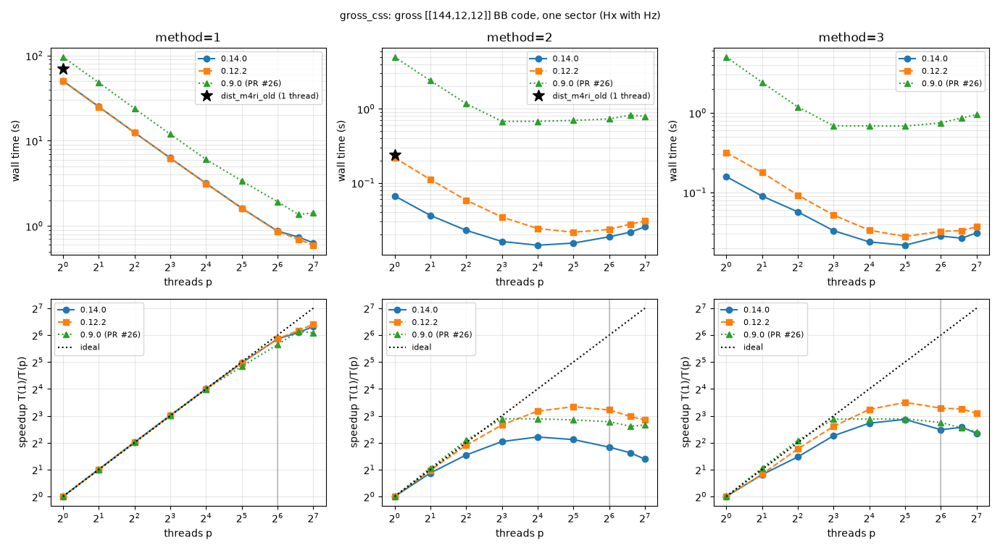
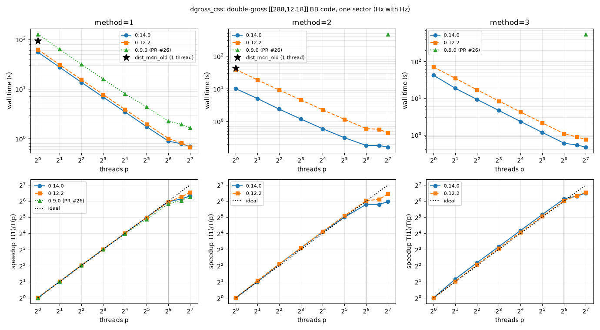
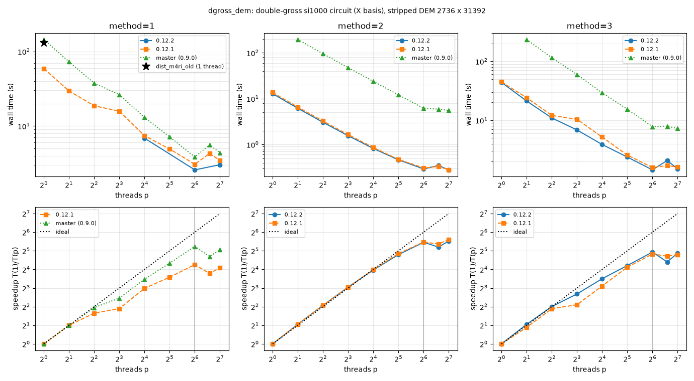
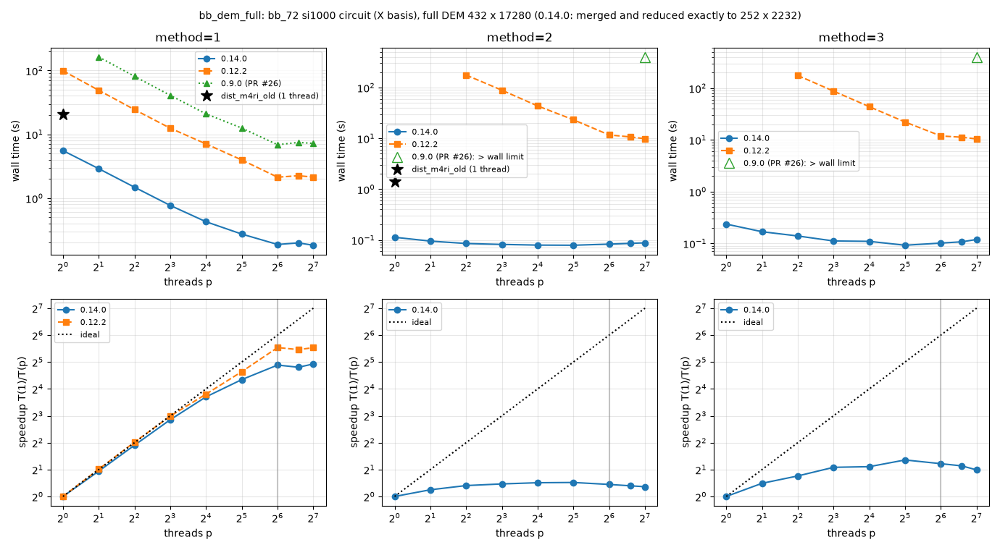

# Benchmark Suite for `dist-m4ri`

This directory contains quantum LDPC CSS parity-check matrices (`.mtx`) and Stim circuit-level fault-tolerance files
(`.stim`) spanning code distances $d = 4$ to $d \le 34$. Detector Error Models (`.dem`) can be generated on the fly from
the `.stim` circuits with `dist_m4ri.py` (noise is added to the noiseless templates with `add_noise`); since version
0.14.0, the binary reduces the full DEM of a circuit exactly (Section 3), so that its distance, the circuit-level
distance, is found as fast as that of the DEM with the minority-basis detectors stripped.

> [!NOTE]
> The distances in the file names (and in the source patterns below) are the nominal values of the sources, and they
> are not always correct; the file names are kept unchanged. The distances computed with `dist_m4ri` are listed in the
> tables below: an exact value is certified (by CC), and $[d_{\min}, d_{\max}]$ is a bracket from a run which hit the
> timeout. The values of the Mitten codes and circuits and of the full DEMs of the $X$-basis BB circuits are from the
> overnight benchmark of `dist_m4ri` 0.14.0 (128 threads, Section 5), and the brackets of the double-gross and `bb_360`
> circuits from the follow-up runs of 0.14.1 (Section 6); the values marked "(s)" are from shorter runs of earlier
> versions on the stripped DEMs, and they are provisional.

## Directory Structure

- `css/`: MatrixMarket (`.mtx`) CSS parity-check matrices (`_Hx.mtx`, `_Hz.mtx`) and canonical logical operators
  (`_Lx.mtx`, `_Lz.mtx` for Mitten codes).
- `stim_bb/`: Unmodified Bivariate Bicycle (BB), Gross, and Double-Gross `.stim` circuits from external repositories.
- `stim_mitten/`: Mitten code `.stim` circuits generated via `quits` with `CircuitBuildOptions(get_all_detectors=True)`.
- `stim_torus/`: 2D local torus Bivariate Bicycle `.stim` circuits (`d = 14` to `17`, noiseless templates).
- `figures/`: scaling of `dist_m4ri` with the number of threads on some of these codes and circuits (Section 4), and
  the time to a minimum-weight codeword in the full DEMs of the circuits (Section 5).

---

## Origins and References

1. **Bivariate Bicycle (BB), Gross (`[[144, 12, 12]]`), and Double-Gross (`[[288, 12, 18]]`) Codes**
   - **Code Construction**: S. Bravyi, A. W. Cross, J. M. Gambetta, D. Maslov, P. Rall, and T. J. Yoder,
     *High-threshold and low-overhead fault-tolerant quantum memory*, Nature **627**, 778–782 (2024), arXiv:2308.07915.
   - **Higher-Distance BB Codes (`[[360, 12, 24]]`, `[[756, 16, <=34]]`) & `si1000` Stim Circuits**:
     Copied unmodified from [`quantumlib/tesseract-decoder`](https://github.com/quantumlib/tesseract-decoder)
     (commit `e7c762eef24161e304ba6fccb856a05b41f88c39`, directory `testdata/bivariatebicyclecodes/`), associated
     with A. Beni et al., arXiv:2503.10988. These circuits use the superconducting-inspired `si1000` noise model at
     $p = 0.0001$ with $r = d$ rounds in both $X$ and $Z$ memory bases.
   - **Uniform-Noise (`uniform_circuit`) BB Stim Circuits**:
     Copied unmodified from [`trmue/relay`](https://github.com/trmue/relay)
     (commit `d185194ba0cb4101ced4340d82b2ee6d42f225f0`, directory `tests/testdata/bicycle_bivariate/`), associated
     with T. Müller et al., arXiv:2503.11514. These circuits use standard uniform circuit-level depolarizing noise at
     $p = 0.001$ with $r = d$ rounds in the $X$ memory basis.

2. **Mitten Codes (Non-Abelian Lifted-Product CSS Codes)**
   - **Code Construction & Stim Circuits**: Generated via [`mkangquantum/quits`](https://github.com/mkangquantum/quits)
     (commit `0f36b8c5a9b81d6b7be0cef2c81c61b5850c0452`), associated with *Quantum LDPC codes for modular
     architectures via lifted products over non-abelian groups*, arXiv:2607.28795.
   - Constructed as $1 \times 2$ lifted products $LP(A, B)$ over non-abelian groups $G = C_m \times S_3$ of order
     $|G| = 6m$, yielding parameters $[[5|G|, |G|, d]]$ with row weight 9 and column weight 3 or 6.
   - Circuits are generated at $p = 0.001$ (`ErrorModel(1e-3, 1e-3, 1e-3, 1e-3)`, `basis="Z"`,
     `CircuitBuildOptions(get_all_detectors=True)`) for two syndrome-extraction schedules:
     - `custom`: depth-12 interleaved mixed $X/Z$ schedule.
     - `hef` (`hook_error_free`): depth-24 group-element-layer schedule where each entangling layer is a permutation
       matching between one check block and one data block.

3. **2D Local Torus Bivariate Bicycle Stim Circuits**
   - Copied unmodified from `tmp/*.stim`. These are noiseless syndrome-extraction templates on a 2D torus with Swap/CNOT
     routing (`L3_torus`, with `CZSWAP` gates) for codes with the nominal parameters $[[60, 8, 14]]$, $[[120, 8, 15]]$,
     $[[200, 16, 16]]$, and $[[200, 8, 17]]$ (from the file names; the code distances have not been verified) in both
     $X$ and $Z$ bases. When passed to `dist_m4ri.compute_dem_distance(circuit=...)` or
     `dist_m4ri.add_noise(circuit, p=0.001)`, uniform circuit-level noise is added on the fly (`DEPOLARIZE2` after the
     two-qubit gates, including `CZSWAP` since 0.14.0, `DEPOLARIZE1` after the one-qubit gates and on idle qubits, and
     `X_ERROR`/`Z_ERROR` at resets and measurements; see the README).

---

## 1. CSS Parity-Check and Logical Matrices (`benchmark/css/`)

| Prefix | $[[n, k, d]]$ | Size ($m \times n$) | Construction / Polynomials or Group |
| :--- | :--- | :--- | :--- |
| `bb_72_12_6` | $[[72, 12, 6]]$ | $36 \times 72$ | $\ell=6, m=6$, $A=x^3+y+y^2$, $B=y^3+x+x^2$ |
| `bb_90_8_10` | $[[90, 8, 10]]$ | $45 \times 90$ | $\ell=15, m=3$, $A=x^9+y+y^2$, $B=1+x^2+x^7$ |
| `bb_108_8_10` | $[[108, 8, 10]]$ | $54 \times 108$ | $\ell=9, m=6$, $A=x^3+y+y^2$, $B=y^3+x+x^2$ |
| `gross_144_12_12` | $[[144, 12, 12]]$ | $72 \times 144$ | $\ell=12, m=6$, $A=x^3+y+y^2$, $B=y^3+x+x^2$ |
| `double_gross_288_12_18` | $[[288, 12, 18]]$ | $144 \times 288$ | $\ell=12, m=12$, $A=x^3+y^2+y^7$, $B=y^3+x+x^2$ |
| `bb_360_12_24` | $[[360, 12, \le 24]]$ | $180 \times 360$ | $\ell=30, m=6$, $A=x^9+y+y^2$, $B=y^3+x^{25}+x^{26}$ |
| `bb_756_16_34` | $[[756, 16, \le 34]]$ | $378 \times 756$ | $\ell=21, m=18, A=x^3+y^{10}+y^{17}, B=y^5+x^3+x^{19}$ |
| `mitten_90_18_6_C3xS3` | $[[90, 18, 6]]$ | $36 \times 90$ | $G = C_3 \times S_3$ ($|G|=18$, `seed=2`) |
| `mitten_150_30_8_C5xS3` | $[[150, 30, 8]]$ | $60 \times 150$ | $G = C_5 \times S_3$ ($|G|=30$, `seed=2`) |
| `mitten_210_42_8_C7xS3` | $[[210, 42, 6]]$ | $84 \times 210$ | $G = C_7 \times S_3$ ($|G|=42$, `seed=2`) |
| `mitten_270_54_10_C9xS3` | $[[270, 54, 10]]$ | $108 \times 270$ | $G = C_9 \times S_3$ ($|G|=54$, `seed=2`) |
| `mitten_330_66_6_C11xS3` | $[[330, 66, 4]]$ | $132 \times 330$ | $G = C_{11}\times S_3$ ($|G|=66$, `seed=2`) |

Distances computed with `dist_m4ri`:

| Prefix | $d_X$ | $d_Z$ |
| :--- | :--- | :--- |
| `bb_72_12_6` | 6 | 6 |
| `bb_90_8_10` | 10 | 10 |
| `bb_108_8_10` | – | 10 |
| `gross_144_12_12` | 12 | 12 |
| `double_gross_288_12_18` | 18 | 18 |
| `bb_360_12_24` | – | [18, 24] |
| `bb_756_16_34` | – | [17, 34] |
| `mitten_90_18_6_C3xS3` | 6 | 6 |
| `mitten_150_30_8_C5xS3` | 8 | 8 |
| `mitten_210_42_8_C7xS3` | **6** | 8 |
| `mitten_270_54_10_C9xS3` | 10 | 10 |
| `mitten_330_66_6_C11xS3` | **4** | 6 |

- $d_X$ ($d_Z$) is the minimum weight of an $X$-type ($Z$-type) logical operator, i.e., of a vector $c$ with
  $H_Z c = 0$ ($H_X c = 0$) which is not in the row space of $H_X$ ($H_Z$); $d = \min(d_X, d_Z)$. "–": not computed
  yet.
- For the BB codes, $d_X = d_Z$ by the symmetry exchanging the two sectors, so one sector suffices.
- `mitten_330_66_6_C11xS3` has distance **4**, not 6: $d_X = 4$ (132 $X$-type logical operators of weight 4 were
  found, and those checked independently over GF(2) are valid), while $d_Z = 6$.
- `mitten_210_42_8_C7xS3` has distance **6**, not 8: $d_X = 6$, while $d_Z = 8$.
- The Mitten distances are certified by CC (0.14.0: under 0.04 s per sector on 128 threads), and the lightest logical
  operator found in each run of the 0.12.1 benchmark passed an independent check over GF(2). Numbers of
  minimum-weight logical operators ($X$ / $Z$, enumerated by CC): 66 / 90 (`mitten_90`), 180 / 120 (`mitten_150`),
  84 / 42 (`mitten_210`), 216 / 648 (`mitten_270`), and 132 / 132 (`mitten_330`).
- For `bb_360` and `bb_756`, the published distances are upper bounds (the codewords found by `dist_m4ri` have the
  same weights), and the lower bounds are from 60 s runs.

---

## 2. Stim Circuits (`stim_bb/`, `stim_mitten/`, `stim_torus/`)

The circuit-level distances are listed in [Section 2.4](#24-circuit-level-distances).

### 2.1 Bivariate Bicycle, Gross, and Double-Gross (`benchmark/stim_bb/`)

| File (`benchmark/stim_bb/`) | Repo | Noise | $p$ | Rounds | Basis | Source Pattern |
| :--- | :--- | :--- | :--- | :--- | :--- | :--- |
| `bb_72_12_6_si1000_r6_X.stim` | `tesseract` | `si1000` | `1e-4` | 6 | `X` | `r=6,d=6,nkd=[[72,12,6]]` |
| `bb_72_12_6_si1000_r6_Z.stim` | `tesseract` | `si1000` | `1e-4` | 6 | `Z` | `r=6,d=6,nkd=[[72,12,6]]` |
| `bb_90_8_10_si1000_r10_X.stim` | `tesseract` | `si1000` | `1e-4` | 10 | `X` | `r=10,d=10,nkd=[[90,8,10]]` |
| `bb_90_8_10_si1000_r10_Z.stim` | `tesseract` | `si1000` | `1e-4` | 10 | `Z` | `r=10,d=10,nkd=[[90,8,10]]` |
| `bb_108_8_10_si1000_r10_X.stim` | `tesseract` | `si1000` | `1e-4` | 10 | `X` | `r=10,d=10,nkd=[[108,8,10]]` |
| `bb_108_8_10_si1000_r10_Z.stim` | `tesseract` | `si1000` | `1e-4` | 10 | `Z` | `r=10,d=10,nkd=[[108,8,10]]` |
| `gross_144_12_12_si1000_r12_X.stim` | `tesseract` | `si1000` | `1e-4` | 12 | `X` | `r=12,d=12,nkd=[[144,12,12]]` |
| `gross_144_12_12_si1000_r12_Z.stim` | `tesseract` | `si1000` | `1e-4` | 12 | `Z` | `r=12,d=12,nkd=[[144,12,12]]` |
| `double_gross_288_12_18_si1000_r18_X.stim` | `tesseract` | `si1000` | `1e-4` | 18 | `X` | `r=18,d=18,[[288,12,18]]` |
| `double_gross_288_12_18_si1000_r18_Z.stim` | `tesseract` | `si1000` | `1e-4` | 18 | `Z` | `r=18,d=18,[[288,12,18]]` |
| `bb_360_12_24_si1000_r24_X.stim` | `tesseract` | `si1000` | `1e-4` | 24 | `X` | `r=24,d=24,nkd=[[360,12,24]]` |
| `bb_360_12_24_si1000_r24_Z.stim` | `tesseract` | `si1000` | `1e-4` | 24 | `Z` | `r=24,d=24,nkd=[[360,12,24]]` |
| `bb_756_16_34_si1000_r34_X.stim` | `tesseract` | `si1000` | `1e-4` | 34 | `X` | `r=34,d=34,nkd=[[756,16,34]]` |
| `bb_756_16_34_si1000_r34_Z.stim` | `tesseract` | `si1000` | `1e-4` | 34 | `Z` | `r=34,d=34,nkd=[[756,16,34]]` |
| `bb_72_12_6_uniform_r6_X.stim` | `relay` | `uniform` | `1e-3` | 6 | `X` | `..._72_12_6_memory_X` |
| `gross_144_12_12_uniform_r12_X.stim` | `relay` | `uniform` | `1e-3` | 12 | `X` | `..._144_12_12_memory_X` |
| `double_gross_288_12_18_uniform_r18_X.stim` | `relay` | `uniform` | `1e-3` | 18 | `X` | `..._288_12_18_memory_X` |

### 2.2 Mitten Codes (`benchmark/stim_mitten/`)

| File (`benchmark/stim_mitten/`) | Source | Schedule | Depth | $p$ | Rounds | Basis |
| :--- | :--- | :--- | :--- | :--- | :--- | :--- |
| `mitten_90_18_6_C3xS3_custom_r4_Z.stim` | `quits` | `custom` (interleaved) | 12 | `1e-3` | 4 | `Z` |
| `mitten_90_18_6_C3xS3_hef_r4_Z.stim` | `quits` | `hook_error_free` | 24 | `1e-3` | 4 | `Z` |
| `mitten_150_30_8_C5xS3_custom_r5_Z.stim` | `quits` | `custom` (interleaved) | 12 | `1e-3` | 5 | `Z` |
| `mitten_150_30_8_C5xS3_hef_r5_Z.stim` | `quits` | `hook_error_free` | 24 | `1e-3` | 5 | `Z` |
| `mitten_210_42_8_C7xS3_custom_r4_Z.stim` | `quits` | `custom` (interleaved) | 12 | `1e-3` | 4 | `Z` |
| `mitten_210_42_8_C7xS3_hef_r4_Z.stim` | `quits` | `hook_error_free` | 24 | `1e-3` | 4 | `Z` |
| `mitten_270_54_10_C9xS3_custom_r4_Z.stim` | `quits` | `custom` (interleaved) | 12 | `1e-3` | 4 | `Z` |
| `mitten_270_54_10_C9xS3_hef_r4_Z.stim` | `quits` | `hook_error_free` | 24 | `1e-3` | 4 | `Z` |
| `mitten_330_66_6_C11xS3_custom_r4_Z.stim` | `quits` | `custom` (interleaved) | 12 | `1e-3` | 4 | `Z` |
| `mitten_330_66_6_C11xS3_hef_r4_Z.stim` | `quits` | `hook_error_free` | 24 | `1e-3` | 4 | `Z` |

The Mitten circuits are $Z$-basis memory experiments, whose logical observables are flipped by $X$-type errors; their
circuit-level distance cannot exceed the code's $d_X$, which is 6 for `mitten_210` and 4 for `mitten_330` (Section 1).

### 2.3 2D Local Torus BB Circuits (`benchmark/stim_torus/`)

| File (`benchmark/stim_torus/`) | Nominal $[[n, k, d]]$ | Basis | Notes |
| :--- | :--- | :--- | :--- |
| `NNEESEEESEENN_L3_torus_s1_NW_w10p_s2_SW_w6p_n60_k8_d14_X.stim` | $[[60, 8, 14]]$ | `X` | Noiseless (`tmp/`) |
| `NNEESEEESEENN_L3_torus_s1_NW_w10p_s2_SW_w6p_n60_k8_d14_Z.stim` | $[[60, 8, 14]]$ | `Z` | Noiseless (`tmp/`) |
| `NEENNWNWNNEEN_L3_torus_s1_NW_w10p_s2_SW_w12p_n120_k8_d15_X.stim` | $[[120, 8, 15]]$ | `X` | Noiseless (`tmp/`) |
| `NEENNWNWNNEEN_L3_torus_s1_NW_w10p_s2_SW_w12p_n120_k8_d15_Z.stim` | $[[120, 8, 15]]$ | `Z` | Noiseless (`tmp/`) |
| `NEENNWNWNNEEN_L3_torus_s1_NW_w10p_s2_SW_w20p_n200_k16_d16_X.stim` | $[[200, 16, 16]]$ | `X` | Noiseless (`tmp/`) |
| `NEENNWNWNNEEN_L3_torus_s1_NW_w10p_s2_SW_w20p_n200_k16_d16_Z.stim` | $[[200, 16, 16]]$ | `Z` | Noiseless (`tmp/`) |
| `ENENESESENENE_L3_torus_s1_NW_w10p_s2_SW_w20p_n200_k8_d17_X.stim` | $[[200, 8, 17]]$ | `X` | Noiseless (`tmp/`) |
| `ENENESESENENE_L3_torus_s1_NW_w10p_s2_SW_w20p_n200_k8_d17_Z.stim` | $[[200, 8, 17]]$ | `Z` | Noiseless (`tmp/`) |

The nominal code parameters are taken from the file names; the code distances of the torus codes have not been
verified yet (no check matrices are included).

### 2.4 Circuit-Level Distances

The circuit-level distance is the minimum number of faults (error mechanisms of the DEM) which cause an undetectable
logical error, i.e., the distance of the full DEM (all detectors).
- Values without a mark: the full DEM, computed by `dist_m4ri` 0.14.0 in the overnight benchmark (Section 5;
  `method=3`, 128 threads), which drops the minority-basis detectors exactly (Section 3). An exact value is certified
  by CC: in under 6 s, except 179 s for `gross` and 182 s for `mitten_270 custom`.
- The brackets of `double_gross` and `bb_360` are from Section 6: the lower bounds are certified with a code-sized model
  of the circuit (Section 6.3), and the upper bounds are codewords of the full DEM found by RW (Sections 6.1, 6.2).
- (s): the stripped DEM (minority-basis detectors removed), computed by earlier versions in 30 s `method=3` runs on 16
  threads. The stripped DEM keeps a subset of the detectors, so its distance is a lower bound on the circuit distance
  (for a bracket, only its lower end applies to the circuit).
- For the noiseless torus templates, the noise of `add_noise(p=0.001)` is added; the circuit distance depends on the
  noise model (which faults are included), but not on $p$. Since 0.14.0, `add_noise` also adds `DEPOLARIZE2` after
  `CZSWAP`, which these circuits use for routing: the values marked "old noise" are for the noise of the earlier
  versions (no noise after `CZSWAP`), and the distance with the current noise can be lower (it is the same, 6, for
  `n60` in the $X$ basis).
- "–": not computed yet; "n/a": no circuit for this basis.

| Circuit (`.stim` file name without `_X`/`_Z`) | $X$ basis | $Z$ basis |
| :--- | :--- | :--- |
| `bb_72_12_6_si1000_r6` | 6 | 6 (s) |
| `bb_90_8_10_si1000_r10` | 8 | – |
| `bb_108_8_10_si1000_r10` | 8 | – |
| `gross_144_12_12_si1000_r12` | 10 | – |
| `double_gross_288_12_18_si1000_r18` | [12, 18] | – |
| `bb_360_12_24_si1000_r24` | [12, 23] | – |
| `bb_756_16_34_si1000_r34` | – | – |
| `bb_72_12_6_uniform_r6` | 6 (s) | n/a |
| `gross_144_12_12_uniform_r12` | [7, 11] (s) | n/a |
| `double_gross_288_12_18_uniform_r18` | – | n/a |
| `mitten_90_18_6_C3xS3_custom_r4` | n/a | 5 |
| `mitten_90_18_6_C3xS3_hef_r4` | n/a | 4 |
| `mitten_150_30_8_C5xS3_custom_r5` | n/a | 7 |
| `mitten_150_30_8_C5xS3_hef_r5` | n/a | 5 |
| `mitten_210_42_8_C7xS3_custom_r4` | n/a | 6 |
| `mitten_210_42_8_C7xS3_hef_r4` | n/a | 5 |
| `mitten_270_54_10_C9xS3_custom_r4` | n/a | 9 |
| `mitten_270_54_10_C9xS3_hef_r4` | n/a | 7 |
| `mitten_330_66_6_C11xS3_custom_r4` | n/a | 4 |
| `mitten_330_66_6_C11xS3_hef_r4` | n/a | 4 |
| `NNEESEEESEENN_L3_torus_..._n60_k8_d14` | 6 | 6 (s, old noise) |
| `NEENNWNWNNEEN_L3_torus_..._n120_k8_d15` | 6 (s, old noise) | – |
| `NEENNWNWNNEEN_L3_torus_..._n200_k16_d16` | [6, 8] (s, old noise) | – |
| `ENENESESENENE_L3_torus_..._n200_k8_d17` | [6, 8] (s, old noise) | – |

The circuit-level distances are often below the code distances in the file names. For example, the gross-code circuit
has distance 10, consistent with the circuit-level distance $\le 10$ reported for the IBM syndrome-extraction circuit,
and the BB circuits with $d = 10$ have distance 8. For the Mitten codes, the "hook-error-free" schedule has a lower
circuit-level distance than the `custom` schedule (4 vs 5, 5 vs 7, 5 vs 6, and 7 vs 9 for `mitten_90`, `mitten_150`,
`mitten_210`, and `mitten_270`; 4 with both schedules for `mitten_330`). The `custom` schedule reaches the code's $d_X$
for `mitten_210` (6) and `mitten_330` (4), and $d_X - 1$ for `mitten_90`, `mitten_150`, and `mitten_270`.

---

## 3. Full DEMs and Their Exact Reduction

In circuit-level noise models using `DEPOLARIZE2(p)`, cross-term two-qubit Pauli errors (such as $X \otimes Z$,
$Y \otimes X$, $Y \otimes Z$, $Y \otimes Y$) occur with probability $p/15 = O(p)$, the same order as single-type errors
($X \otimes X$ or $Z \otimes Z$). Consequently, the full DEM couples $X$-detectors and $Z$-detectors into a single
large parity-check matrix with 6–8 times more distinct error columns than a single-basis projection. Since version
0.14.0, `dist_m4ri` merges the equal columns of a DEM and drops detectors when this is verified to be exact
(`drop=auto`, the default; see "Dropping DEM Detectors" in the README): for every circuit below, it finds exactly the
minority-basis detectors, and the matrix searched is the stripped DEM with its equal columns merged (the search for
the detectors to drop takes 0.02–0.4 s, and 1.2 s for `bb_756`). Hence the distance of the full DEM, the
circuit-level distance, is found as fast as that of the stripped DEM, which is only a lower bound on it.

To avoid storing large pre-generated `.dem` files in the repository, DEMs can be generated on the fly from the `.stim`
files (noise of strength `p_noise=0.001` is added to the noiseless templates; `--force-noise` replaces the noise of a
circuit by this uniform noise):
```python
import dist_m4ri

# the full DEM of the circuit, reduced exactly by the binary; also save the reduced DEM and its maps to the full one
dist, bounds = dist_m4ri.compute_dem_distance(
    circuit="benchmark/stim_torus/NNEESEEESEENN_L3_torus_s1_NW_w10p_s2_SW_w6p_n60_k8_d14_X.stim",
    out_dem="tmp/torus_n60_X_full.dem", out_reduced="tmp/torus_n60_X")  # tmp/torus_n60_X_red.dem, _red.json
```

| Stim circuit | Basis | Full (dets x errs) | Stripped | Searched (0.14.0) | $k$ |
| :--- | :--- | :--- | :--- | :--- | :--- |
| `mitten_90_18_6_C3xS3_custom_r4_Z` | `Z` | 360 x 23,394 | 216 x 3,330 | 216 x 2,970 | 18 |
| `mitten_90_18_6_C3xS3_hef_r4_Z` | `Z` | 360 x 22,410 | 216 x 3,330 | 216 x 2,970 | 18 |
| `mitten_150_30_8_C5xS3_custom_r5_Z` | `Z` | 720 x 47,700 | 420 x 6,660 | 420 x 5,910 | 30 |
| `mitten_150_30_8_C5xS3_hef_r5_Z` | `Z` | 720 x 46,130 | 420 x 6,660 | 420 x 5,910 | 30 |
| `mitten_210_42_8_C7xS3_custom_r4_Z` | `Z` | 840 x 54,726 | 504 x 7,770 | 504 x 6,930 | 42 |
| `mitten_210_42_8_C7xS3_hef_r4_Z` | `Z` | 840 x 52,437 | 504 x 7,665 | 504 x 6,825 | 42 |
| `mitten_270_54_10_C9xS3_custom_r4_Z` | `Z` | 1,080 x 70,254 | 648 x 9,990 | 648 x 8,910 | 54 |
| `mitten_270_54_10_C9xS3_hef_r4_Z` | `Z` | 1,080 x 67,482 | 648 x 9,990 | 648 x 8,910 | 54 |
| `mitten_330_66_6_C11xS3_custom_r4_Z` | `Z` | 1,320 x 85,932 | 792 x 12,210 | 792 x 10,890 | 66 |
| `mitten_330_66_6_C11xS3_hef_r4_Z` | `Z` | 1,320 x 81,642 | 792 x 11,880 | 792 x 10,560 | 66 |
| `bb_72_12_6_si1000_r6_X` | `X` | 432 x 17,280 | 252 x 2,664 | 252 x 2,232 | 12 |
| `bb_72_12_6_si1000_r6_Z` | `Z` | 432 x 17,244 | 252 x 2,664 | 252 x 2,232 | 12 |
| `bb_90_8_10_si1000_r10_X` | `X` | 900 x 37,440 | 495 x 5,490 | 495 x 4,590 | 8 |
| `bb_90_8_10_si1000_r10_Z` | `Z` | 900 x 37,395 | 495 x 5,490 | 495 x 4,590 | 8 |
| `bb_108_8_10_si1000_r10_X` | `X` | 1,080 x 44,928 | 594 x 6,588 | 594 x 5,508 | 8 |
| `bb_108_8_10_si1000_r10_Z` | `Z` | 1,080 x 44,874 | 594 x 6,588 | 594 x 5,508 | 8 |
| `gross_144_12_12_si1000_r12_X` | `X` | 1,728 x 72,576 | 936 x 10,512 | 936 x 8,784 | 12 |
| `gross_144_12_12_si1000_r12_Z` | `Z` | 1,728 x 72,504 | 936 x 10,512 | 936 x 8,784 | 12 |
| `double_gross_288_12_18_si1000_r18_X` | `X` | 5,184 x 221,184 | 2,736 x 31,392 | 2,736 x 26,208 | 12 |
| `double_gross_288_12_18_si1000_r18_Z` | `Z` | 5,184 x 221,040 | 2,736 x 31,392 | 2,736 x 26,208 | 12 |
| `bb_360_12_24_si1000_r24_X` | `X` | 8,640 x 371,520 | 4,500 x 52,200 | 4,500 x 43,560 | 12 |
| `bb_360_12_24_si1000_r24_Z` | `Z` | 8,640 x 371,340 | 4,500 x 52,200 | 4,500 x 43,560 | 12 |
| `bb_756_16_34_si1000_r34_X` | `X` | 25,704 x 1,112,832 | 13,230 x 154,980 | 13,230 x 129,276 | 16 |
| `bb_756_16_34_si1000_r34_Z` | `Z` | 25,704 x 1,112,454 | 13,230 x 154,980 | 13,230 x 129,276 | 16 |
| `bb_72_12_6_uniform_r6_X` | `X` | 432 x 16,200 | 252 x 2,232 | 252 x 2,232 | 12 |
| `gross_144_12_12_uniform_r12_X` | `X` | 1,728 x 67,824 | 936 x 8,784 | 936 x 8,784 | 12 |
| `double_gross_288_12_18_uniform_r18_X` | `X` | 5,184 x 206,496 | 2,736 x 26,208 | 2,736 x 26,208 | 12 |
| `NNEESEEESEENN_..._n60_k8_d14_X` | `X` | 120 x 10,710 | 90 x 1,500 | 90 x 1,500 | 8 |
| `NNEESEEESEENN_..._n60_k8_d14_Z` | `Z` | 120 x 10,710 | 90 x 1,500 | 90 x 1,500 | 8 |
| `NEENNWNWNNEEN_..._n120_k8_d15_X` | `X` | 240 x 21,120 | 180 x 3,000 | 180 x 3,000 | 8 |
| `NEENNWNWNNEEN_..._n120_k8_d15_Z` | `Z` | 240 x 21,120 | 180 x 3,000 | 180 x 3,000 | 8 |
| `NEENNWNWNNEEN_..._n200_k16_d16_X` | `X` | 400 x 35,200 | 300 x 5,000 | 300 x 5,000 | 16 |
| `NEENNWNWNNEEN_..._n200_k16_d16_Z` | `Z` | 400 x 35,200 | 300 x 5,000 | 300 x 5,000 | 16 |
| `ENENESESENENE_..._n200_k8_d17_X` | `X` | 400 x 29,200 | 300 x 4,800 | 300 x 4,800 | 8 |
| `ENENESESENENE_..._n200_k8_d17_Z` | `Z` | 400 x 29,200 | 300 x 4,800 | 300 x 4,800 | 8 |

The sizes are those of the DEMs generated by `dist_m4ri.py` 0.14.0 (stim 1.16; the torus templates with the noise of
`add_noise`, which since 0.14.0 includes `DEPOLARIZE2` after `CZSWAP`: their full DEMs have about twice as many columns
as with the noise of the earlier versions, and the same stripped DEMs). The full DEMs of the `si1000` and Mitten
circuits have 5–7% equal columns, and their stripped DEMs 11–16% (merged by the binary); the DEMs of the uniform-noise
circuits and of the torus templates have none.

---

## 4. Scaling with the Number of Threads (`benchmark/figures/`)

Wall time and speedup $T(1)/T(p)$ of `dist_m4ri` for $p = 1, \dots, 128$ threads on a two-socket AMD EPYC 7B13 server
(2 x 32 cores, 128 logical CPUs with SMT, 236 GB of memory), with `nothrottle=1`, `threads=p`, and `taskset` to the
logical CPUs $0..p-1$ (socket 0 first, then socket 1, then the SMT siblings for $p > 64$; the gray line marks $p = 64$,
one thread per physical core). Each run does a fixed amount of work: `method=1` a fixed number of RW `steps` with
`min_hits=0`, `method=2` all CC rounds up to `wmax`, and `method=3` both (or, with the default parameters, the search
for the exact distance). Versions (Section 5): 0.14.0, 0.12.2, 0.9.0 (pull request #26), and the legacy
single-threaded `dist_m4ri_old` (one thread; built from the 0.14.0 sources, so that it shares the input stage, e.g.,
the merging of equal columns and the dropping of detectors of a DEM). The runs of 0.9.0 were limited to 600 s per case
and method (both older versions: 400 s on the full DEM), from many threads to few, so that some of the runs with few
threads are missing; an open marker is a run stopped at the wall-clock limit. The times include reading the input
(median of repeated runs for the fast cases).



**gross** $[[144, 12, 12]]$, one sector (`css/gross_144_12_12_Hx.mtx` with `_Hz.mtx`; `method=1`: `steps=3000000`,
`method=2`: `wmax=11`, `method=3`: default parameters). RW takes 50 s on one thread (as in 0.12.2; 0.9.0: 96 s) and
scales almost linearly up to 64 threads (58x); the SMT siblings add another 40% (80x at 128 threads). CC up to $w = 11$
takes 0.067 s on one thread, 3.3x less than 0.12.2 and 75x less than 0.9.0; beyond 8–16 threads, the run (15–25 ms) is
limited by the start-up of the threads.



**double-gross** $[[288, 12, 18]]$, one sector (`steps=1000000`; `wmax=15`; `steps=500000 wmax=15`). RW scales to 80x
at 128 threads (55 s on one thread; 0.9.0: 127 s). CC up to $w = 15$ takes 10 s on one thread, 3.9x less than 0.12.2
(the last cluster extension is now looked up in a hash table), and 0.16 s on 128 threads (speedup 62); 0.9.0 needs
472 s for this CC run on 128 threads. `method=3`: 0.46 s on 128 threads (0.12.2: 0.75 s; 0.9.0: 551 s).



**double-gross circuit** (`stim_bb/double_gross_288_12_18_si1000_r18_X.stim`, stripped DEM $2736 \times 31392$, merged
to 26208 columns by 0.14.0; `steps=300`; `wmax=5`; `steps=150 wmax=5`). RW takes 20.7 s on one thread, 2.8x less than
0.12.2 (1.2x from merging the equal columns, 2.3x from the faster RW elimination on large matrices); on this large
matrix it is limited by the memory bandwidth (dense copies of $H$ and $H^T$ per thread), at most about 15–20x, at 64
threads on both sockets, and the SMT siblings of socket 0 ($p = 96$) make it slower. CC up to $w = 5$ takes 0.61 s on
one thread, 21x less than 0.12.2 (1.8x from merging, 11x from the faster CC), and 0.12–0.15 s from 16 threads on.



**bb_72 circuit, full DEM** (`stim_bb/bb_72_12_6_si1000_r6_X.stim`, $432 \times 17280$; `steps=20000`; `wmax=5`;
default parameters, i.e., the exact distance 6). 0.14.0 reduces the full DEM exactly to $252 \times 2232$ (the stripped
DEM, merged): RW takes 5.6 s on one thread instead of 99 s (0.12.2) and 163 s (0.9.0, two threads), and 0.18 s on 128
threads instead of 2.1 s and 7.2 s. CC up to $w = 5$ takes 0.11 s on one thread, against 176 s for 0.12.2 on four
threads and more than 400 s for 0.9.0 on 128 threads; on 128 threads, 0.088 s against 9.8 s for 0.12.2 (112x). The
reduced problem is so small that more threads hardly help CC (0.08–0.11 s); the exact distance takes 0.09–0.24 s.

---

## 5. Overnight Benchmark of 0.14.0 (2026-10-11)

Versions: 0.14.0 (commit `40faf58`), 0.12.2 (`528f35f`, the version of the previous benchmark), and 0.9.0 (`1f46277`,
pull request #26, 2026-09-18), on the server of Section 4. All versions read the same DEM files (the components of
decomposed errors summed mod 2, so that the older DEM readers read the same matrices), identical to the inputs of the
previous benchmark of 0.12.1; 1547 runs in 7 h, plus 40 runs of the ablation (Section 5.5). The scaling runs are in
Section 4.

### 5.1 Certified circuit distances (0.14.0, full DEMs, `method=3`, 128 threads)

| Circuit | full DEM | searched | $d$ | time (s) | 0.12.1: stripped DEM |
| :--- | :--- | :--- | :---: | ---: | :--- |
| `mitten_90_18_6_C3xS3_custom_r4_Z` | 360 x 23394 | 216 x 2970 | 5 | 0.18 | 5 in 0.06 s |
| `mitten_90_18_6_C3xS3_hef_r4_Z` | 360 x 22410 | 216 x 2970 | 4 | 0.18 | 4 in 0.05 s |
| `mitten_150_30_8_C5xS3_custom_r5_Z` | 720 x 47700 | 420 x 5910 | 7 | 0.56 | 7 in 8.0 s |
| `mitten_150_30_8_C5xS3_hef_r5_Z` | 720 x 46130 | 420 x 5910 | 5 | 0.40 | 5 in 0.15 s |
| `mitten_210_42_8_C7xS3_custom_r4_Z` | 840 x 54726 | 504 x 6930 | 6 | 0.48 | 6 in 0.48 s |
| `mitten_210_42_8_C7xS3_hef_r4_Z` | 840 x 52437 | 504 x 6825 | 5 | 0.50 | 5 in 0.17 s |
| `mitten_270_54_10_C9xS3_custom_r4_Z` | 1080 x 70254 | 648 x 8910 | 9 | 182 | 9 in 7700 s |
| `mitten_270_54_10_C9xS3_hef_r4_Z` | 1080 x 67482 | 648 x 8910 | 7 | 5.8 | 7 in 184 s |
| `mitten_330_66_6_C11xS3_custom_r4_Z` | 1320 x 85932 | 792 x 10890 | 4 | 0.70 | 4 in 0.22 s |
| `mitten_330_66_6_C11xS3_hef_r4_Z` | 1320 x 81642 | 792 x 10560 | 4 | 0.76 | 4 in 0.21 s |
| `bb_72_12_6_si1000_r6_X` | 432 x 17280 | 252 x 2232 | 6 | 0.11 | |
| `bb_90_8_10_si1000_r10_X` | 900 x 37440 | 495 x 4590 | 8 | 0.68 | |
| `bb_108_8_10_si1000_r10_X` | 1080 x 44928 | 594 x 5508 | 8 | 0.71 | |
| `gross_144_12_12_si1000_r12_X` | 1728 x 72576 | 936 x 8784 | 10 | 179 | |
| `double_gross_288_12_18_si1000_r18_X` | 5184 x 221184 | 2736 x 26208 | [11, 19] | 10211 | |
| `NNEESEEESEENN_..._n60_k8_d14_X` | 120 x 10710 | 90 x 1500 | 6 | 0.15 | |

- All ten Mitten distances are now certified on the full DEMs. `mitten_270 custom` took 182 s, against 7700 s for the
  stripped DEM with 0.12.1, when its full DEM could not be certified at all (CC on its 70254 columns did not close the
  bracket $[9, 10]$ in 2.8 h).
- The double-gross circuit: CC certified $d_{\min} = 11$ (all rounds up to $w = 10$) and RW found a codeword of weight
  19; the run ended at 2.8 h, since the CC round $w = 11$ was predicted not to finish in the time left. The earlier
  brackets were $[4, 24]$ for the stripped DEM and $[4, 53]$ for the full one. Section 6 improves the bracket to
  $[12, 18]$.

### 5.2 Full DEMs: time to a codeword of the minimum weight

The time of RW (`method=1`, `wmin=d`: the run stops at the first codeword of weight at most $d$; 128 threads,
`nothrottle=1`, timeout 300 s) on the full DEMs: 0.14.0 reduces them exactly, the older versions work on the full
matrices. "> 300 (w)": no codeword of weight $d$ found, $w$ is the lightest weight found.


| Circuit | $d$ | full DEM | 0.14.0 | 0.12.2 | 0.9.0 |
| :--- | :---: | :--- | ---: | ---: | ---: |
| `bb_72_12_6_si1000_r6_X` | 6 | 432 x 17280 | 0.089 | 0.13 | 0.32 |
| `mitten_90_18_6_C3xS3_custom_r4_Z` | 5 | 360 x 23394 | 0.16 | 0.21 | 0.44 |
| `mitten_90_18_6_C3xS3_hef_r4_Z` | 4 | 360 x 22410 | 0.17 | 0.23 | 0.44 |
| `mitten_150_30_8_C5xS3_custom_r5_Z` | 7 | 720 x 47700 | 0.36 | 52.3 | > 300 (13) |
| `mitten_150_30_8_C5xS3_hef_r5_Z` | 5 | 720 x 46130 | 0.39 | 0.84 | 44.8 |
| `mitten_210_42_8_C7xS3_custom_r4_Z` | 6 | 840 x 54726 | 0.42 | 0.84 | 37.2 |
| `mitten_210_42_8_C7xS3_hef_r4_Z` | 5 | 840 x 52437 | 0.47 | 6.77 | 8.60 |
| `mitten_270_54_10_C9xS3_custom_r4_Z` | 9 | 1080 x 70254 | 1.36 | > 300 (10) | > 300 (307) |
| `mitten_270_54_10_C9xS3_hef_r4_Z` | 7 | 1080 x 67482 | 1.12 | > 300 (8) | > 300 (197) |
| `mitten_330_66_6_C11xS3_custom_r4_Z` | 4 | 1320 x 85932 | 0.73 | 2.11 | 2.31 |
| `mitten_330_66_6_C11xS3_hef_r4_Z` | 4 | 1320 x 81642 | 0.73 | 2.15 | 2.10 |

0.14.0 finds a minimum-weight codeword in at most 1.4 s for all eleven circuits (including reading the DEM and the
reduction); 0.12.2 needs up to 52 s and finds none for the two `mitten_270` circuits in 300 s, and 0.9.0 misses three.
The reduction makes each RW step cheaper (about 8 times fewer columns, and lighter ones) and much more likely to find a
codeword of weight $w$: the probability that an information set contains one scales roughly as $(r/n)^{w-1}$ (rank
$r$, $n$ columns).

### 5.3 Default parameters (no `threads=`, throttling on, no `taskset`)

Wall time in s (median of the repeated runs for the fast cases); the arguments are those of the scaling runs
(Section 4).

| case | method | 0.14.0 | 0.12.2 | 0.9.0 |
| :--- | :---: | ---: | ---: | ---: |
| `QX150` $[[150,32,6]]$, one sector | 1 | 0.54 | 0.53 | 21.3 |
| | 2 | 0.006 | 0.006 | 0.006 |
| | 3 | 0.017 | 0.017 | 0.012 |
| `c204H` $[204,102,8]$ | 1 | 0.49 | 0.46 | 18.8 |
| | 2 | 0.007 | 0.009 | 0.039 |
| | 3 | 0.018 | 0.018 | 0.034 |
| `bb_72` circuit, stripped DEM | 1 | 0.85 | 0.92 | 7.40 |
| | 2 | 0.025 | 0.039 | 0.29 |
| | 3 | 0.053 | 0.092 | 0.38 |
| `bb_72` circuit, full DEM | 1 | 0.19 | 2.21 | 6.69 |
| | 2 | 0.095 | 9.57 | > 400 |
| | 3 | 0.12 | 10.3 | > 400 |
| gross, one sector | 1 | 0.66 | 0.65 | 23.9 |
| | 2 | 0.028 | 0.033 | 1.15 |
| | 3 | 0.031 | 0.038 | 1.17 |
| double gross, one sector | 1 | 0.76 | 0.76 | 31.9 |
| | 2 | 0.16 | 0.48 | 1021 |
| | 3 | 0.47 | 0.76 | 1051 |
| random LDPC, $n = 3000$ | 1 | 0.49 | 1.13 | 1.66 |
| | 2 | 0.13 | 0.29 | 16.2 |
| | 3 | 0.40 | 0.88 | 4.34 |
| double-gross circuit, stripped DEM | 1 | 1.49 | 3.65 | 7.54 |
| | 2 | 0.15 | 0.28 | 11.9 |
| | 3 | 1.45 | 2.87 | 30.3 |

With the default parameters, 0.9.0 uses at most four threads for the small codes (hence the slow RW), and its CC is up
to 6000 times slower (double gross: 17 min instead of 0.16 s). Compared with 0.12.2, 0.14.0 has the same RW speed on
the small matrices, and it is 2.3–2.5 times faster on the large ones (the LDPC code, the double-gross DEM), 1.2–3 times
faster in CC, and 12–100 times faster on the full DEM.

### 5.4 Large full DEMs (RW for 180 s, default parameters)

| DEM | version | read | searched | drop=auto (s) | RW threads | s/step/thread | RW steps | lightest |
| :--- | :--- | :--- | :--- | ---: | ---: | ---: | ---: | ---: |
| `gross_144_12_12_si1000_r12_X` | 0.14.0 | 1728 x 72576 | 936 x 8784 | 0.07 | 128 | 0.010 | 2,216,685 | 10 |
| `gross_144_12_12_si1000_r12_X` | 0.12.2 | 1728 x 72576 | 1728 x 72576 | | 32 | 0.70 | 8,223 | 11 |
| `bb_360_12_24_si1000_r24_X` | 0.14.0 | 8640 x 371520 | 4500 x 43560 | 0.44 | 32 | 0.80 | 7,179 | 25 |
| `bb_756_16_34_si1000_r34_Z` | 0.14.0 | 25704 x 1112454 | 13230 x 129276 | 1.75 | 3 | 11.3 | 46 | 58 |

- On the gross circuit, a RW step of 0.14.0 is 67 times faster, and all 128 threads are used (the dense RW working
  memory of the full matrix limits 0.12.2 to 32 threads): 270 times more steps in 180 s, and a codeword of the minimum
  weight 10.
- For `bb_360`, the codeword of weight 25 is an upper bound on the circuit distance (Section 2.4); Section 6.1 found
  one of weight 23.
- For `bb_756`, the memory throttle (dense RW working memory capped at about 1.5 GB) allows only 3 RW threads on the
  reduced matrix ($13230 \times 129276$, about 0.4 GB per thread); on this 236 GB server, `nothrottle=1` would run
  128 threads (about 55 GB). With 32–64 RW threads, RW runs 6.7–7.4 times more steps per second (Section 6.1); 0.14.3
  runs 32 RW threads by default (Section 7.1).

### 5.5 Where the speedups come from

0.14.0 with `merge=0 drop=0` (neither merging nor dropping) and with `drop=0` (merging only), against its default
(both) and 0.12.2, on the DEM cases of Section 4 (wall time in s; "–": not run, from the budget of 0.12.2, which took
176 s on four threads).

| case | method | $p$ | `merge=0 drop=0` | `drop=0` | default | 0.12.2 |
| :--- | :---: | ---: | ---: | ---: | ---: | ---: |
| `bb_72` circuit, stripped DEM | 1 | 1 | 61.2 | | 59.9 | 58.2 |
| | 1 | 128 | 0.99 | | 0.89 | 0.93 |
| | 2 | 1 | 0.094 | | 0.051 | 1.12 |
| | 2 | 128 | 0.027 | | 0.026 | 0.042 |
| `bb_72` circuit, full DEM | 1 | 1 | 48.8 | 45.7 | 5.56 | 98.9 |
| | 1 | 128 | 1.21 | 1.20 | 0.18 | 2.14 |
| | 2 | 1 | 28.8 | 21.7 | 0.11 | – |
| | 2 | 128 | 0.38 | 0.32 | 0.088 | 9.84 |
| double-gross circuit, stripped DEM | 1 | 1 | 25.5 | | 20.7 | 58.9 |
| | 1 | 128 | 1.61 | | 1.40 | 3.27 |
| | 2 | 1 | 1.13 | | 0.61 | 12.7 |
| | 2 | 128 | 0.14 | | 0.15 | 0.27 |

- The faster CC of 0.12.3 (the last cluster extension is looked up in a hash table): 3.3–3.9 times on the CSS codes
  and the LDPC code, 11–12 times on the stripped DEMs, and about 25 times on the full `bb_72` DEM (estimated from the
  four-thread run of 0.12.2); one thread.
- The faster RW of 0.12.3 on large matrices: 2.0–2.3 times (the LDPC code, the double-gross DEM, the full `bb_72`
  DEM); unchanged on small matrices.
- Merging the equal columns (0.12.4): 1.0–1.2 times for RW, and 1.3–1.9 times for CC.
- Dropping detectors (`drop=auto`, 0.14.0): 8 times for RW and 190 times for CC on the full `bb_72` DEM (one thread).

The legacy `dist_m4ri_old` (one thread, built from the 0.14.0 sources) took, for the RW runs of Section 4, 66.5 s
(`QX150`), 47.7 s (`c204H`), 203 s (`bb_72` stripped), 20.5 s (`bb_72` full, reduced), 69 s (gross), 92 s (double
gross), 71 s (LDPC), and 85 s (double-gross DEM).

---

## 6. Follow-up Runs of 0.14.1 (2026-10-14)

`dist_m4ri` 0.14.1 (commit `68e5e02`), on the server of Section 4, with the full DEMs of Section 5. RW runs use the
reduced DEMs (`drop=auto`, the default) and `min_hits=0`.

### 6.1 RW threads for the largest DEMs

RW steps per second against the number of RW threads (`method=1`, timeout 90 s for `bb_360` and 150 s for `bb_756`,
`nothrottle=1 threads=N`; "default": the throttled run).

| DEM | searched | dense RW memory per thread | RW threads | RW steps/s | s/step/thread |
| :--- | :--- | ---: | :--- | :--- | :--- |
| `bb_360_12_24_si1000_r24_X` | 4500 x 43560 | 49 MB | default (32) | 45.2 | 0.70 |
| | | | 8 / 16 / 32 | 14.9 / 31.1 / 45.3 | 0.54 / 0.51 / 0.70 |
| | | | 64 / 128 | 42.1 / 33.9 | 1.50 / 3.58 |
| `bb_756_16_34_si1000_r34_Z` | 13230 x 129276 | 0.43 GB | default (3) | 0.23 | 12.2 |
| | | | 8 / 16 / 32 | 0.63 / 1.12 / 1.57 | 12.0 / 13.4 / 18.8 |
| | | | 64 / 128 | 1.72 / 1.57 | 31.0 / 49.4 |

- The throughput peaks at 32 RW threads for `bb_360`, the number the throttle allows, and at 32–64 threads for
  `bb_756`, where the throttle allows only 3: the memory bus saturates at 32–64 threads whatever the size of the matrix.
- The run of `bb_360` on 16 threads found a codeword of weight **23** (seed 20261014); a second run with the same
  arguments (150 s) found weight 23 again. The upper bound was 25.

### 6.2 RW windows on the gross and double-gross DEMs

RW with the column permutations of each step from:
- **hybrid**: the default of 0.14.1 (`kwin=0`), an index window of $\min(512, 3n/4)$ columns on every other step
  (0.14.3: 256 columns for a DEM, Section 7.2);
- **uniform**: uniform permutations only (`kwin` at least $n$);
- **idx1**, **idx2**: an index window of about one or two rounds of columns on every step (`kwin=1456` or `kwin=2912`
  for double gross, 732 or 1464 for gross, with `win_mode=1`);
- **bfs1**: a Tanner-graph ball of about one round on every step (`win_mode=0`).

| case | hybrid | uniform | idx1 | idx2 | bfs1 |
| :--- | :--- | :--- | :--- | :--- | :--- |
| gross: steps to weight 10 | 2.6k, 4.1k, 7.9k | 12k, 20k, 26k | 0.7k, 2.0k, 6.6k | 4.2k, 4.6k, 17k | 4.6k, 5.2k, 14k |
| double gross: lightest in 120 s | 20, **18** | 36, 31 | **18**, **18** | **18**, **18** | 24, 26 |

- gross: three seeds, 128 threads; double gross: two seeds, 32 RW threads (the default).
- On gross, every configuration finds a codeword of the minimum weight 10 in under 3 s; the window steps need 4–10
  times fewer steps than uniform ones.
- On double gross, uniform steps are hopeless, index windows of one or two rounds found weight **18** in all four runs
  (the upper bound was 19), the default hybrid in one of two, and Tanner-graph balls are much worse than the index
  windows (time slabs).
- A run with `kwin=1456 win_mode=1` for 180 s found three distinct codewords of weight 18. They consist of errors of the
  final data measurements (the last error mechanisms of the DEM), i.e., a logical operator of the code (distance 18) at
  the time boundary.

### 6.3 Certified lower bounds from a code-sized model

For a memory circuit, a certified lower bound needs no CC on the DEM:
1. The checks of the measured basis are read from the detectors after the final data measurement: the final data
   measurements in such a detector give the support of a check.
2. One observable per check is added to the circuit: the parity of the final data measurements on its support. It is
   deterministic, and it is flipped by an error mechanism iff the net effect of the error on the data anticommutes with
   the check.
3. The rows $O$ of these observables in the DEM are verified to lie in the row space of the detector matrix $H$:
   $\mathrm{rank}([H; O]) = \mathrm{rank}(H)$. Then every codeword $x$ of the DEM ($Hx = 0$, $Lx \neq 0$) gives a
   codeword of the model $(O, L)$ (equal columns merged) of weight at most $|x|$.
4. The distance of the model, computed by CC with the binary, is therefore a lower bound on the circuit distance.

The model has one column per net effect of a single error on the checks and the observables: about $2.5 n$ columns (the
data qubits and the hook errors), with 3–6 nonzeros each. The verification held for all circuits below ($X$ basis).

| Circuit | model | model distance | CC on the model | circuit distance |
| :--- | :--- | :---: | :--- | :--- |
| `bb_72_12_6_si1000_r6_X` | 36 x 180 | 5 | < 0.1 s | 6 |
| `bb_90_8_10_si1000_r10_X` | 45 x 225 | 7 | < 0.1 s | 8 |
| `bb_108_8_10_si1000_r10_X` | 54 x 270 | 6 | < 0.1 s | 8 |
| `gross_144_12_12_si1000_r12_X` | 72 x 360 | 8 | 0.1 s | 10 |
| `double_gross_288_12_18_si1000_r18_X` | 144 x 720 | 12 | $w \le 11$: 550 s; $w = 12$: 467 s | [12, 18] |
| `bb_360_12_24_si1000_r24_X` | 180 x 900 | $\ge 12$ | $w \le 11$: 966 s | [12, 23] |

- The CC runs on the double-gross and `bb_360` models used 32 threads, and 96 for the round $w = 12$ of double gross.
- For these schedules, the model is 1–2 below the circuit distance: its lightest codewords do not lift to codewords of
  the DEM of the same weight. It is still a certified bound, and CC on the model reaches weights which CC on the DEM
  cannot: CC on the DEM of the double-gross circuit took 2.8 h on 128 threads to certify 11 (Section 5.1).
- With the gaps of the smaller circuits, the true distances of the double-gross and `bb_360` circuits may be well below
  the upper bounds 18 and 23.

---

## 7. RW Windows and Thread Throttle of 0.14.3 (2026-10-14)

`dist_m4ri` 0.14.3 (commit `741d9a1`), on the server of Section 4, with the full DEMs of Section 5; RW runs use the
reduced DEMs (`drop=auto`, the default). The raw data and scripts are in `scratch/speedup/` (not in the repository).

### 7.1 Thread throttle

0.14.3: above 15 MB of dense RW memory per thread, at most 32 threads run RW, with their dense matrices within a
quarter of the physical memory (at least 2; 1.5 GB if the physical memory is not known), instead of about 1.5 GB in
total (Section 6.1: the memory bus saturates at 32–64 RW threads whatever the size of the matrix). Default runs
(`method=1 min_hits=0`, no `threads=`):

| DEM | searched | dense RW memory per thread | RW threads: 0.14.2 → 0.14.3 | RW steps/s: 0.14.2 → 0.14.3 |
| :--- | :--- | ---: | :--- | :--- |
| `bb_756_16_34_si1000_r34_Z` | 13230 x 129276 | 0.43 GB | 3 → 32 | 0.23 → **1.49** |
| `bb_360_12_24_si1000_r24_X` | 4500 x 43560 | 49 MB | 32 → 32 | 45 → 45 |

### 7.2 Window size of the hybrid RW steps

With `kwin=0` and $n \ge 500$, every other RW step uses an index window of $W$ consecutive columns, and the others a
uniform random permutation. A step finds a codeword if all but one of its columns are pivots. The window columns come
first in the elimination order, so that they are pivots unless they depend on earlier window columns, while a column
outside is a pivot with probability about $r/n \approx 0.1$ ($r = \mathrm{rank}\,H$). In a DEM, whose errors are in time
order, a window is a slab of errors close in time, and its rank is at most the number of detectors they touch. Rank
density of windows ($D$ detectors and $L$ columns per round, see below):

| DEM (reduced) | $D$ | $L$ | rank / $W$ of $W$ consecutive columns, $W$ = 128 / 256 / 512 / 1024 / 2048 |
| :--- | ---: | ---: | :--- |
| gross | 72 | 676 | 0.73 / 0.47 / 0.28 / 0.19 / 0.15 |
| `mitten_270_54_10_C9xS3_custom_r4_Z` | 108 | 1485 | 0.80 / 0.53 / 0.32 / 0.19 / 0.13 |
| `mitten_150_30_8_C5xS3_custom_r5_Z` | 60 | 844 | 0.63 / 0.34 / 0.20 / 0.13 / 0.10 |
| double gross | 144 | 1379 | 0.90 / 0.72 / 0.49 / 0.28 / 0.19 |
| `bb_360_12_24_si1000_r24_X` | 180 | 1742 | 0.91 / 0.80 / 0.56 / 0.34 / 0.22 |

A window of one round of columns ($L \approx 10 D$) touches about $2D$ detectors, so that most of its columns cannot be
pivots. A scan of the window size (a single size, the same hybrid scheme); first, the mean number of steps to a
codeword of the minimum weight (six seeds, 16 threads):

| DEM (reduced) | 128 | 192 | 256 | 384 | 512 | 1024 | 2048 |
| :--- | ---: | ---: | ---: | ---: | ---: | ---: | ---: |
| gross ($d = 10$) | 3.8k | **1.5k** | 1.8k | 1.8k | 4.8k | 15.5k | 22k |
| `mitten_270` custom ($d = 9$) | 4.4k | 7.5k | **3.9k** | 7.3k | 25k | 111k | 125k |
| `mitten_270` hef ($d = 7$) | 30k | **3.3k** | 6.2k | 9.5k | 15k | 13k | |
| `mitten_150` custom ($d = 7$) | 286 | **133** | 352 | | 1200 | 2.0k | |

Second, the distinct light codewords found in a fixed number of steps (two or three seeds, 32 RW threads, the
default): for double gross, those of weight at most 21 in $2 \cdot 10^4$ steps (in parentheses: of weight 18); for
`bb_360`, those of weight at most 28 in 3000 steps (in parentheses: the lightest weight found):

| DEM (reduced) | 128 | 192 | 256 | 384 | 512 | $L$ | $2L$ |
| :--- | :--- | :--- | :--- | :--- | :--- | :--- | :--- |
| double gross | 5, 2 (1, 1) | 63, 45 (18, 14) | 58, 64 (9, 13) | 31, 18 (4, 2) | 3, 7 (0, 2) | 3, 2 (2, 0) | 0, 1 |
| `bb_360` | 3, 12 (27, 26) | | 24, 35, 36 (26, 24, 24) | 18, 8 (25, 26) | 6, 0 (24, 29) | 0 (31) | 0 (33) |

- The best window is 192–256 columns for all six DEMs (1.3–3.6 $D$; it does not grow with $D$ from 60 to 180), 2–10
  times better than 512: on double gross, about 10 distinct codewords of weight 18 per $2 \cdot 10^4$ steps with 256
  columns, and 0–2 with 512 or with one round. 0.14.3 uses 256 columns for a DEM (`win_hyb=0`; `win_hyb=N` sets the
  size).
- Windows of one and two rounds of columns, alternately, were tried first (from a round estimate): slower than 512.
  On gross, 9.3k against 4.1k steps to weight 10 (median of five seeds); on `mitten_270` custom, 75k–86k against
  2k–26k steps; on double gross, a similar time to weight 18; and on `bb_360`, the lightest weight in 120 s was
  29 and 30 against 27 and 25.
- Cycling through several sizes (e.g., $2L$ down to $L/8$, or $2D$ and $4D$) is worse than the best single size: the
  optimum is sharp (double gross: 5, 54, and 5 codewords with 128, 192–256, and 512 columns).
- Where the codewords are: the weight-18 codewords of double gross are errors of the final data measurements, within
  177 columns at the end of the DEM; the weight-10 codewords of gross span 120–240 columns, anywhere in time; the
  weight-9 codewords of `mitten_270` custom have 7 columns within about 90, and 2 columns 800–1000 columns later.
- Matrices of codes gain nothing from 256 columns (`c1920H`: lightest weights 302–333 with 256 and 297–308 with 512
  after $10^3$ steps; the random LDPC code with $n = 3000$: the same; `surf_d5`, `surf_d7`, and `QX900`: saturated),
  so that 0.14.3 keeps 512 for matrices.
- Graph distance is no restriction at the scale of the codewords: in the column graph of the reduced double-gross DEM
  (columns adjacent if they share a detector), the balls of radius 2, 3, 12, and 18 hold about 2.2k, 8.3k (32%), 24.5k
  (93%), and all 26208 columns (median over 20 seed columns): the spatial layer is covered within 3–4 hops, and then
  the ball grows by about one round per hop in each time direction. The index windows work because the light
  codewords are compact in the column order of the DEM.
- With `debug&1`, 0.14.3 prints the rounds of a DEM (from the time translation of its errors): $D$ and $L$ as in the
  table above, $D = 36$ and $L = 319$ for `bb_72`, $D = 378$ and $L = 3694$ for `bb_756`, and none for the torus
  circuits with SWAP routing.

### 7.3 Codewords found by the uniform and by the window steps

With `debug&1`, 0.14.3 prints the distinct codewords of the three lowest weights found by each kind of RW step (half of
the steps are uniform). Runs with `min_hits` large and `cov_cws=300`, so that the 300 lightest codewords are kept:

| DEM (reduced) | RW steps | $w = d$ | $w = d + 1$ | $w = d + 2$ |
| :--- | ---: | :--- | :--- | :--- |
| gross | 20000 | 10: 16, all by windows | 11: 113, all by windows | 12: 271, 3 by uniform steps |
| double gross | 30000 | 18: 10, all by windows | 19: 10, all by windows | 20: 18, all by windows |
| `bb_360` | 4000 | 24: 3, all by windows | 25: 1, by windows | 26: 8, all by windows |

The uniform steps find almost none of these codewords: with uniform random information sets, a codeword of weight 10
of gross is found with probability about $1.5 \cdot 10^{-8}$ per step. They are kept for codewords which are not local
in the column order (e.g., time-like codewords with one error per round), and for the information-set estimate.

### 7.4 Time to a codeword of the minimum weight

On the full DEMs of Section 5.2 (`method=1`, `wmin=d`, 128 threads, `nothrottle=1`, three seeds), 0.14.3 finds a
codeword of the minimum weight within 0.53 s (median) for all eleven circuits, as 0.14.2. On gross, the steps to weight
10 (five seeds) were 0.5k–5.7k with 256 columns (median 2.0k) against 1.3k–7.3k with 512 (median 3.0k).
